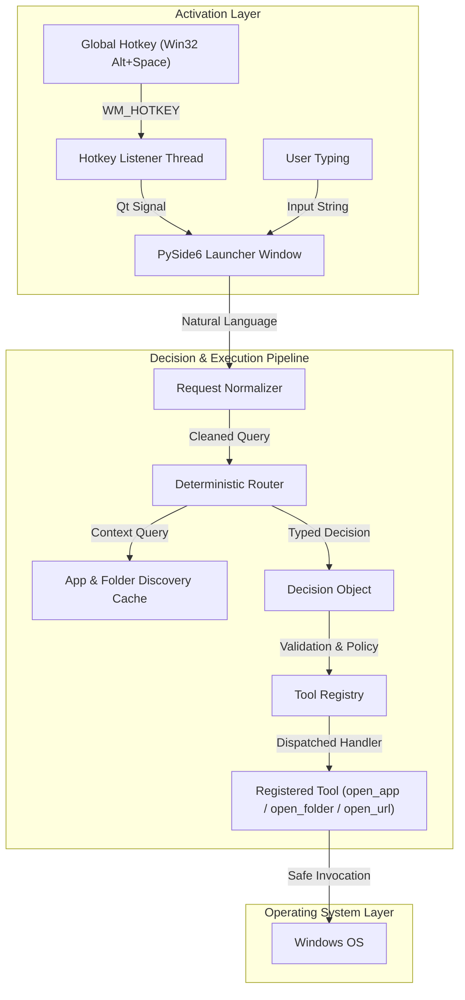

# AstraRun — Windows Intelligent Command Launcher (v0.1)

AstraRun is a local, lightweight, low-latency Windows command launcher engineered as the foundational command interface for an evolving AI-assisted workstation control ecosystem.

AstraRun replaces fragile string-interpolated shell execution with a strictly typed pipeline:
`Natural Language -> Request Normalizer -> Router -> Typed Decision -> Tool Registry -> Windows OS`.

---

## Key Capabilities (v0.1)

- **Instantaneous Hotkey Activation**: Summoned with `Alt+Space` in ~4.5ms from a pre-warmed resident background process.
- **Zero Raw Shell Ingestion**: Strictly prohibits `os.system()`, `shell=True`, and `eval()`. Commands are parsed into structured decisions and dispatched through validated tool handlers.
- **Dynamic Application Discovery**: Discovers over 80+ local Windows executables via `App Paths` registry and `PATH` without hardcoded usernames or fixed paths.
- **Known Folders Resolution**: Resolves user known folders (`Downloads`, `Documents`, `Desktop`, `Pictures`, `Videos`, `Workspace`, `Active Projects`) using Windows Registry and Windows Shell APIs.
- **Configurable URL Aliases**: Instantly open web destinations (`github`, `youtube`, `google`) or raw URLs in the default browser.
- **Sleek PySide6 Interface**: Borderless, translucent dark-mode command bar centered on the active display.
- **Extensible Router Abstraction**: Pluggable interface (`route(request, context) -> Decision`) designed for seamless drop-in integration with Laya and Kev in future milestones.

---

## Architecture Overview



---

## Keyboard Controls

| Shortcut / Key | Context | Action |
| :--- | :--- | :--- |
| **`Alt + Space`** | Global (Anywhere) | Toggle / summon AstraRun command bar |
| **`Enter`** | Command Bar Active | Execute the entered command |
| **`Escape`** | Command Bar Active | Dismiss AstraRun without executing |
| **`Down Arrow`** | Command Bar Active | Focus and select from real-time suggestions |
| **`Click Outside`** | Command Bar Active | Auto-dismisses window (configurable) |

---

## Supported Commands

### Applications
```text
open notepad          # or 'launch notepad', 'notepad', 'editor'
open calculator       # or 'calc'
open vscode           # or 'code', 'vs code'
open vivaldi          # or 'browser'
open terminal         # or 'wt', 'windows terminal'
open powershell       # or 'pwsh'
open cmd              # or 'prompt'
open explorer         # or 'files'
```

### Folders
```text
open downloads        # opens User Downloads
open documents        # opens User Documents
open desktop          # opens User Desktop
open pictures         # opens User Pictures
open videos           # opens User Videos
open workspace        # opens E:\Workspace
open active projects  # opens E:\Workspace\Active
```

### Web & URLs
```text
open github           # opens https://github.com
open youtube          # opens https://youtube.com
open google           # opens https://google.com
open https://news.ycombinator.com
```

---

## Performance Metrics

Empirical measurements gathered on Windows 11 host (1536x864, Python 3.13):

| Metric | Measured Value | Target Standard |
| :--- | :--- | :--- |
| **Hotkey-to-Visible Latency** | **4.51 ms** | < 50 ms |
| **Routing Latency** | **4.61 µs** | < 1 ms |
| **Startup to Pre-warmed Ready** | **1.27 s** | < 3 s |
| **Resident Idle Memory** | **~4 MB - 50 MB** | < 100 MB |
| **Idle CPU Utilization** | **0.0%** (Kernel Wait) | 0.0% |

---

## Installation & Setup

AstraRun uses a project-local virtual environment (`.venv`).

### 1. Requirements
- Windows 10 or 11 (64-bit)
- Python 3.11+ (Python 3.13 recommended)
- `uv` (recommended) or standard `pip`

### 2. Virtual Environment Setup
```powershell
# Navigate to AstraRun directory
cd E:\Workspace\Active\AstraRun

# Create isolated virtual environment
uv venv .venv --python 3.13

# Install dependencies in editable mode
uv pip install -e . --python .venv\Scripts\python.exe
uv pip install pytest --python .venv\Scripts\python.exe
```

---

## Running AstraRun

### Start the Resident Background Daemon
```powershell
.venv\Scripts\python src\astrarun\main.py
```
AstraRun will pre-warm its interface, register `Alt+Space`, and remain resident in the background. Press `Alt+Space` to summon it.

### Launch and Show Immediately (Debug / Direct)
```powershell
.venv\Scripts\python src\astrarun\main.py --show-now
```

### Execute a Command Headless (CLI / Testing)
```powershell
.venv\Scripts\python src\astrarun\main.py --run-command "open notepad"
.venv\Scripts\python src\astrarun\main.py --run-command "open downloads"
```

---

## Configuration

Configuration files are stored under `config/`:
- **`config/settings.json`**: Global hotkey (`modifiers`, `key`), UI dimensions, theme, and logging.
- **`config/apps.json`**: Custom application definitions and paths.
- **`config/aliases.json`**: Natural language aliases (`calculator` -> `calc`, `vscode` -> `code`).
- **`config/urls.json`**: Web aliases (`github` -> `https://github.com`).

---

## Testing

Run the automated test suite with:

```powershell
.venv\Scripts\pytest
```

All 24 automated tests cover configuration loading, normalization, routing logic, tool registry policy enforcement, UI navigation, and live host system discovery.

---

## Project Structure

```text
AstraRun/
|-- AGENTS.md                  # Project operating contract
|-- README.md                  # System documentation
|-- requirements.txt           # Pinned dependencies
|-- pyproject.toml             # Package metadata & build definition
|-- .gitignore                 # Environment & build ignores
|-- config/                    # Human-editable configuration files
|   |-- settings.json
|   |-- apps.json
|   |-- aliases.json
|   |-- urls.json
|-- docs/                      # Engineering documentation
|   |-- ARCHITECTURE.md        # Architecture specification & diagrams
|   |-- DECISIONS.md           # Architecture Decision Records (ADRs)
|   |-- SECURITY.md            # Security boundaries & risk model
|   |-- ROADMAP.md             # Evolutionary roadmap
|   |-- LAYA_KEV_INTEGRATION.md# Future AI routing integration
|   |-- TOOLS.md               # Tool registry specifications
|   |-- CONFIGURATION.md       # Configuration reference
|   |-- ENVIRONMENT_AUDIT.md   # Initial host environment audit
|   |-- TESTING.md             # Testing & empirical verification report
|   |-- STATUS.md              # Current milestone status report
|-- logs/                      # Rotating application logs
|   |-- astrarun.log
|-- scripts/                   # Developer utilities & benchmarks
|   |-- benchmark.py
|-- src/
|   |-- astrarun/
|       |-- __init__.py
|       |-- main.py            # Main entrypoint & daemon orchestration
|       |-- core/              # Models, enums, structured logging
|       |-- routing/           # Base router & deterministic implementation
|       |-- tools/             # Tool registry & safe execution handlers
|       |-- discovery/         # Windows App Paths & Known Folders discovery
|       |-- hotkeys/           # Win32 RegisterHotKey background listener
|       |-- config/            # Resilient JSON configuration loader
|       |-- ui/                # PySide6 frameless launcher window
`-- tests/                     # Unit, UI, and integration tests
```
