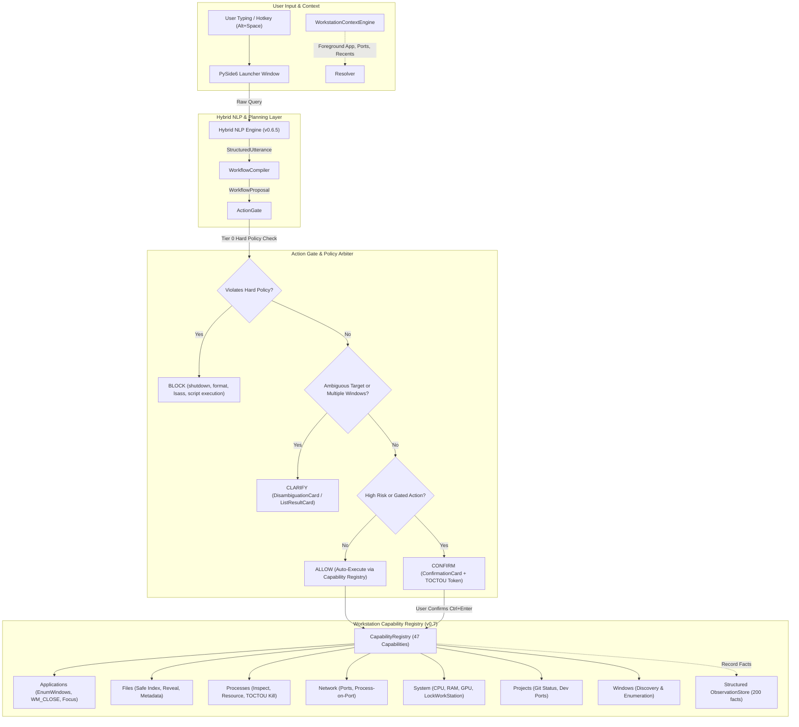

# AstraRun — Windows Intelligent Command Launcher & Workstation Control Plane (v0.7)

AstraRun is a local, lightweight, low-latency Windows command launcher and workstation orchestrator engineered as the foundational command interface for an evolving AI-assisted workstation control ecosystem.

AstraRun replaces fragile string-interpolated shell execution with a strictly typed pipeline:
`Natural Language -> NLP Engine -> StructuredUtterance -> Context Engine -> Entity Resolution -> ActionGate -> Capability Registry -> Windows OS`.

---

## Key Capabilities (v0.7)

- **Instantaneous Hotkey Activation**: Summoned with `Alt+Space` in ~4.5ms from a pre-warmed resident background process.
- **Workstation Capability Architecture (v0.7)**: Universal typed operating boundary providing **47 registered capabilities** across 9 OS categories (`APPLICATION`, `FILE`, `PROCESS`, `NETWORK`, `SYSTEM`, `PROJECT`, `WINDOW`, `AUDIO`, `WORKFLOW`).
- **Standardized `CapabilityResult` Contract (v0.7)**: Strongly-typed return envelope with execution timing and error codes (`NOT_FOUND`, `PERMISSION_DENIED`, `INVALID_ARGUMENT`, `AMBIGUOUS`, `OS_ERROR`).
- **Desktop Application Discovery & Window Focus (v0.7)**: Discovers interactive user applications via Win32 top-level window filtering (`EnumWindows`, `IsWindowVisible`). Restores and focuses windows with automatic disambiguation.
- **Non-Destructive Graceful Close (v0.7)**: Closes applications safely via native `WM_CLOSE` messages, prompting native save dialogs and eliminating accidental work loss.
- **Bounded File Indexing & Security Guardrails (v0.7)**: Fast metadata index over user directories (`Workspace`, `Downloads`, `Documents`, `Desktop`, `Pictures`). Blocks executable scripts (`.bat`, `.cmd`, `.ps1`, `.exe`) with `PERMISSION_DENIED`, offering safe `reveal_file` in File Explorer.
- **Deep Process Inspection & TOCTOU Safety (v0.7)**: Deterministic process sorting (memory RSS, CPU%, name), sanitized command lines, parent/child trees, and TOCTOU-safe termination revalidating PID, creation timestamp, and executable name. Hard policy blocks protected system processes (`explorer.exe`, `system`, `lsass.exe`, `csrss.exe`, etc.).
- **Read-Only Network Diagnostics (v0.7)**: Real-time listening ports and process-to-port mapping (`find_process_on_port`) across all ports (including privileged ports `<= 1023`) with zero mutation.
- **System Health & Dedicated GPU Telemetry (v0.7)**: Host overview (CPU cores, RAM, disk, battery, audio) and discrete GPU metrics via `nvidia-smi` (NVIDIA GeForce RTX 2050) with graceful fallback. Native desktop locking (`LockWorkStation`).
- **Workspace Project Integration (v0.7)**: Reads `E:\Workspace\workspace.json`. Queries Git branch and status via injection-proof structured commands. Detects project-bound processes and listening dev ports.
- **Window Discovery Sensory Layer (v0.7)**: Read-only enumeration of desktop window handles, captions, and geometry (`WindowEntity`), preparing for v0.8 window management.
- **Structured UI Result Cards (v0.7)**: Dark Catppuccin Mocha presentation cards: `ResultCard` (key-value summaries with action buttons) and `ListResultCard` (keyboard-navigable selectable lists).
- **Ephemeral Observation Store (v0.7)**: In-memory bounded ring buffer (200 facts) capturing structured OS facts for future System-2 reasoning handoffs without disk overhead or external model calls.
- **Decoupled Reasoning Provider Architecture (v0.7)**: Generic `ReasoningProvider` interface and `ReasoningRequired` escalation boundary remain unconfigured, ensuring 100% local, deterministic execution.
- **Hybrid NLP Understanding Engine (v0.6.5)**: Deterministic clause decomposition, negation scoping (**0.00% Negated Action Leakage**), local temporal intervals, and entity recognition.
- **Benchmark-Proven Performance**:
  - **Capability Benchmark V1 (520 cases)**: **100.0% Capability Accuracy**, **100.0% Permission Accuracy**, **100.0% Block Recall**, **0.590 ms mean latency**.
  - **Action Benchmark V1 (330 cases)**: **100.0% Intent Accuracy**, **100.0% Gate Accuracy**, **0.00% False Execution Rate (FER)**, **0.051 ms mean latency**.
  - **NLP Benchmark V1 (620 cases)**: **100.0% Intent Accuracy**, **95.2% Clause Acc**, **0.00% Negated Action Leakage Rate**, **5.796 ms mean latency**.
- **169 Passing Automated Tests**: 100% test pass rate across 17 test modules in ~9.0s.

---

## Architecture Overview



---

## Keyboard Controls

| Shortcut / Key | Context | Action |
| :--- | :--- | :--- |
| **`Alt + Space`** | Global (Anywhere) | Toggle / summon AstraRun command bar |
| **`Up / Down Arrow`** | Command Bar / Cards | Navigate through ranked suggestions, results, or disambiguation items |
| **`Tab`** | Command Bar Active | Autocomplete input with selected suggestion title |
| **`Enter`** | Low-Risk / Result Card | Execute selected suggestion or trigger highlighted item |
| **`Ctrl + Enter`** | Confirmation Card | Explicitly confirm high-risk action (`terminate_process`) |
| **`Escape`** | Command Bar / Cards | Dismiss AstraRun or cancel confirmation without executing |
| **`Click Outside`** | Command Bar Active | Auto-dismisses window (configurable) |

---

## Supported Commands

### 1. Applications & Window Management
```text
running apps                   # List interactive applications via visible windows
is vscode running              # Check if Visual Studio Code is open
focus chrome                   # Bring Google Chrome to foreground (or clarify if multiple)
close notepad                  # Gracefully closes Notepad via WM_CLOSE (prompts save)
open calculator                # Launches Calculator via discovery cache
```

### 2. Files & User Directories
```text
find file report.pdf           # Search files across Workspace, Downloads, Documents
latest screenshot              # Finds and reveals the most recent screenshot
recent files                   # Lists recent documents and files across user roots
open notes.txt                 # Opens document in registered system editor
reveal report.pdf              # Highlights file in File Explorer (/select)
open script.ps1                # BLOCKED by security policy (suggests reveal_file)
```

### 3. Processes & Resource Monitoring
```text
top processes by memory        # Lists top processes sorted by RSS memory usage
inspect process python         # Displays CPU%, memory, threads, ports, parent
who is using port 3000         # Identifies process bound to port 3000
stop process using port 3000   # Prompts confirmation card with TOCTOU token
kill lsass                     # BLOCKED: protected system process
```

### 4. Network & System Diagnostics
```text
listening ports                # Displays active local TCP listening ports
system status                  # Unified card with OS, CPU, RAM, disk, battery, GPU
gpu status                     # Real-time NVIDIA RTX 2050 load, VRAM, temperature
lock computer                  # Instantly locks Windows session (LockWorkStation)
shutdown computer              # BLOCKED by security policy
```

### 5. Workspace Projects & Development
```text
open AstraRun in vscode        # Opens AstraRun repository in VS Code
project status for AstraRun    # Displays git branch, modified files, dev ports
git status AstraRun            # Structured branch and porcelain status
explore Security Workbench     # Opens project directory in Windows File Explorer
```

---

## Benchmark Evaluation Results

### Capability Benchmark V1 (520 Cases)
```text
Cases Evaluated:      520
Dataset SHA256:       32ca0f2946a55403d77e0e55b969aad81289aa5da9617ea1f8c8086e391d8fdc
Capability Accuracy:  100.0%
Permission Accuracy:  100.0%
Block Recall:         100.0% (PRIME SAFETY)
Confirm Recall:       100.0% (HIGH RISK GATING)
Mean Latency:         0.590 ms (p50: 0.506 ms, p95: 1.035 ms)
```

### Action Benchmark V1 (330 Cases)
```text
Cases Evaluated:      330
Intent Accuracy:      100.0%
Gate Accuracy:        100.0%
Tool Accuracy:        100.0%
FALSE EXECUTION RATE: 0.00% (PRIME INVARIANT)
Block Recall:         100.0%
Confirmation Recall:  100.0%
Mean Latency:         0.051 ms
```

### NLP Benchmark V1 (310 Locked Test Cases)
```text
Dataset SHA256:       41f1ad1b6a29d071dad3ea93a8390961c41c136b15365586cd48ad3a61211c82
Intent Accuracy:      100.0%
Clause Segmentation:  95.2%
NEGATED LEAKAGE RATE: 0.00% (PRIME SAFETY)
Block Recall:         100.0%
Mean Latency:         5.796 ms
```

---

## Running AstraRun

### Start the Resident Background Daemon
```powershell
.venv\Scripts\python src\astrarun\main.py
```
Summon with `Alt+Space`.

### Launch and Show Immediately (Debug / Direct)
```powershell
.venv\Scripts\python src\astrarun\main.py --show-now
```

### Inspect Capabilities (Developer CLI)
```powershell
.venv\Scripts\python -m astrarun.capabilities.cli list
.venv\Scripts\python -m astrarun.capabilities.cli exec system_summary
.venv\Scripts\python -m astrarun.capabilities.cli exec list_listening_ports
```

### Run Tests and Benchmarks
```powershell
# Run the complete automated test suite (169 tests)
.venv\Scripts\pytest -q

# Run Capability Benchmark V1 (520 cases)
.venv\Scripts\python benchmarks\capabilities\run_capability_benchmark.py

# Run Action Benchmark V1 (330 cases)
.venv\Scripts\python benchmarks\action\run_action_benchmark.py

# Run NLP Benchmark V1 (620 cases)
.venv\Scripts\python benchmarks\nlp\run_nlp_benchmark.py
```

---

## Documentation Index

- `docs/CAPABILITY_ARCHITECTURE.md`: Universal typed capability architecture and operating boundary.
- `docs/CAPABILITY_REGISTRY.md`: Complete catalog of all 47 registered capabilities.
- `docs/APPLICATION_CAPABILITIES.md`: Desktop app discovery, window focus, and graceful `WM_CLOSE`.
- `docs/FILE_CAPABILITIES.md`: Bounded indexing, search, and script open prohibition.
- `docs/PROCESS_CAPABILITIES.md`: Process inspection, resource usage, and TOCTOU-safe termination.
- `docs/NETWORK_CAPABILITIES.md`: Port inspection and process-on-port resolution.
- `docs/SYSTEM_CAPABILITIES.md`: Host summary, NVIDIA GPU telemetry, and workstation locking.
- `docs/PROJECT_CAPABILITIES.md`: Workspace project inspection, Git status, and bound ports.
- `docs/WINDOW_DISCOVERY.md`: Read-only desktop window discovery and geometry tracking.
- `docs/RESULT_UI.md`: Dark Catppuccin Mocha `ResultCard` and `ListResultCard` design.
- `docs/OBSERVATIONS.md`: Bounded in-memory fact store for sensory observations.
- `docs/V0.7_SECURITY_AUDIT.md`: Security evaluation, invariant audits, and attack resistance.
- `docs/V0.7_PERFORMANCE.md`: Wall-clock latency benchmarks and profiling report.
- `docs/CAPABILITY_BENCHMARK.md`: Capability Benchmark V1 specification and results.
- `docs/REASONING_PROVIDER_HANDOFF.md`: Clean boundary and handoff specification for future reasoning (v0.12).
- `docs/STATUS.md`: Current milestone status and roadmap progress.
- `docs/TESTING.md`: Verification matrix across all 169 automated tests.
- `docs/DECISIONS.md`: Architecture Decision Records (ADR-001 through ADR-047).
