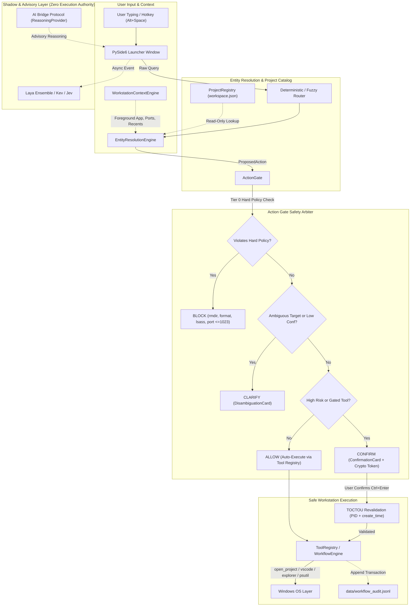

# AstraRun — Windows Intelligent Command Launcher & Workstation Orchestrator (v0.6.5)

AstraRun is a local, lightweight, low-latency Windows command launcher and workstation orchestrator engineered as the foundational command interface for an evolving AI-assisted workstation control ecosystem.

AstraRun replaces fragile string-interpolated shell execution with a strictly typed pipeline:
`Natural Language -> NLP Engine -> StructuredUtterance -> Context Engine -> Entity Resolution -> ActionGate -> Workflow Engine -> Registered Tool -> Windows OS`.

---

## Key Capabilities (v0.6.5)

- **Instantaneous Hotkey Activation**: Summoned with `Alt+Space` in ~4.5ms from a pre-warmed resident background process.
- **Hybrid NLP Understanding Engine (v0.6.5)**: Multi-layer NLU stack blending deterministic extractors (< 0.05 ms), clause decomposition & ordering grammar (< 0.08 ms), workstation local-time temporal engine (< 0.04 ms), and optional spaCy linguistic tagging (7.16 ms) with zero execution authority.
- **Typed Intermediate Representation (`StructuredUtterance`) (v0.6.5)**: Converts requests into inert, inspectable data structures capturing clauses, 13 typed entity classes, directed relations, temporal intervals, and constraints.
- **Absolute Negation Safety (v0.6.5)**: Scopes negative polarity per clause. Enforces `verify_negation_safety()`, strictly forbidding any proposal step from originating from a negated clause (**0.00% Negated Action Leakage Rate**).
- **Safe Workflow Compiler (v0.6.5)**: Compiles `StructuredUtterance` into `WorkflowProposal`. Conservative multi-clause policy: any blocked clause immediately blocks the entire proposal (`status="BLOCKED"`). Distinguishes `PARTIALLY_SUPPORTED` requests with itemized reporting.
- **Developer Debugger CLI (v0.6.5)**: `python -m astrarun.nlp.debugger "<utterance>"` providing real-time parse tree, entity span, relation, and workflow preview inspection without executing anything.
- **AI Bridge Escalation Boundary (v0.6.5)**: Emits structured `ReasoningRequired` escalation envelopes for complex activity restoration and diagnostic questions without invoking LLMs.
- **Action Gate Safety Layer (v0.6)**: Multi-tier safety gating evaluating every action across Tier 0 (Hard Policy), Tier 1 (Ambiguity & Disagreement), Tier 2 (Tool Registry Mapping), and Tier 3 (Confirmation vs. Direct Allowance).
- **Workstation Context Engine (v0.6)**: Structured local awareness of foreground window (app, title, PID), active TCP dev listening ports, and recent project interactions with 300s process TTL and 24h project TTL. Rejects context injection attacks with zero keystroke logging and zero screenshots.
- **TOCTOU Process Protection (v0.6)**: Cryptographic tokens (`secrets.token_hex(16)`) binding target PID, kernel `create_time`, and process name to eliminate OS PID recycling race conditions.
- **Project Registry (v0.6)**: Strictly read-only catalog over `E:\Workspace\workspace.json` (28 projects) with dynamic discovery fallback and ranked fuzzy matching (`find_project`).
- **Confirmation & Disambiguation UI Cards (v0.6)**: Keyboard-safe PySide6 cards where single `Enter` is ignored on HIGH risk (requires `Ctrl+Enter` or click), `Esc` cancels, and Up/Down arrows navigate ambiguous candidates.
- **Benchmark Proven Performance**:
  - **NLP Benchmark V1 (620 queries)**: **100.0% Intent Accuracy**, **95.2% Clause Segmentation Acc**, **100.0% Multi-Action Match**, **100.0% Negation Acc**, **0.00% Negated Action Leakage Rate**, **100.0% Block Recall**, and **0.394 ms mean latency** (rules) / **7.157 ms** (spaCy hybrid).
  - **Action Benchmark V1 (330 queries)**: **100.0% Intent Accuracy**, **100.0% Gate Accuracy**, **100.0% Tool Accuracy**, **0.00% False Execution Rate (FER)**, **100.0% Block Recall**, and **100.0% Confirmation Recall**.
- **126 Passing Automated Tests**: 97 baseline regression tests + 29 comprehensive v0.6.5 NLP tests passing cleanly in ~6.4s.


---

## Architecture Overview



---

## Keyboard Controls

| Shortcut / Key | Context | Action |
| :--- | :--- | :--- |
| **`Alt + Space`** | Global (Anywhere) | Toggle / summon AstraRun command bar |
| **`Up / Down Arrow`** | Command Bar / Cards | Navigate through ranked suggestions or disambiguation items |
| **`Tab`** | Command Bar Active | Autocomplete input with selected suggestion title |
| **`Enter`** | Low-Risk Suggestion | Immediately execute selected suggestion |
| **`Ctrl + Enter`** | Confirmation Card | Explicitly confirm high-risk action (`terminate_process`) |
| **`Escape`** | Command Bar / Cards | Dismiss AstraRun or cancel confirmation without executing |
| **`Click Outside`** | Command Bar Active | Auto-dismisses window (configurable) |

---

## Supported Commands

### 1. Workspace Projects & Development
```text
open AstraRun in vscode        # Launches VS Code for Active/AstraRun
open AI Bridge in code         # Launches VS Code for Active/AI-Bridge
vscode for Vivaldi AI          # Launches VS Code for Active/vivaldi-ai
open folder for AstraRun       # Opens File Explorer in Active/AstraRun
explore Security Workbench     # Opens File Explorer in Active/SecurityWorkbench
continue working on Server     # Opens workspace for Server-NexusNode
open my most recent project    # Contextual: opens the last interacted project
open that project in vscode    # Contextual: opens recent project in VS Code
```

### 2. Network Ports & Process Management
```text
what is running on port 3000   # Read-only query of listening process on port 3000
who is using port 80           # Read-only inspection allowed on port 80
inspect process python         # Read-only inspection of python process
stop the process using port 3000 # Gated: generates confirmation card for port 3000
stop that process              # Contextual: terminates previously inspected process
kill it                        # Contextual: pronoun termination requiring confirmation
```

### 3. Applications & Discovered Software (~400 apps)
```text
open notepad                   # or 'launch notepad', 'notepad', 'editor'
notpad                         # Typo-tolerant: automatically resolves to Notepad
open calculator                # or 'calc'
open vscode                    # or 'code', 'vs code'
open vivaldi                   # or 'browser'
open terminal                  # or 'wt', 'windows terminal'
refresh apps                   # Internal command: re-scans application caches
```

### 4. Folders & System Shortcuts
```text
open downloads                 # opens User Downloads
open documents                 # opens User Documents
open desktop                   # opens User Desktop
open workspace                 # opens E:\Workspace
open active projects           # opens E:\Workspace\Active
```

### 5. Web & URLs
```text
open github                    # opens https://github.com
open youtube                   # opens https://youtube.com
open reddit                    # opens https://reddit.com
open https://news.ycombinator.com
```

---

## Performance & Action Benchmark Results

Measured across 330 end-to-end evaluation queries in Action Benchmark V1:

```
=================================================================
  AstraRun v0.6 Action Benchmark Evaluation Harness
=================================================================
Loaded 330 test cases from action_benchmark_v1.json

-----------------------------------------------------------------
  Benchmark Cases:             330
  Intent Accuracy:             100.0% (330/330)
  Entity Accuracy:             93.64% (309/330)
  Gate Accuracy:               100.0% (330/330)
  Tool Selection Accuracy:     100.0% (330/330)
  Proposed Action Accuracy:    100.0% (330/330)
  False Action Proposal (FAPR):0.0%
  FALSE EXECUTION RATE (FER):  0.0% (PRIME INVARIANT)
  Clarification Precision:     100.0%
  Block Recall:                100.0% (74/74)
  Confirmation Recall:         100.0% (31/31)
  End-to-End Latency (Mean):   0.077 ms (p50: 0.027 ms, p95: 0.187 ms)
-----------------------------------------------------------------
```

---

## Installation & Setup

AstraRun uses a project-local virtual environment (`.venv`).

```powershell
# Navigate to AstraRun directory
cd E:\Workspace\Active\AstraRun

# Create isolated virtual environment
uv venv .venv --python 3.13

# Install dependencies in editable mode
uv pip install -e . --python .venv\Scripts\python.exe
uv pip install pytest psutil PySide6 torch --python .venv\Scripts\python.exe
```

---

## Running AstraRun

### Start the Resident Background Daemon
```powershell
.venv\Scripts\python src\astrarun\main.py
```
Summon with `Alt+Space`.

### Launch and Show Immediately (Debug / Direct)
```powershell
.venv\Scripts\python src\astrarun\main.py --show-now
```

### Run Tests and Benchmarks
```powershell
# Run the complete automated test suite (97 tests)
.venv\Scripts\pytest -v

# Run Action Benchmark V1 (330 queries)
.venv\Scripts\python benchmarks\action\run_action_benchmark.py

# Run deterministic regression benchmark (88 queries)
.venv\Scripts\python benchmarks\routing\run_benchmark.py
```

---

## Documentation Index

- `docs/ARCHITECTURE.md`: Complete system architecture and pipeline diagrams (v0.6).
- `docs/ACTION_GATE.md`: Multi-tier safety gating, crypto tokens, and TOCTOU defense.
- `docs/CONTEXT_ENGINE.md`: Workstation context engine, recency indices, and TTL rules.
- `docs/WORKFLOW_ENGINE.md`: Typed multi-step workflow templates and audit logging.
- `docs/PROJECT_REGISTRY.md`: Read-only `workspace.json` catalog and dynamic discovery.
- `docs/CONFIRMATION_UI.md`: PySide6 confirmation and disambiguation modal cards.
- `docs/ACTION_BENCHMARK.md`: Action Benchmark V1 specification and results.
- `docs/AI_BRIDGE_BOUNDARY.md`: AI Bridge protocol boundary and reasoning interface.
- `docs/V0.6_SECURITY_AUDIT.md`: Threat model, attack vector analysis, and security audit.
- `docs/V0.6_PERFORMANCE.md`: Wall-clock latency benchmarks and profiling report.
- `docs/STATUS.md`: Current milestone status and roadmap progress.
- `docs/TESTING.md`: Verification matrix across all 97 automated tests.
