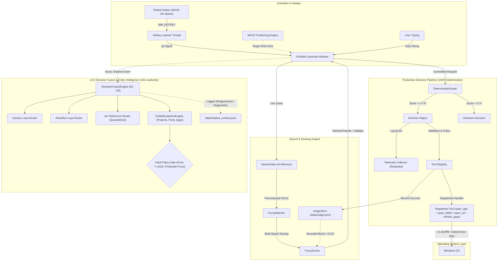

# AstraRun — Windows Intelligent Command Launcher (v0.5)

AstraRun is a local, lightweight, low-latency Windows command launcher engineered as the foundational command interface for an evolving AI-assisted workstation control ecosystem.

AstraRun replaces fragile string-interpolated shell execution with a strictly typed pipeline:
`Natural Language -> Request Normalizer -> Fuzzy / Deterministic Router -> Typed Decision -> Tool Registry -> Windows OS`.

---

## Key Capabilities (v0.5)

- **Instantaneous Hotkey Activation**: Summoned with `Alt+Space` in ~4.5ms from a pre-warmed resident background process.
- **Multi-Signal Fuzzy Matching Engine**: Combines exact, alias, prefix, word-token, acronym, single-drop typo (`notpad` -> `Notepad`), and Damerau-Levenshtein edit-distance scoring with bounded usage boost (`<= 0.03`).
- **Ranked Suggestions UI**: Dynamic dropdown drawer with visual category badges (`APP`, `FOLDER`, `WEB`, `COMMAND`), active selection highlighting, and ergonomic auto-expansion.
- **Full Keyboard Navigation**: Complete keyboard-only control via `Up`/`Down` arrow navigation, `Tab` autocompletion, `Enter` execution, and `Escape` dismissal.
- **Zero Raw Shell Ingestion & 0.0% False Execution Rate**: Strict confidence gating (`0.75`) guarantees ambiguous or out-of-scope queries (`kill port 3000`, `delete system32`, `asdfgh`) are safely rejected as `unknown` rather than mistriggering apps.
- **Decision Fusion Engine (v0.5)**: Evaluates ensemble modes E0–E5 blending zero-shot generic Laya and fine-tuned AstraRun-Laya. Mode E5 leverages Jensen-Shannon divergence ($D_{\text{JS}}$), ambiguity detection ($\ge 0.50$), and consequence risk gating ($\ge 0.50$) to achieve **100.0% Safe False Abstention Rate (SFAR)** and **0.0% False Execution Rate (FER)** while elevating top-1 accuracy to **58.4%**.
- **Local Domain Adaptation (v0.5)**: Parameter-efficient head adaptation of ModernBERT-large (394.8M frozen encoder parameters + 26.5M trainable decision head parameters) saved canonically in `E:\AI_Models\AstraRun-Laya`. Yields +7.20% intent accuracy and +43.20% risk accuracy gains.
- **Deterministic Entity Resolution Engine (v0.5)**: Resolves natural language queries to `workspace.json` projects, Start Menu applications, known folders, network ports, and running processes with multi-match candidate disambiguation ($\Delta \le 0.15$).
- **Hard Policy Security Boundaries**: Enforces strict kernel-level security rules blocking protected system processes (`system`, `registry`, `lsass`, `csrss`), privileged ports ($\le 1023$), and destructive shell command injections (`rmdir /s /q`, `format`, `del system32`).
- **Quarantined Jev Reference Judge (v0.5)**: Integrates TypeSafe Jev System One as an external reference judge with path sanitization (`<LOCAL_PATH>`), credential stripping, and offline fallback.
- **Prime Invariant Maintained**: Zero production execution authority for neural routers, entity resolution, and Jev. All production execution remains 100% deterministic/fuzzy.
- **79 Automated Tests**: Comprehensive unit, UI, integration, fusion, entity resolution, and safety test suite verifying 0.0% false execution rate.

---

## Architecture Overview



---

## Keyboard Controls

| Shortcut / Key | Context | Action |
| :--- | :--- | :--- |
| **`Alt + Space`** | Global (Anywhere) | Toggle / summon AstraRun command bar |
| **`Up / Down Arrow`** | Command Bar Active | Navigate through ranked suggestions |
| **`Tab`** | Command Bar Active | Autocomplete input with selected suggestion title |
| **`Enter`** | Suggestion Selected | Immediately execute selected suggestion |
| **`Enter`** | Raw Input (No selection) | Route query through deterministic & fuzzy engine (score >= 0.75) |
| **`Escape`** | Command Bar Active | Dismiss AstraRun without executing |
| **`Click Outside`** | Command Bar Active | Auto-dismisses window (configurable) |

---

## Supported Commands

### Applications & Discovered Software (~400 apps)
```text
open notepad          # or 'launch notepad', 'notepad', 'editor'
notpad                # Typo-tolerant: automatically resolves to Notepad
open calculator       # or 'calc'
open vscode           # or 'code', 'vs code'
open vivaldi          # or 'browser'
open terminal         # or 'wt', 'windows terminal'
open powershell       # or 'pwsh'
open cmd              # or 'prompt'
open explorer         # or 'files'
refresh apps          # Internal command: re-scans application caches
```

### Folders & Workspaces
```text
open downloads        # opens User Downloads
open documents        # opens User Documents
open desktop          # opens User Desktop
open pictures         # opens User Pictures
open videos           # opens User Videos
open workspace        # opens E:\Workspace
open active projects  # opens E:\Workspace\Active
```

### Web & URLs
```text
open github           # opens https://github.com
open youtube          # opens https://youtube.com
open google           # opens https://google.com
open reddit           # opens https://reddit.com
open https://news.ycombinator.com
```

---

## Performance & Benchmark Metrics

Empirical measurements gathered on Windows 11 host (Python 3.13):

### 1. Interactive Runtime Latencies
| Metric | Measured Value | Target Standard |
| :--- | :--- | :--- |
| **Hotkey-to-Visible Latency** | **4.51 ms** | < 50 ms |
| **Fuzzy Search Latency (Mean)** | **3.03 ms** (~411 candidates) | < 15 ms |
| **Fuzzy Search Latency (p50)** | **21.7 µs** | < 1 ms |
| **Direct Route Latency** | **4.61 µs** | < 1 ms |
| **Startup to Pre-warmed Ready** | **1.27 s** | < 3 s |
| **Resident Idle Memory** | **~4 MB - 50 MB** | < 100 MB |
| **Idle CPU Utilization** | **0.0%** (Kernel Wait) | 0.0% |

### 2. Deterministic Routing Benchmark (88 Queries)
| Benchmark Metric | Result | Target Standard |
| :--- | :--- | :--- |
| **Overall Accuracy** | **100.0%** (88 / 88) | >= 95.0% |
| **Exact Resolution Accuracy** | **100.0%** (20 / 20) | 100.0% |
| **Fuzzy Resolution Accuracy** | **100.0%** (20 / 20) | >= 95.0% |
| **Unresolved Rejection Accuracy** | **100.0%** (18 / 18) | >= 95.0% |
| **FALSE EXECUTION RATE** | **0.0%** (0 / 18 false triggers) | <= 1.0% |

---

## Installation & Setup

AstraRun uses a project-local virtual environment (`.venv`).

### 1. Requirements
- Windows 10 or 11 (64-bit)
- Python 3.11+ (Python 3.13 recommended)
- `uv` (recommended) or standard `pip`

### 2. Virtual Environment Setup
```powershell
# Navigate to AstraRun directory
cd E:\Workspace\Active\AstraRun

# Create isolated virtual environment
uv venv .venv --python 3.13

# Install dependencies in editable mode
uv pip install -e . --python .venv\Scripts\python.exe
uv pip install pytest --python .venv\Scripts\python.exe
```

---

## Running AstraRun

### Start the Resident Background Daemon
```powershell
.venv\Scripts\python src\astrarun\main.py
```
AstraRun will pre-warm its interface, register `Alt+Space`, and remain resident in the background. Press `Alt+Space` to summon it.

### Launch and Show Immediately (Debug / Direct)
```powershell
.venv\Scripts\python src\astrarun\main.py --show-now
```

### Execute a Command Headless (CLI / Testing)
```powershell
.venv\Scripts\python src\astrarun\main.py --run-command "open notepad"
.venv\Scripts\python src\astrarun\main.py --run-command "open downloads"
```

---

## Configuration

Configuration files are stored under `config/`:
- **`config/settings.json`**: Global hotkey, UI dimensions, theme, max suggestions, telemetry, and shadow router configuration.
- **`config/apps.json`**: Custom application definitions and paths.
- **`config/aliases.json`**: Natural language aliases (`calculator` -> `calc`, `vscode` -> `code`).
- **`config/urls.json`**: Web aliases (`github` -> `https://github.com`).

---

## Testing & Benchmarks

Run the complete automated test suite (79 tests):
```powershell
.venv\Scripts\pytest -v
```

Run the deterministic regression benchmark (88 queries):
```powershell
.venv\Scripts\python benchmarks\routing\run_benchmark.py
```

Run the AstraRun v0.5 ensemble and locked evaluation benchmark:
```powershell
.venv\Scripts\python benchmarks\routing\run_v05_benchmark.py
```

---

## Project Structure

```text
AstraRun/
|-- AGENTS.md                  # Project operating contract
|-- README.md                  # System documentation
|-- requirements.txt           # Pinned dependencies
|-- pyproject.toml             # Package metadata & build definition
|-- .gitignore                 # Environment & build ignores
|-- benchmarks/                # Evaluation suites & harnesses
|   `-- routing/
|       |-- locked/
|       |   `-- test_v3.json          # Locked Test Set V3 (400 queries, 120 unknowns, SHA256 verified)
|       |-- validation/
|       |   `-- val_dataset.json      # Holdout validation set (125 queries)
|       |-- routing_dataset.json      # 88 curated deterministic evaluation queries
|       |-- run_benchmark.py          # Deterministic evaluation runner
|       |-- run_v05_benchmark.py      # v0.5 10-config evaluation runner (B0 - B9)
|       |-- results_v05_val.json      # Validation benchmark results
|       `-- results_v05_test_v3.json  # Locked Test Set V3 benchmark results
|-- config/                    # Human-editable configuration files
|   |-- settings.json          # Hotkey, UI, telemetry, and ensemble configuration
|   |-- apps.json              # Custom application definitions
|   |-- aliases.json           # Natural language aliases
|   `-- urls.json              # Web aliases
|-- data/                      # Local runtime storage & training data
|   |-- training/
|   |   `-- train_dataset.json        # Reproducible training dataset (250 queries)
|   |-- routing_events.jsonl   # Redacted telemetry event stream
|   |-- shadow_events.jsonl    # Dual-model shadow evaluation stream
|   `-- usage.json             # Usage frequency & recency store
|-- docs/                      # Engineering documentation
|   |-- ARCHITECTURE.md        # Architecture specification & diagrams (v0.5)
|   |-- DECISIONS.md           # Architecture Decision Records (ADRs 001-026)
|   |-- SECURITY.md            # Security boundaries, entity policies & telemetry quarantine
|   |-- ROADMAP.md             # Evolutionary roadmap (v0.1 -> Workstation Daemon)
|   |-- V0.5_BASELINE.md       # v0.5 Pre-implementation baseline audit
|   |-- TEST_V3.md             # Locked Test Set V3 definition & checksum verification
|   |-- LAYA_FINETUNING.md     # Domain adaptation methodology, parameters & results
|   |-- DECISION_FUSION.md     # DecisionFusionEngine mathematical & architectural spec
|   |-- LAYA_ENSEMBLE.md       # Multi-model Laya ensemble architecture & trade-offs
|   |-- ENTITY_RESOLUTION.md   # Deterministic entity resolution engine & disambiguation
|   |-- JEV_RESEARCH.md        # TypeSafe Jev System One upstream analysis
|   |-- JEV_BENCHMARK.md       # Jev reference evaluation metrics & comparison
|   |-- LOCAL_VS_JEV.md        # Empirical local-vs-cloud reference trade-off report
|   |-- V0.5_BENCHMARK.md      # 10-configuration comparative benchmark report (B0 - B9)
|   |-- V0.5_CALIBRATION.md    # Uncertainty calibration, JSD, and entropy analysis
|   |-- TESTING.md             # Automated test report & verification matrix (79 tests)
|   `-- STATUS.md              # Current milestone status report (v0.5)
|-- logs/                      # Rotating application logs
|   `-- astrarun.log
|-- scripts/                   # Developer utilities & test scripts
|   |-- build_v05_datasets.py  # Split builder (Train N=250, Val N=125, Test N=400)
|   |-- train_laya_astrarun.py # Local ModernBERT head fine-tuning script
|   |-- label_tool.py          # Local zero-cloud dataset labeling utility
|   `-- test_multi_question.py # Multi-question ambiguity/risk inference test
|-- src/
|   `-- astrarun/
|       |-- __init__.py
|       |-- main.py            # Main entrypoint & daemon orchestration
|       |-- core/              # Models, enums, structured logging
|       |-- search/            # Fuzzy search engine, scorer, matcher, index
|       |-- routing/           # Routing engines & adapters
|       |   |-- __init__.py
|       |   |-- base.py
|       |   |-- deterministic.py
|       |   |-- laya.py        # Generic & fine-tuned Laya router
|       |   |-- kev.py         # Kev shadow router
|       |   |-- jev.py         # Jev quarantined reference router
|       |   |-- fusion.py      # DecisionFusionEngine (E0 - E5)
|       |   `-- entity_resolver.py # EntityResolutionEngine
|       |-- tools/             # Tool registry & safe execution handlers
|       |-- discovery/         # App Paths, Start Menu shortcuts, Known Folders
|       |-- hotkeys/           # Win32 RegisterHotKey background listener
|       |-- telemetry/         # Local privacy-preserving event logger & redactor
|       |-- usage/             # Atomic usage store for frequency ranking
|       |-- config/            # Resilient JSON configuration loader
|       `-- ui/                # PySide6 launcher window & positioning engine
`-- tests/                     # 79 automated unit, UI, integration, and safety tests
    |-- test_v05_ensemble.py   # v0.5 ensemble, fusion, entity resolution, and Jev safety tests
    |-- test_laya_router.py    # Laya safety, resilience & shadow isolation tests
    |-- test_kev_router.py     # Kev safety, formatting, resilience & shadow isolation tests
    `-- ...
```
