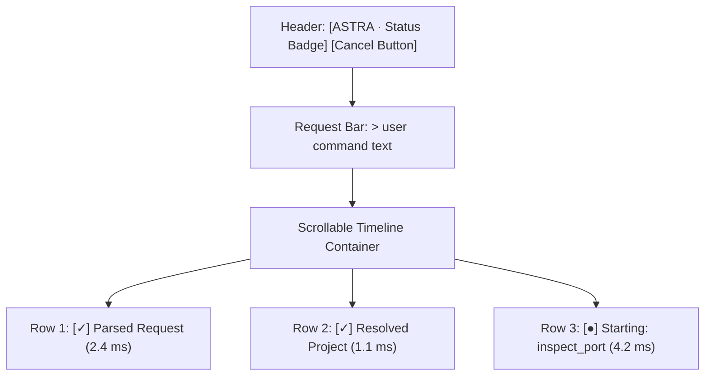

# AstraRun Live Task Activity Timeline UI

## 1. UX Principles
The Task Activity Timeline (`TaskActivityView` in `src/astrarun/ui/activity.py`) provides real-time, transparent observation of task progress.
- **Truth in Presentation**: Displays real system actions (NLP, entity resolution, action gate, capabilities). No fake thinking or LLM-style typing delays.
- **Visual Clarity**: Follows the workstation's dark-mode Catppuccin Mocha aesthetic.
- **Immediate Interactivity**: Supports one-click cooperative cancellation via the `Cancel` button or `Escape` key.

---

## 2. Event Row Indicator Styles
| Status | Icon | Color Code | Description |
|---|---|---|---|
| `SUCCESS` | ✓ | `#a6e3a1` (Green) | Completed step |
| `RUNNING` | ● | `#89b4fa` (Blue) | Active step |
| `PENDING` | ○ | `#6c7086` (Gray) | Queued step |
| `WAITING` | ⏳ | `#f9e2af` (Yellow) | Awaiting confirmation or choice |
| `WARNING` | ! | `#f9e2af` (Yellow) | Action required |
| `FAILED` | ✗ | `#f38ba8` (Red) | Execution error |
| `BLOCKED` | ⊘ | `#f38ba8` (Red) | Security policy block |
| `CANCELLED` | — | `#585b70` (Subtext) | Aborted step |

---

## 3. UI Component Structure

- **Collapsible Diagnostics**: Clicking on an individual event row expands technical diagnostic data (e.g. `capability_id`, resolved entities, duration badges).
- **Auto-Scroll**: New events automatically scroll the view to the latest activity.
- **Cancellation**: Emits `task_cancelled` signal which invokes `task_manager.cancel_task(task_id)`.
