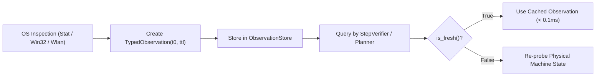

# Agent Observations & Freshness TTL in AstraRun v0.11.1

> **Milestone**: AstraRun v0.11.1 (Generality & Reality Gate)  
> **Status**: APPROVED  
> **Last Verified**: 2026-09-29  

---

## 1. Overview & Observation Types

Workstation agents cannot rely on stale snapshots of operating system state. AstraRun v0.11.1 models workstation state through **Typed Observations** equipped with explicit **Freshness TTLs** (Time-To-Live).

Defined in [`astrarun.agent.models`](file:///E:/Workspace/Active/AstraRun/src/astrarun/agent/models.py):

| Observation Class | Attributes | Description |
| :--- | :--- | :--- |
| `FileObservation` | `path`, `exists`, `size_bytes`, `modified_time`, `freshness_ttl_s` | File existence, size, and modification timestamp |
| `WindowObservation` | `hwnd`, `title`, `process_name`, `is_foreground`, `bounds` | Win32 window presence and foreground focus state |
| `NetworkObservation` | `connected_ssid`, `signal_strength_percent`, `adapter_state` | Native Wi-Fi interface state from `wlanapi.dll` |
| `ProcessObservation` | `pid`, `name`, `cpu_percent`, `memory_mb`, `status` | Real-time process metrics from Windows subsystem |

---

## 2. Freshness TTL Architecture

Every observation records its creation timestamp `timestamp = time.time()` and a designated `freshness_ttl_s` (default: $1.0\,\text{s}$ to $5.0\,\text{s}$ depending on the volatility of the resource).

```python
class TypedObservation:
    timestamp: float = field(default_factory=time.time)
    freshness_ttl_s: float = 2.0

    def is_fresh(self) -> bool:
        return (time.time() - self.timestamp) <= self.freshness_ttl_s
```



---

## 3. Storage & Integration

- Managed centrally via [`ObservationStore`](file:///E:/Workspace/Active/AstraRun/src/astrarun/capabilities/store.py).
- Ensures that verifiers and planners always evaluate decisions against current, non-stale workstation reality.
- Prevents redundant expensive OS queries when multiple verifiers inspect the same state within milliseconds.
