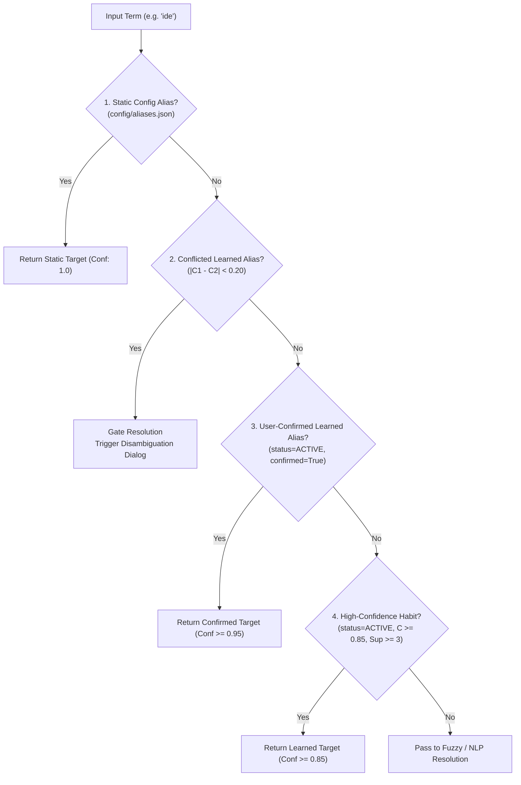

# AstraRun Learned Alias Resolution & Precedence

> **Document**: `docs/ALIAS_LEARNING.md`  
> **Milestone**: AstraRun v0.8.5 (Memory, Learning & Skill Foundation)  
> **Status**: APPROVED RESOLUTION SPECIFICATION  

---

## 1. Multi-Tier Evaluation Pipeline

To guarantee determinism, predictability, and 0.00% False Execution Rate, the `AliasManager` evaluates candidate alias strings across strict, hierarchical priority tiers:



---

## 2. Type Safety Enforcement

Aliases are strongly typed to prevent semantic misdirection:
- An alias in the `application` category cannot bind to a dangerous executable or process.
- If `expected_target_type="project"` is requested, an alias pointing to an `application` target is ignored.
- The `target_type` contract ensures that project management commands receive valid project paths, terminal commands receive valid process executables, and folder commands receive verified directory paths.

---

## 3. Conflict Resolution Protocol

When two applications vie for the same alias (e.g. user uses both VS Code and Notepad++ for `"editor"`):
1. `ConfidenceCalculator.detect_conflicts()` calculates the confidence spread:
   $$\Delta C = |C_{\text{code}} - C_{\text{notepad++}}|$$
2. If $\Delta C < 0.20$ and neither is explicitly `user_confirmed`, both memories transition to `MemoryStatus.CONFLICTED`.
3. `AliasManager.resolve()` returns `None`.
4. `EntityResolutionEngine` detects the conflict and emits:
   ```json
   {
     "status": "ambiguous",
     "confidence": 0.50,
     "candidate_matches": [
       {"alias": "editor", "target": "code.exe", "score": 0.85, "status": "CONFLICTED"},
       {"alias": "editor", "target": "notepad++.exe", "score": 0.82, "status": "CONFLICTED"}
     ]
   }
   ```
5. The launcher displays the Disambiguation dialog. When the user selects their desired target, `MemoryStore.resolve_conflicts()` promotes the chosen target to `ACTIVE` with `user_confirmed=True` and demotes the other.
