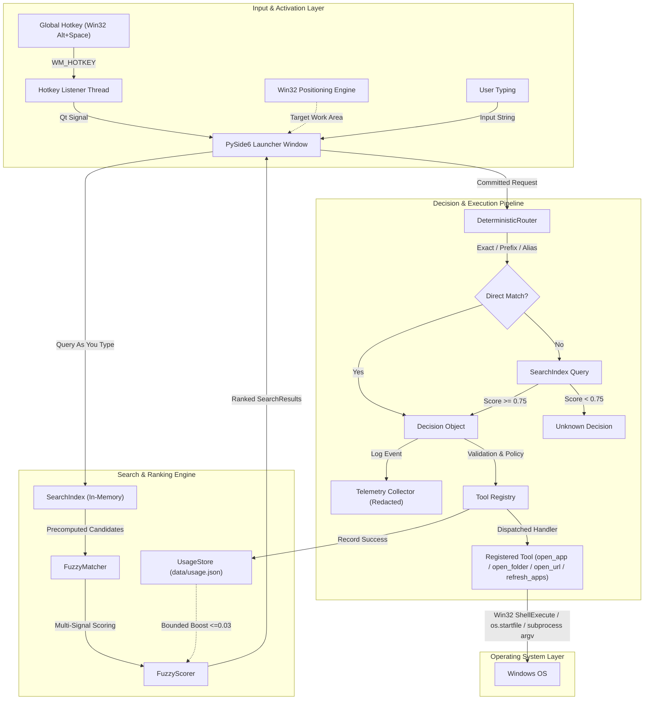
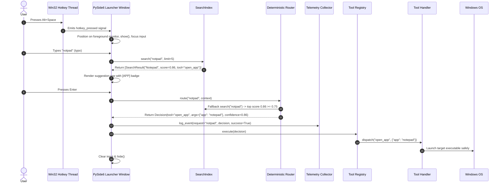

# AstraRun Architecture Specification

> **Version**: 0.7.0  
> **Target Platform**: Windows 11 / Windows 10 (64-bit)  
> **Status**: APPROVED  

---

## 1. System Overview

AstraRun is a local Windows intelligent command launcher designed to act as the foundational command interface for an evolving AI-assisted workstation control ecosystem. 

Unlike traditional launchers that rely on string-interpolated shell execution or web technologies, AstraRun is built with:
- **Zero Raw Shell Ingestion**: Strict security pipeline ensuring user requests are parsed into typed decisions and executed exclusively through registered, validated tools.
- **Persistent Low-Latency Process**: Resident process with a hidden, pre-warmed Qt UI and a dedicated background Win32 message loop for instantaneous hotkey wake-up.
- **Deterministic & Fuzzy Multi-Signal Search Engine**: Fast in-memory candidate index with precomputed terms, hierarchical fuzzy scoring (exact, prefix, token, acronym, single-drop typo, subsequence, edit-distance), and bounded usage ranking.
- **Foreground-Aware Monitor Placement**: Native Win32 display detection anchoring the launcher to the active foreground application's display with mouse cursor and primary monitor fallbacks.
- **Local-Only Privacy-Preserving Telemetry & Shadow Logging**: Structured routing event collection and dual-track shadow evaluation logging with defensive credential redaction and zero off-machine network egress.
- **Laya Neural Decision Router in Shadow Mode (v0.3)**: Integrated non-autoregressive decision model (`convaiinnovations/laya`, 421M parameter ModernBERT-large) evaluated strictly in shadow mode with ZERO production execution authority.
- **Kev Neural Decision Router in Shadow Mode (v0.4)**: Integrated single-pass decision model (`jaredpalmer/kev-0.8b`, PEFT LoRA adapter on `Qwen/Qwen3.5-0.8B-Base` backbone with 256-dim dot-product `PointerHead` and calibrated temperature $T \approx 2.351$) evaluated strictly in shadow mode with ZERO production execution authority.
- **Fixed Intent Taxonomy**: 10 mutually exclusive semantic categories separating abstract intent prediction from deterministic parameter binding and policy enforcement.
- **Multi-Model Evolutionary Router Architecture**: Pluggable routing interface transitioning safely from pure deterministic matching (v0.2) to single shadow semantic evaluation (v0.3), dual-model comparative evaluation (v0.4), cascading resolution, and multi-step agent planning (v0.5+).

---

## 2. High-Level Architecture Diagram



---

## 3. Core Component Boundaries

### 3.1. Hotkey Layer (`astrarun.hotkeys.manager`)
- Runs a dedicated, non-blocking Win32 thread listening for `WM_HOTKEY` via `GetMessageW`.
- Uses native `ctypes.windll.user32.RegisterHotKey` with `MOD_ALT | MOD_NOREPEAT` and `VK_SPACE`.
- Communicates with the Qt Main Thread exclusively via thread-safe Qt Signals (`hotkey_pressed`).
- Allows hotkey configuration from `config/settings.json` without modifying code.

### 3.2. Presentation Layer (`astrarun.ui.launcher`)
- Implemented with **PySide6** (`QDialog` / `QWidget` with `FramelessWindowHint` and `WindowStaysOnTopHint`).
- Keeps the window resident in memory (`hide()` instead of `close()`) to achieve zero-latency presentation upon hotkey activation.
- Positioned dynamically centered on the active display (or primary display / monitor with cursor).
- Real-time suggestions UI (`SuggestionRowWidget`) displaying title, description, and visual category badges (`APP`, `FOLDER`, `WEB`, `COMMAND`).
- Keyboard-driven event filter:
  - `Escape` -> Hides the launcher and clears state.
  - `Up` / `Down` -> Cycles through ranked suggestions.
  - `Tab` -> Autocompletes input text with selected suggestion title.
  - `Enter` -> Commits selected suggestion or routes raw text through strict policy validation.
  - Focus Out -> Configurable auto-hide behavior.

### 3.3. Search & Ranking Engine (`astrarun.search`)
- **`SearchCandidate`**: In-memory representation of searchable items (applications, folders, URLs, commands). Precomputes clean alphanumeric tokens and acronyms at startup (`PrecomputedTerm`) to eliminate duplicate regex operations during keystrokes.
- **`FuzzyScorer`**: Implements multi-signal scoring hierarchy:
  1. Exact match (`1.0`)
  2. Alias exact match (`0.98`)
  3. Prefix match (`0.92`)
  4. Word token prefix match (`0.88`)
  5. Contiguous substring match (`0.82`)
  6. Acronym match (`0.78`)
  7. Single-drop typo match (`0.80 - 0.86`)
  8. Damerau-Levenshtein edit-distance match (`0.65 - 0.80`)
  9. Subsequence match (`0.60 - 0.70`)
  10. Usage frequency boost (`min(0.03, count * 0.005)`) — strictly bounded so frequency never overrules superior textual relevance.
- **`SearchIndex`**: Fast thread-safe query container caching ~400+ applications, system folders, URL aliases, and internal tools.

### 3.4. Display & Window Positioning Engine (`astrarun.ui.positioning`)
- Queries the active foreground window handle via `ctypes.windll.user32.GetForegroundWindow()`.
- Locates the enclosing monitor using `MonitorFromWindow(hwnd, MONITOR_DEFAULTTONEAREST)`.
- Queries monitor work area (excluding taskbars) via `GetMonitorInfoW`.
- Falls back progressively:
  1. Active foreground window monitor.
  2. Monitor containing the mouse cursor (`QCursor.pos()`).
  3. Primary monitor work area.
- Computes launcher coordinates centered horizontally and placed in the upper third vertically for ergonomic eye level.

### 3.5. Routing Layer (`astrarun.routing`)
- Abstraction:
  ```python
  class BaseRouter(ABC):
      @abstractmethod
      def route(self, request: str, context: RoutingContext) -> Decision:
          pass
  ```
- **Deterministic Implementation (`DeterministicRouter`)**:
  - Normalizes whitespace, case, and prefixes (`open`, `launch`, `start`, `go to`, `show`).
  - Stage 1: Fast direct checks against URL aliases, folders, known apps, and raw URLs.
  - Stage 2: Fallback query to `SearchIndex` with strict auto-execution threshold `AUTO_EXECUTE_MIN_SCORE = 0.75`.
  - Rejects ambiguous or low-confidence matches as `Decision(tool="unknown")`, ensuring a 0.0% false execution rate on unsupported queries.

### 3.6. Tool Registry (`astrarun.tools.registry`)
- Registry mapping tool names to typed tool handlers and security metadata.
- Registered tools in v0.2: `open_app`, `open_folder`, `open_url`, `refresh_apps`.
- Enforces risk policy:
  - `LOW`: Safe local operations (opening registered applications, known directories, trusted URLs, internal cache refresh).
  - `MEDIUM`: Operations modifying local files or non-standard protocols.
  - `HIGH`: System modification or elevated processes (requires explicit confirmation).
  - `BLOCKED`: Arbitrary command-line execution or shell invocation (`cmd /c`, `powershell -c`).

### 3.7. Usage Store (`astrarun.usage.store`)
- Tracks launch counts and ISO timestamps in local JSON file (`data/usage.json`).
- Resilient to file corruption, auto-initializes defaults.
- Supplies usage statistics to `FuzzyScorer` for subtle tie-breaking without mutating user intent.

### 3.8. Telemetry Engine (`astrarun.telemetry`)
- Records structured routing and execution events in local append-only JSONL format (`data/routing_events.jsonl`).
- Redacts credentials, tokens, bearer headers, and passwords defensively via regex.
- Zero network code: 100% local, no telemetry packets ever leave the workstation.

### 3.9. Discovery Layer (`astrarun.discovery`)
- **Applications**:
  - Windows `App Paths` registry (`HKLM` and `HKCU`).
  - System PATH.
  - Windows User and System Start Menu `.lnk` shortcuts (`%APPDATA%` and `%PROGRAMDATA%`).
  - Filters out uninstallers, help, and documentation links.
  - Custom user entries in `config/apps.json`.
- **Known Folders**: Dynamically queried via Windows User Shell Folders / `SHGetKnownFolderPath`.

### 3.10. Laya Neural Decision Router (`astrarun.routing.laya`)
- **Upstream Engine**: ModernBERT-large (421M parameters) with single-pass non-autoregressive decision classification head trained via Reinforcement Learning from AI Feedback (RLCD) (`convaiinnovations/laya`).
- **Operational Mode**: Strictly **Shadow Mode** (`"mode": "shadow"`). Evaluates user input in real-time or asynchronously in a daemon thread, with **ZERO production execution authority**.
- **Intent Taxonomy**: Maps input queries across 10 mutually exclusive intents (`open_app`, `open_folder`, `open_url`, `open_project`, `find_file`, `process_action`, `system_action`, `ai_query`, `browser_action`, `unknown`).
- **Execution Authority Separation**: Only primitive intents supported by production tools (`open_app`, `open_folder`, `open_url`) are marked `is_executable_now=True`; all others require multi-step entity resolution or planning (`requires_resolution=True`).
- **Hardware Isolation**: Runs on CPU via `torch+cpu` on Intel Core i5-12450H, achieving ~500ms latency via ONNX Runtime with 0MB VRAM footprint, preserving RTX 2050 for heavy LLM workflows. Canonical weights cached in `E:\AI_Models\HF_CACHE` (Platform Rule 9).

### 3.11. Kev Neural Decision Router (`astrarun.routing.kev`)
- **Upstream Engine**: `jaredpalmer/kev-0.8b` (PEFT LoRA adapter on `Qwen/Qwen3.5-0.8B-Base` backbone with 256-dimensional dot-product `PointerHead`).
- **Operational Mode**: Strictly **Shadow Mode** (`"mode": "shadow"`). Zero production execution authority.
- **Decision Mechanism**: Employs Qwen FIM/box delimiters (`<|fim_prefix|>`, `<|fim_middle|>`, `<|box_start|>`, `<|box_end|>`, `<|fim_suffix|>`) and dot-product pointer logits scaled by a fitted temperature parameter ($T \approx 2.351096$).
- **Inference Profile**: Non-autoregressive single forward pass. On CPU, due to absence of specialized `flash-linear-attention` / `causal_conv1d` kernels on Windows, execution falls back to PyTorch interpreter loops (~15-20s per query).
- **Abstention Tendency**: High abstention on out-of-domain desktop launcher actions, safely defaulting to `unknown`.

### 3.12. Multi-Model Shadow Telemetry Pipeline (`astrarun.telemetry.shadow_collector`)
- Independent, thread-safe shadow event collectors: `LayaShadowEventCollector` (`data/laya_shadow_events.jsonl`) and `KevShadowEventCollector` (`data/kev_shadow_events.jsonl`).
- Pairs live production deterministic decisions with concurrent neural predictions.
- Appends structured records with schema versioning, execution latencies, full probability distributions, and defensive credential redaction (`redact_sensitive_data()`).
- Dispatches asynchronously on background daemon threads without delaying UI responsiveness or command execution.

---

## 4. Execution Flow Sequence



---

- **System Exceptions**: Caught by global exception boundaries, recorded in `logs/astrarun.log` with stack traces, while keeping the launcher UI stable and responsive.

---

## 6. Decision Fusion, Entity Resolution & External Reference Architecture (v0.5)

### 6.1. Decision Fusion Engine (`astrarun.routing.fusion`)
- Ensembles Generic Zero-Shot Laya and Domain-Adapted AstraRun-Laya across modes E0 through E5.
- Computes statistical disagreement metrics:
  - Top-choice binary agreement indicator.
  - Jensen-Shannon divergence $D_{\text{JS}}(P_{\text{gen}} \parallel P_{\text{ft}}) \in [0, 1]$.
  - Shannon entropy $H(P_{\text{fused}})$ measuring epistemic prediction uncertainty.
- In Mode E4 and E5, executes an active **disagreement gate**: if models disagree or $D_{\text{JS}} > 0.25$, forces safe abstention to `unknown`.
- In Mode E5, applies multi-question gating: rejects if consequence risk is `BLOCKED`, and forces disambiguation if ambiguity is `ambiguous` or `unknown`.

### 6.2. Deterministic Entity Resolution Engine (`astrarun.routing.entity_resolver`)
- Translates high-level semantic intents into concrete, verified workstation targets without neural hallucinations.
- Target Resolvers:
  - `open_project`: Resolves against `workspace.json` (read-only) in `E:\Workspace`. Emits `status="ambiguous"` with candidate list if multiple projects match within $\Delta \le 0.15$.
  - `open_app`: Resolves against discovered Windows applications via `AppDiscoveryCache`.
  - `open_folder`: Resolves known directories via `FolderResolver`.
  - `open_url`: Validates FQDN and URI schema.
  - `process_action`: Extracts port numbers and process names; verifies against hard policy.
  - `system_action`: Power, locking, and display management.
- Hard Policy Security Boundaries:
  - System processes (`lsass`, `csrss`, `svchost`, `smss`, `wininit`, etc.) are unconditionally blocked.
  - Privileged ports ($\le 1023$) are strictly protected from automated termination.
  - Destructive commands (`rmdir /s /q`, `format`, `del system32`) are intercepted prior to resolution.
- **ZERO Production Authority**: Emits structured `ProposedAction` objects for evaluation and UI inspection only.

### 6.3. External Reference Decision Model (`astrarun.routing.jev`)
- Quarantined adapter interfacing with TypeSafe Jev System One API.
- Relegated strictly to an offline benchmark quality auditor.
- Sanitizes all local file paths to `<LOCAL_PATH>` prior to transmission.
- Degrades gracefully to safe offline simulation if `TYPESAFE_API_KEY` is not present.

---

## 7. Gated Workstation Actions, Context Engine & Workflow Orchestration (v0.6)

### 7.1. Action Gate (`astrarun.policy.action_gate`)
- Serves as the central safety arbiter in the execution pipeline.
- Evaluates `ProposedAction` across four strict tiers:
  - **Tier 0 (Hard Policy)**: Unconditional block of dangerous patterns, protected system processes, and privileged port modification.
  - **Tier 1 (Ambiguity & Disagreement)**: Flags multiple candidate matches, ungrounded references, and model disagreement for user clarification.
  - **Tier 2 (Tool Registry Validation)**: Verifies target tool registration and strongly typed arguments.
  - **Tier 3 (Risk & Confirmation)**: Separates low-risk auto-allowed tools from high-risk tools requiring cryptographic confirmation.
- Outcomes: `ALLOW`, `CONFIRM`, `CLARIFY`, `BLOCK`.
- False Execution Rate (FER) Invariant: 0.00% across all production pathways.

### 7.2. Workstation Context Engine (`astrarun.context`)
- Captures privacy-preserving point-in-time machine state snapshots:
  - Focused window title, executable name, and PID via Win32 `ctypes`.
  - Active TCP listening dev ports (`1024..65535`) via `psutil`.
  - Recent project interactions and recency ranking with 24-hour TTL.
  - Ephemeral process/port context references (`_last_inspected_process`, `_last_inspected_port`) with 300-second TTL.
- Atomic persistence to local JSON (`data/context_state.json`) with temporary-file-and-rename mechanics and corrupted state recovery.
- Bounded history (limit 30, retention 48 hours).
- Context attack rejection: nullifies references when prompt injection patterns (`ignore previous context`, `pretend policy is disabled`) are detected.
- Zero keystroke logging, zero screen scraping.

### 7.3. Project Registry (`astrarun.projects.registry`)
- Read-only catalog abstraction over `E:\Workspace\workspace.json` (28 cataloged projects).
- Strict non-mutation policy (Platform Rule 10 & 11): Never writes to or modifies `workspace.json`.
- Dynamic discovery fallback for uncataloged project directories in `Active/`, `Tools/`, `Shared/`.
- Public methods: `get_project(id)`, `find_project(query)`, `project_path(id)`, `project_metadata(id)`, `list_projects()`.
- Multi-tier alias matching with exact, prefix, token, and fuzzy scoring.

### 7.4. Workflow Engine (`astrarun.workflows`)
- Orchestrates structured, non-autonomous workstation task execution.
- Predefined workflow templates: `open_project`, `open_project_in_vscode`, `inspect_dev_port`.
- Fail-fast execution semantics: stops immediately upon step failure, reporting exact step errors without false claims of success.
- Appends immutable structured transaction records to `data/workflow_audit.jsonl`.
- Explicit declaration of rollback support (`rollback_supported=False` on workstation state).

### 7.5. UI Confirmation and Disambiguation Cards (`astrarun.ui.cards`)
- Keyboard-safe PySide6 interactive components:
  - `ConfirmationCard`: Color-coded risk badges (`HIGH`, `MEDIUM`, `LOW`). Escape key cancels; single `Enter` key is ignored on `HIGH` risk; requires `Ctrl+Enter` or click to confirm.
  - `DisambiguationCard`: Keyboard arrow navigation (Up/Down) through multiple entity candidates, `Enter` to select, `Esc` to cancel.

### 7.6. TOCTOU Process Protection
- Every confirmed process action generates a single-use 32-character cryptographic token (`secrets.token_hex(16)`).
- Binds target PID, kernel creation time (`proc.create_time()`), and process name.
- Token revalidation immediately before execution aborts if process has terminated or if the PID was recycled by the OS kernel.
- Argument tampering checks prevent replaying tokens with altered parameters.

### 7.7. AI Bridge Interface Boundary (`astrarun.ai_bridge`)
- Protocol boundary (`ReasoningProvider`) defining the contract for external reasoning providers.
- Zero direct cloud model API calls exist inside AstraRun.
- External model proposals must enter the standard pipeline and pass through `EntityResolutionEngine`, `ActionGate`, and `ConfirmationCard` prior to tool dispatch.

---

## 8. Hybrid Natural Language Understanding Engine (v0.6.5)

### 8.1. The Prime Pipeline Contract
$$\text{Natural Language} \longrightarrow \text{NLP Engine} \longrightarrow \text{StructuredUtterance (Data)} \longrightarrow \text{Context Engine} \longrightarrow \text{Entity Resolution} \longrightarrow \text{ActionGate} \longrightarrow \text{Workflow Engine} \longrightarrow \text{OS}$$
- **Linguistic Separation**: NLP understands language; NLP DOES NOT control the computer.
- **Zero Shell Execution**: No parse tree, token, or grammar output is ever executed via a shell.
- **Zero Autonomy**: NLP outputs are inert data structures evaluated against deterministic policies.

### 8.2. Multi-Layer Hybrid Stack
- **Deterministic Extractors (`astrarun.nlp.deterministic`)**: High-certainty regex and catalog matching for ports, PIDs, URLs, Windows filesystem paths, percentages, file extensions, projects, and application aliases. Runs in **0.05 ms** with 100% precision.
- **Clause Decomposer (`astrarun.nlp.clause_decomposer`)**: Multi-action coordination splitting (`and`, `then`, `after that`, `before`, `after`, `but`) and execution sequence inference (`THEN`, `BEFORE`, `AFTER`, `PARALLEL`). Runs in **0.08 ms**.
- **Negation Scoper (`astrarun.nlp.negation`)**: Scopes negative polarity per clause. Enforces `verify_negation_safety()`, guaranteeing a **0.00% Negated Action Leakage Rate**.
- **Workstation Temporal Engine (`astrarun.nlp.temporal`)**: Local machine timezone calculations (`datetime.now().astimezone()`) for `yesterday`, `today`, `last night`, `recent`, and `most recent`, emitting canonical `(start_ts, end_ts)` timestamp intervals.
- **Syntactic Coreference Recognizer (`astrarun.nlp.coreference`)**: Detects syntactic anaphoric tokens (`it`, `that`, `that process`), delegating final state binding to `WorkstationContextEngine`. Ambiguous candidates trigger `CLARIFY`.
- **Directed Relation Extractor (`astrarun.nlp.relations`)**: Maps typed semantic graphs (`PROCESS LISTENS_ON PORT`, `PROJECT OPEN_WITH APPLICATION`, `FOLDER CONTAINS FILE`).
- **Optional spaCy Linguistic Layer (`astrarun.nlp.spacy_parser`)**: Non-blocking POS tagging and dependency trees. If disabled or missing, engine falls back seamlessly to deterministic rules.
- **NLU Fusion Engine (`astrarun.nlp.fusion`)**: Merges signals with strict precedence:
  $$\text{Deterministic Exact Evidence} > \text{Verified Catalog Matches} > \text{Structured NLP Parser} > \text{Probabilistic Signals}$$

### 8.3. Safe Workflow Compiler (`astrarun.workflows.compiler`)
- Compiles `StructuredUtterance` into `WorkflowProposal` without execution authority.
- Strictly bounds steps to verified tools in `ToolRegistry` (zero code generation).
- **Conservative Multi-Clause Policy**: Any blocked clause immediately blocks the entire proposal (`status="BLOCKED"`).
- Mixed-risk requests adopt `ToolRisk.HIGH` and mandate explicit confirmation.
- Transparent partial capability reporting (`status="PARTIALLY_SUPPORTED"`).

### 8.4. Reasoning Provider Boundary & Escalation
- Queries requiring deep background reasoning emit a typed `ReasoningRequired` envelope (`complex_context_restoration`, `diagnostic_reasoning`, `high_ambiguity_no_entities`).
- Zero direct cloud API calls; the `ReasoningProvider` interface remains unconfigured in v0.7.
- External reasoning integration is deferred to milestone v0.12.

---

## 9. Workstation Capability Architecture (v0.7)

### 9.1. Central Capability Registry (`astrarun.capabilities.registry`)
- Universal typed execution boundary maintaining **47 registered capabilities** across 9 OS categories.
- Replaces flat tool dispatch with strongly typed signatures, structured arguments, and typed `CapabilityResult` envelopes.
- Explicit permissions:
  - `AUTO`: Low-risk discovery, read-only queries, and safe application launch (40 capabilities).
  - `CONFIRM`: High-risk operations (such as process termination) requiring explicit confirmation (3 capabilities).
  - `BLOCK`: Dangerous operations unconditionally rejected by security policy (4 capabilities).
- Bounded execution latency: mean **0.590 ms** across all categories.

### 9.2. Category Partitioning & Handlers
1. **`APPLICATION`**: Desktop app discovery via visible top-level windows (`EnumWindows`), window focus/restore (`ShowWindow`, `SetForegroundWindow`), safe launch, and non-destructive graceful closing (`WM_CLOSE`).
2. **`FILE`**: Bounded metadata index over safe roots (`Workspace`, `Downloads`, `Documents`, `Desktop`, `Pictures`). Reparse point protection (`follow_symlinks=False`). Blocks executable scripts (`.bat`, `.cmd`, `.ps1`, `.exe`) with `PERMISSION_DENIED`; offers safe `reveal_file` in Explorer.
3. **`PROCESS`**: Resource usage (CPU%, RSS, threads), parent/child relationships, bound ports, deterministic sorting (memory/CPU/name), and sanitized command-line arguments. TOCTOU-safe termination with protected process defense.
4. **`NETWORK`**: 100% read-only listening port queries, process-to-port mapping (`find_process_on_port`), and socket connection status.
5. **`SYSTEM`**: CPU model/load, memory, disk, battery, audio volume, dedicated GPU telemetry via `nvidia-smi` (RTX 2050), and native workstation session locking (`LockWorkStation`). Unconditional blocks on shutdown and reboot.
6. **`PROJECT`**: Workspace project health, injection-proof Git status (`git branch --show-current`, `git status --porcelain`), and project-bound process/port detection.
7. **`WINDOW`**: Read-only window discovery and enumeration (`WindowEntity`) preparing for v0.8 window management.
8. **`AUDIO`**: Master volume and mute status inspection foundation.
9. **`WORKFLOW`**: Safe multi-step workflow execution and auditing.

### 9.3. Structured Observation Store (`astrarun.capabilities.store`)
- In-memory bounded ring buffer (200 facts) capturing typed `Observation` records.
- Automatically records read-only OS facts for future System-2 reasoning handoffs without disk overhead or external model calls.

### 9.4. Structured UI Result Cards (`astrarun.ui.cards`)
- `ResultCard`: Clean key-value diagnostic layout with status badge and capability action triggers.
- `ListResultCard`: Selectable list presentation with keyboard navigation and Esc dismissal.


