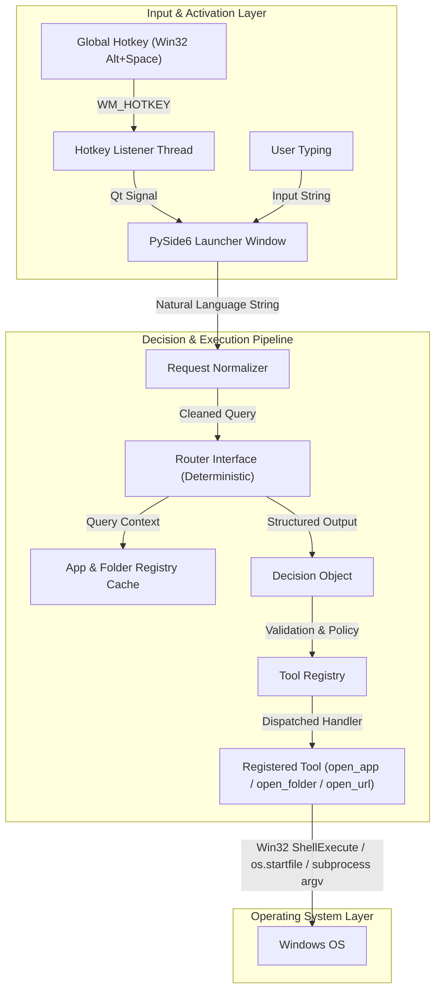
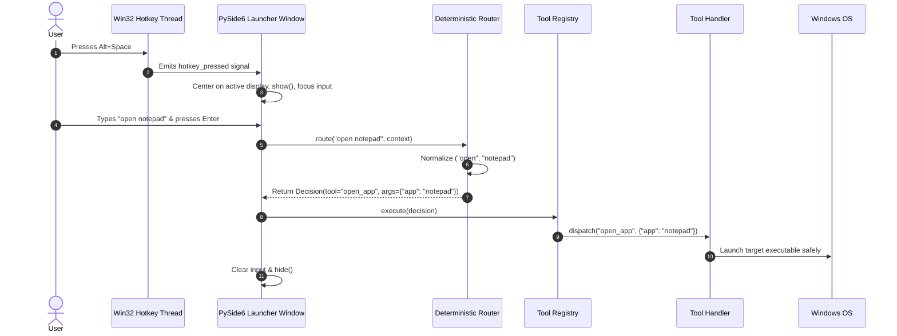

# AstraRun Architecture Specification

> **Version**: 0.1.0  
> **Target Platform**: Windows 11 / Windows 10 (64-bit)  
> **Status**: APPROVED  

---

## 1. System Overview

AstraRun is a local Windows intelligent command launcher designed to act as the foundational command interface for an evolving AI-assisted workstation control ecosystem. 

Unlike traditional launchers that rely on string-interpolated shell execution or web technologies, AstraRun is built with:
- **Zero Raw Shell Ingestion**: Strict security pipeline ensuring user requests are parsed into typed decisions and executed exclusively through registered, validated tools.
- **Persistent Low-Latency Process**: Resident process with a hidden, pre-warmed Qt UI and a dedicated background Win32 message loop for instantaneous hotkey wake-up.
- **Modular Router Abstraction**: Pluggable routing interface (`route(request, context) -> Decision`) designed to seamlessly transition from deterministic rule-based matching in v0.1 to multi-tiered intelligence (Laya, Kev, AI Bridge) in subsequent versions.

---

## 2. High-Level Architecture Diagram



---

## 3. Core Component Boundaries

### 3.1. Hotkey Layer (`astrarun.hotkeys.manager`)
- Runs a dedicated, non-blocking Win32 thread listening for `WM_HOTKEY` via `GetMessageW`.
- Uses native `ctypes.windll.user32.RegisterHotKey` with `MOD_ALT | MOD_NOREPEAT` and `VK_SPACE`.
- Communicates with the Qt Main Thread exclusively via thread-safe Qt Signals (`hotkey_pressed`).
- Allows hotkey configuration from `config/settings.json` without modifying code.

### 3.2. Presentation Layer (`astrarun.ui.launcher`)
- Implemented with **PySide6** (`QDialog` / `QWidget` with `FramelessWindowHint` and `WindowStaysOnTopHint`).
- Keeps the window resident in memory (`hide()` instead of `close()`) to achieve zero-latency presentation upon hotkey activation.
- Positioned dynamically centered on the active display (or primary display / monitor with cursor).
- Keyboard-driven event filter:
  - `Escape` -> Hides the launcher and clears state.
  - `Enter` -> Commits query to the pipeline.
  - Focus Out -> Configurable auto-hide behavior.

### 3.3. Routing Layer (`astrarun.routing`)
- Abstraction:
  ```python
  class BaseRouter(ABC):
      @abstractmethod
      def route(self, request: str, context: RoutingContext) -> Decision:
          pass
  ```
- **`Decision` Model**:
  ```python
  @dataclass
  class Decision:
      tool: str
      args: dict[str, Any]
      confidence: float
      source: str  # e.g., "deterministic", "laya", "kev", "ai_bridge"
      explanation: str = ""
  ```
- **Deterministic Implementation (`DeterministicRouter`)**:
  - Normalizes whitespace, case, and prefixes (`open`, `launch`, `start`, `go to`, `show`).
  - Matches against:
    1. Direct URL aliases (e.g. `github`, `youtube`, `google`).
    2. Folder aliases (e.g. `downloads`, `documents`, `desktop`, `workspace`).
    3. Application aliases & discovered executables (e.g. `notepad`, `calc`, `vscode`, `vivaldi`).
    4. HTTP/HTTPS raw URLs (`https://...`).
  - Produces an explicit `Decision(tool="unknown")` if no deterministic match is found, preventing arbitrary pass-through.

### 3.4. Tool Registry (`astrarun.tools.registry`)
- Registry mapping tool names to typed tool handlers and security metadata.
- Enforces risk policy:
  - `LOW`: Safe local operations (opening registered applications, known directories, trusted URLs).
  - `MEDIUM`: Operations modifying local files or non-standard protocols.
  - `HIGH`: System modification or elevated processes (requires explicit confirmation in future versions).
  - `BLOCKED`: Arbitrary command-line execution or shell invocation (`cmd /c`, `powershell -c`).

### 3.5. Discovery Layer (`astrarun.discovery`)
- **Applications**: Discovered asynchronously or pre-cached at startup:
  - App Paths registry (`HKLM` and `HKCU` `Software\Microsoft\Windows\CurrentVersion\App Paths`).
  - System PATH.
  - Common known locations and custom user entries in `config/apps.json`.
- **Known Folders**: Dynamically queried via Windows User Shell Folders / `SHGetKnownFolderPath`.

---

## 4. Execution Flow Sequence



---

## 5. Error Handling & Feedback Strategy

- **Unknown Command**: Returns a polite, non-intrusive status in the UI ("I don't know how to do that yet") without throwing unhandled exceptions.
- **Application Not Found**: Displays specific message (e.g., "Application 'foo' was not found") and logs discovery cache status.
- **System Exceptions**: Caught by global exception boundaries, recorded in `logs/astrarun.log` with stack traces, while keeping the launcher UI stable and responsive.
