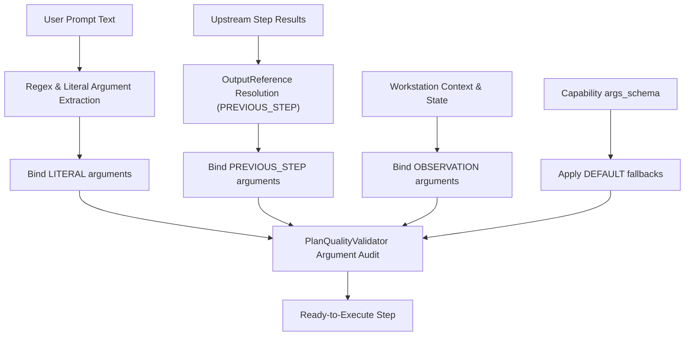

# Argument Binding in AstraRun v0.11.1

> **Milestone**: AstraRun v0.11.1 (Generality & Reality Gate)  
> **Status**: APPROVED  
> **Last Verified**: 2026-09-29  

---

## 1. Overview & Binding Provenance

AstraRun v0.11.1 enforces strict parameter provenance for every argument supplied to a capability. Rather than arbitrary string mapping, every argument in a [`PlanStep`](file:///E:/Workspace/Active/AstraRun/src/astrarun/agent/models.py) records an [`ArgumentBinding`](file:///E:/Workspace/Active/AstraRun/src/astrarun/agent/models.py) tracking its [`ArgumentSourceType`](file:///E:/Workspace/Active/AstraRun/src/astrarun/agent/models.py):

| Source Type | Description | Example |
| :--- | :--- | :--- |
| `LITERAL` | Extracted directly from user utterance / regex / entity resolver | `"hello world"`, `"C:\report.html"` |
| `PREVIOUS_STEP` | Dynamically resolved from upstream step output (`OutputReference`) | `step_a.result.data["reversed"]` |
| `OBSERVATION` | Extracted from current workstation observation / context store | Foreground window HWND, default monitor |
| `DEFAULT` | Fallback specified by capability schema parameter default | `timeout_s = 30.0` |

---

## 2. Argument Resolution Pipeline

---

## 3. Validation & Type Coercion

Before step execution:
1. **Mandatory Argument Audit**: The validator checks Python signature defaults and type hints. If a capability requires a mandatory argument (e.g. `secret_key` in a security tool) and neither a literal nor a previous step binding is provided, the plan is invalidated immediately.
2. **Path Normalization**: Windows path arguments are normalized across drive letters, spaces, and quoting rules. Relative paths directed at user directories (`Downloads/...`) are automatically resolved via portable system abstractions.
3. **Type Safety**: Float, integer, boolean, and string parameters are cast according to the capability's declared schema, preventing runtime type errors.
