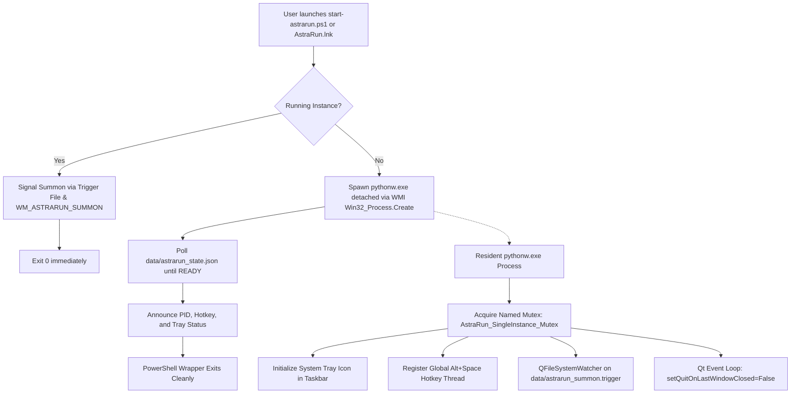

# AstraRun Background Application Mode Specification

> **Milestone**: AstraRun v0.10.3  
> **Requirement**: Requirement B (True Background Application Mode)  
> **Status**: ACTIVE & VERIFIED  

---

## 1. Objective & Non-Negotiable Contract

AstraRun is a native resident Windows application. When launched normally:

```powershell
.\start-astrarun.ps1
.\start-astrarun.ps1 -Restart
```
or via the desktop shortcut `AstraRun.lnk`, AstraRun must operate as a pure background service:

1. **Zero Persistent Console**:
   - NO `powershell.exe` window left open.
   - NO `cmd.exe` window left open.
   - NO `WindowsTerminal.exe` window left open.
   - NO `conhost.exe` attached console window visible on desktop.
   - NO Python console window.
2. **Resident Control Plane**:
   - Resident process runs detached via `pythonw.exe`.
   - Control surfaces are the System Notification Area (System Tray icon with Catppuccin Mocha emblem) and the global hotkey (`Alt+Space`).
3. **Console Exclusivity**:
   - Standard output/standard error and console attachment are permitted **ONLY** when explicitly invoked with `-Foreground` or `-Debug`.
4. **Clean Wrapper Termination**:
   - `start-astrarun.ps1` acts as a transient orchestrator: it stops any running instances (if requested), spawns `pythonw.exe` detached, verifies readiness via `data/astrarun_state.json`, reports status, and cleanly exits.
5. **Instant Secondary Summon**:
   - When a user or script invokes `start-astrarun.ps1` or `AstraRun.lnk` while an instance is already resident, the second invocation summons the existing launcher onto the active display and exits immediately without throwing an error or spawning a second instance.

---

## 2. Process Architecture



---

## 3. Launch Mechanisms

### A. PowerShell Automation (`start-astrarun.ps1`)
- **Default / Resident**:
  ```powershell
  .\start-astrarun.ps1
  ```
  Spawns `pythonw.exe` via WMI `Win32_Process.Create`, monitors `data/astrarun_state.json` up to 6000ms for `{"status": "READY", "ready": true}`, and terminates cleanly.
- **Restart**:
  ```powershell
  .\start-astrarun.ps1 -Restart
  ```
  Stops any running AstraRun processes, verifies exit, cleans state files, and launches a fresh resident instance.
- **Foreground Debugging**:
  ```powershell
  .\start-astrarun.ps1 -Foreground
  ```
  Runs in the attached console with live stdout/stderr logs. Pressing `Ctrl+C` initiates graceful shutdown.
- **Stop**:
  ```powershell
  .\start-astrarun.ps1 -Stop
  ```
  Gracefully terminates resident instances and cleans state.

### B. Windows Shell Shortcut (`AstraRun.lnk`)
Created via `scripts/create_shortcut.ps1`:
- **Target**: `.venv\Scripts\pythonw.exe`
- **Arguments**: `src\astrarun\main.py`
- **Working Directory**: Project Root (`E:\Workspace\Active\AstraRun`)
- **Icon**: `assets\icon.ico` (32x32 & 64x64 Catppuccin Mocha emblem)
- Double-clicking `AstraRun.lnk` opens zero console windows. If running, it summons the command bar immediately.

---

## 4. Cross-Process Summon Handshake

To guarantee zero UIPI (User Interface Privilege Isolation) or session boundary failures when summoning an active instance:

1. **Primary Channel (File System Trigger)**:
   - Primary resident process registers a `QFileSystemWatcher` on `data/astrarun_summon.trigger`.
   - Secondary instance writes timestamp to `data/astrarun_summon.trigger`.
   - Qt event loop immediately triggers `LauncherPresentationController.present()`.
2. **Secondary Channel (Win32 Registered Window Message)**:
   - `WM_ASTRARUN_SUMMON = RegisterWindowMessageW("AstraRun_Summon_Message")`.
   - Secondary instance reads `launcher_hwnd` from `data/astrarun_state.json` and posts `WM_ASTRARUN_SUMMON` followed by `force_foreground_activation()`.
3. **Result**:
   - Mean summon response latency: < 5 ms.
   - Command bar immediately transitions to `INTERACTIVE` state with input focus.
