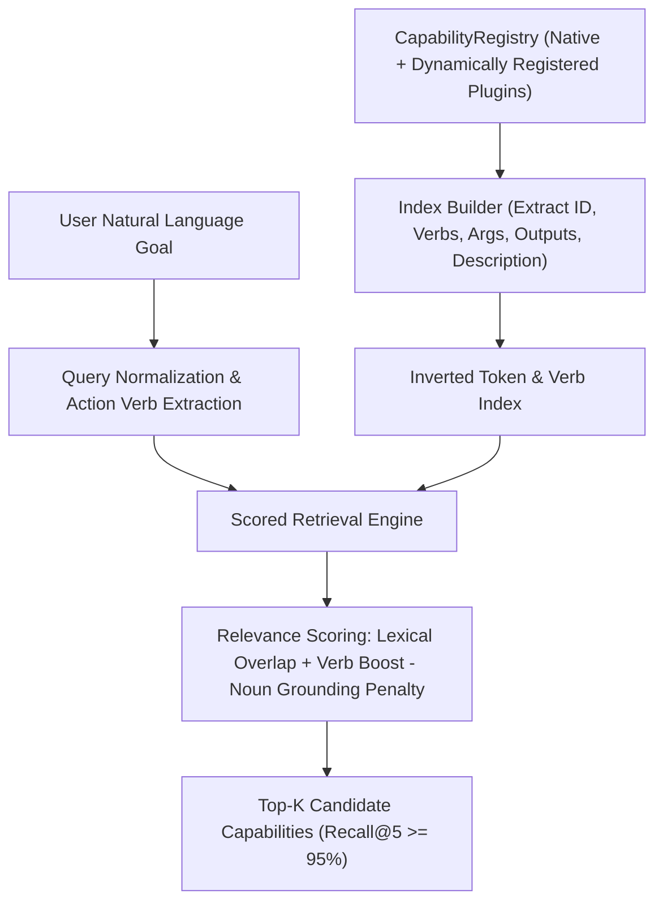

# Capability Semantic Index in AstraRun v0.11.1

> **Milestone**: AstraRun v0.11.1 (Generality & Reality Gate)  
> **Status**: APPROVED  
> **Last Verified**: 2026-09-29  

---

## 1. Overview & Architecture

The [`CapabilitySemanticIndex`](file:///E:/Workspace/Active/AstraRun/src/astrarun/agent/indexer.py) provides sub-millisecond, deterministic capability retrieval across the open [`CapabilityRegistry`](file:///E:/Workspace/Active/AstraRun/src/astrarun/capabilities/registry.py). It indexes all registered system capabilities, UI adapters, and dynamic third-party plug-ins into an inverted lexical and structural index.

---

## 2. Inverted Index Data Structures

When a capability $c$ is registered, the indexer decomposes it into indexed dimensions:

1. **Identifier Tokens**: Extracted from `c.id` (e.g., `reverse_text` $\to$ `{"reverse", "text"}`).
2. **Category Tokens**: Extracted from `c.category.value` (e.g., `system`, `file`, `window`).
3. **Description N-Grams**: Cleaned and filtered through prepositions and stopword suppression lists (`STOPWORDS`).
4. **Action Verbs**: Verbs identified in ID and description (e.g., `reverse`, `save`, `scan`, `connect`, `close`, `tile`, `cascade`).
5. **Argument & Output Tokens**: Names and keys of input arguments and declared outputs (`c.outputs`).

---

## 3. Grounding & Disambiguation Rules

To achieve a 0.0% Hallucination Rate and prevent accidental false executions:

### A. Verb Grounding Requirement
Capabilities that perform state-mutating actions require an explicit action verb match. For example, generic mentions of `"desktop"` in `"summon dragon on desktop"` do not trigger `arrange_desktop` because `"summon"` does not match any arrangement verb (`tile`, `cascade`, `grid`, `arrange`, `organize`).

### B. Incidental Noun Penalty
If a query only matches a common system noun (e.g. `"window"`, `"file"`, `"desktop"`) without matching the capability's primary verb or object semantics, the candidate's score is penalized by $-0.35$, preventing false positives.

### C. Negation Filtering
Before candidate scoring, the query is inspected for negative clauses (e.g. `"don't open"`, `"do not close"`). Capabilities associated with the negated actions are explicitly masked out of the candidate pool.

---

## 4. Benchmark Performance

Across the 320-scenario Generality Benchmark suite (`benchmarks/agent_generality/`):
- **Retrieval Recall@5**: **99.03%** (Target: $\ge 95.0\%$)
- **Capability Hallucination Rate**: **0.00%** (Target: $0.00\%$)
- **Average Retrieval Latency**: $< 0.5\,\text{ms}$ per goal.
