# AstraRun Compound Workflow Architecture

> **Milestone**: v0.10.2  
> **Status**: APPROVED  
> **Target Audience**: Core Engineers & Agent Maintainers  
> **Date**: 2026-09-28  

---

## 1. Architectural Overview

The Compound Workflow Architecture coordinates multi-step execution plans derived from natural-language user commands. In v0.10.2, this system solves the fundamental challenge of synchronizing asynchronous desktop operations (process creation, window creation, UIA control tree materialization, and focus acquisition) into a reliable sequential pipeline.

```mermaid
sequenceDiagram
    autonumber
    actor User
    participant Launcher as LauncherWindow
    participant Router as DeterministicRouter
    participant Decomposer as ClauseDecomposer
    participant Compiler as WorkflowCompiler
    participant Context as WorkflowContext
    participant Registry as CapabilityRegistry
    participant HUD as FloatingTaskHUD
    participant OS as Windows 11 Desktop (Win32 / UIA)

    User->>Launcher: Types "open notepad and type pqr" + Enter
    Launcher->>Launcher: has_compound_indicators() == True (Suppress Suggestions)
    Launcher->>Router: handle_request("open notepad and type pqr")
    Router->>Decomposer: decompose_clauses(text)
    Decomposer-->>Router: [Clause(open_app, 'notepad'), Clause(type_text, 'pqr')]
    Router->>Compiler: compile(clauses)
    Compiler-->>Router: WorkflowPlan(4 steps)
    
    Router->>HUD: show_progress("task_1", "Compound Workflow", "Step 1/4: Launching notepad")
    
    rect rgb(24, 24, 37)
        Note over Router,OS: Step 1: Process Creation
        Router->>Registry: execute("open_application", {app: "notepad"})
        Registry->>OS: os.startfile("notepad.exe")
        OS-->>Registry: Process spawned
        Registry-->>Context: record_step_result(last_opened_application="notepad")
    end

    rect rgb(30, 30, 46)
        Note over Router,OS: Step 2: Window Synchronization
        Router->>HUD: update_progress("Step 2/4: Waiting for window synchronization")
        Router->>Registry: execute("wait_for_window", {app: "notepad"})
        Registry->>OS: Bounded EnumWindows polling (50ms)
        OS-->>Registry: HWND 19924906, PID 22776
        Registry-->>Context: record_step_result(last_opened_window=19924906)
    end

    rect rgb(24, 24, 37)
        Note over Router,OS: Step 3: Editable Control Resolution
        Router->>HUD: update_progress("Step 3/4: Resolving editable control")
        Router->>Registry: execute("resolve_editable_element", {hwnd: 19924906})
        Registry->>OS: Inspect UIA Tree for Document/Edit control
        OS-->>Registry: RichEditD2DPT control found
        Registry-->>Context: record_step_result(last_ui_element=UIElementRef)
    end

    rect rgb(30, 30, 46)
        Note over Router,OS: Step 4: Focus & Keystroke Injection
        Router->>HUD: update_progress("Step 4/4: Typing literal text 'pqr'")
        Router->>Registry: execute("type_text", {text: "pqr", hwnd: 19924906})
        Registry->>OS: _ensure_desktop_attached() -> OpenInputDesktop
        Registry->>OS: force_foreground_activation(19924906) [AttachThreadInput + Alt pulse]
        Registry->>OS: SendInput(KEYEVENTF_UNICODE, "pqr")
        OS-->>Registry: Keystrokes delivered
    end

    Router->>HUD: show_success("task_1", "Workflow executed 4 step(s)")
    Router-->>Launcher: ExecutionResult(success=True, steps=4)
```

---

## 2. Core Execution Phases

### Phase 1: Compound Query Detection & Suggestion Suppression
- `has_compound_indicators(query: str)`:
  - Scans query for conjunctions (`and`, `then`, `&`, `;`) and action verbs.
  - When detected, `LauncherWindow.suggestions_list` is cleared and hidden.
  - This prevents autocomplete from auto-selecting single application recommendations and truncating user intent upon pressing Enter.

### Phase 2: Intermediate Representation (IR) Decomposition
- `ClauseDecomposer.decompose_clauses()`:
  - Partitions the text into independent verb-action clauses.
  - Assigns standardized intents (`open_app`, `type_text`, `maximize`, `snap_left`, `shortcut`).
  - Cleans and strips clauses while preserving exact text payloads.

### Phase 3: 4-Step Sequential Synchronization Expansion
When the intent sequence `open_app` + `type_text` is recognized, the `WorkflowCompiler` automatically injects the two mandatory desktop synchronization primitives:
1. `wait_for_window`: Prevents race conditions where keystrokes are fired before the process has created its top-level window.
2. `resolve_editable_element`: Traverses Microsoft UI Automation tree to locate the primary document editor or text box.

### Phase 4: WorkflowContext State Propagation
- Downstream steps receive parameters produced by upstream steps:
  - Step 1 produces `app: "notepad"` -> Step 2 binds `app: "notepad"`.
  - Step 2 produces `hwnd: 19924906` -> Steps 3 & 4 bind `hwnd: 19924906`.
  - Step 3 produces `target_element` -> Step 4 optionally uses direct ValuePattern.

### Phase 5: Win32 Interactive Desktop Attachment & Foreground Activation
- Modern Windows sessions isolate background subshells or services from the user's interactive input desktop.
- `_ensure_desktop_attached()` attaches the calling thread to `user32.OpenInputDesktop(0, False, 0x01FF)`.
- `force_foreground_activation(hwnd)`:
  - Attaches caller thread input to both current foreground thread and target thread (`AttachThreadInput`).
  - Calls `user32.AllowSetForegroundWindow(-1)`.
  - Simulates `VK_MENU` (Alt) key pulse if Windows focus lock is present.
  - Brings target window to top and sets keyboard focus.

### Phase 6: Keystroke Delivery without Shell Evaluation
- Keystrokes are injected via Win32 `SendInput` using `KEYEVENTF_UNICODE`.
- Payloads are treated strictly as character data. Zero shell evaluation (`shell=False`, no `cmd.exe`, no `powershell.exe`, no `os.system`).

---

## 3. Telemetry & User Feedback

1. **Floating Task HUD**:
   - Updates passively in top-right corner of the monitor housing the origin window.
   - Non-focus-stealing extended style `WS_EX_NOACTIVATE` guarantees the target window never loses keyboard focus to AstraRun's own HUD during typing.
   - Shows step-by-step progress (`Step 1/4`, `Step 2/4`, `Step 3/4`, `Step 4/4`) with auto-dismissal on completion.
2. **Task Ledger**:
   - `TaskManager` assigns a UUID task token and logs all intermediate step outcomes to the durable task ledger.
