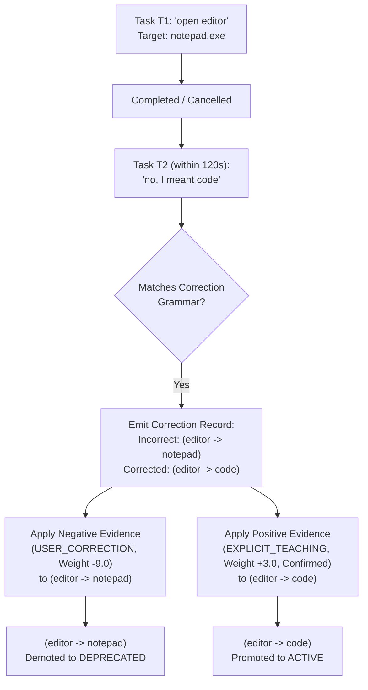

# AstraRun User Correction Detection & Adaptation

> **Document**: `docs/CORRECTIONS.md`  
> **Milestone**: AstraRun v0.8.5 (Memory, Learning & Skill Foundation)  
> **Status**: APPROVED ADAPTATION SPECIFICATION  

---

## 1. The Correction Signal

When a user interacts with a workstation launcher and experiences an unexpected outcome, their immediate response is to correct the system:
- User types `"open editor"` ➔ System opens Notepad.
- Within 10 seconds, user types: `"no, I meant code"` or `"use vscode instead"`.

In conventional systems, this generates two disconnected queries, leaving the erroneous association active. In AstraRun, **corrections are treated as the highest-fidelity empirical feedback signal available**.

---

## 2. Correction Detection Engine

The `EvidenceExtractor` analyzes sequential tasks within the same conversation window:

### 2.1 Detection Criteria
A task $T_2$ is classified as a correction of $T_1$ if and only if:
1. $\text{conversation\_id}(T_1) == \text{conversation\_id}(T_2)$.
2. $\Delta t = \text{created\_at}(T_2) - \text{completed\_at}(T_1) \le 120.0\text{ seconds}$.
3. Query text in $T_2$ matches regex patterns:
   - `^(?:no\s*,\s*)?(?:i\s+meant|actually|instead|rather)\s+([^\s]+)`
   - `^not\s+([^\s]+)\s*,\s*([^\s]+)`
   - `^no\s+([^\s]+)`
4. The proposed corrected target passes non-learnable security policies.

---

## 3. Asymmetric Reward-Penalty Update

A correction represents an explicit human error signal. Therefore, the weight update is intentionally asymmetric:
- **Incorrect Target**: Receives `EvidenceType.USER_CORRECTION` with base weight $3.0$ and double contradiction penalty ($\times 2.0$), causing immediate confidence collapse ($C < 0.10$) and demoting it to `DEPRECATED`.
- **Corrected Target**: Receives `EvidenceType.EXPLICIT_TEACHING` with `user_confirmed=True`, immediately promoting it to `ACTIVE` ($C \ge 0.95$).

---

## 4. Reversibility & Conflict Protection

If a user later reverses a correction:
- All corrections are stored in the `corrections` SQLite table with full audit provenance.
- The `MemoryView` UI displays active and corrected targets, allowing the user to click "Confirm" or "Delete" on any individual memory at any time.
