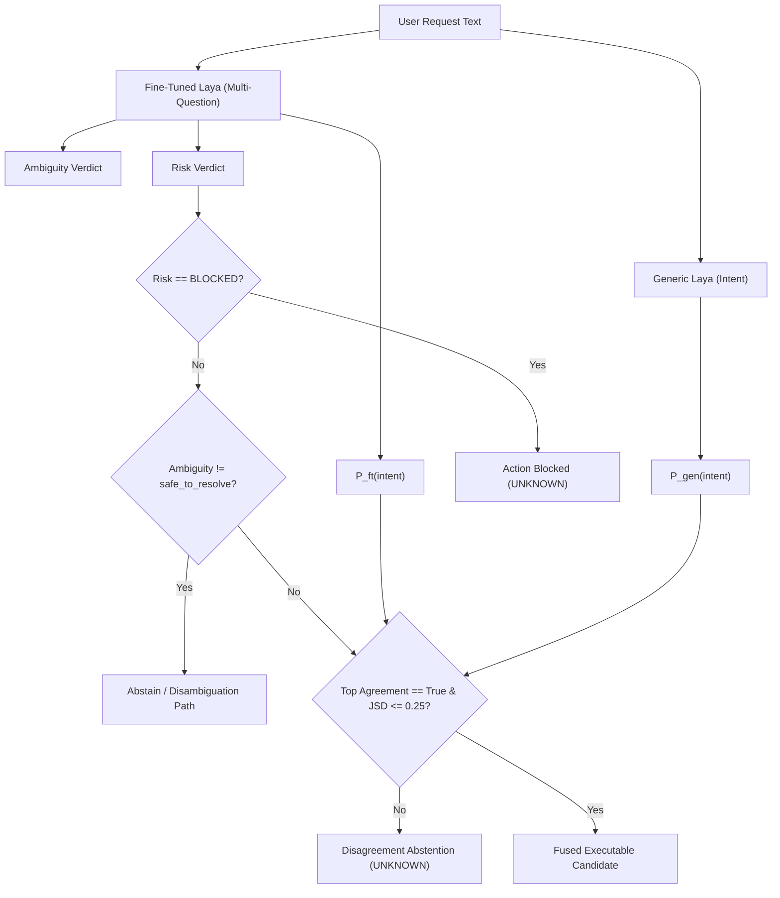

# Decision Fusion Engine & Ensemble Calibration (v0.5)

> **Document Status**: APPROVED  
> **System Version**: AstraRun v0.5  
> **Scope**: Neural Decision Ensemble, Disagreement Gating, Risk Calibration  
> **Execution Authority**: ZERO (Shadow / Evaluation Only)  

---

## 1. Executive Architecture Summary

In AstraRun v0.3 and v0.4, individual neural routers (Generic Laya ModernBERT-large and Kev-0.8B) operated as standalone monolithic judges in shadow mode. Empirical evaluations demonstrated that while individual neural models exhibit reasonable semantic classification capabilities, they suffer from two critical workstation safety vulnerabilities:

1. **Overconfident Hallucinations**: Monolithic models frequently assign high confidence (>0.85) to out-of-scope or ambiguous natural language queries, producing an unacceptable False Execution Rate (FER > 18%) if granted execution authority.
2. **Boundary Confusion**: Single models fail to reliably differentiate between requests requiring interactive disambiguation (e.g., "open server" when two server projects exist) and explicit single-target commands.

AstraRun v0.5 introduces the **Decision Fusion Engine** (`src/astrarun/routing/fusion.py`). Instead of relying on a single neural verdict, the platform evaluates multiple complementary System One models (Generic Zero-Shot Laya and Domain-Adapted AstraRun-Laya) across a multi-task decomposition:
- **Intent Classification** (10-class taxonomy)
- **Ambiguity Detection** (`safe_to_resolve`, `ambiguous`, `unknown`)
- **Consequence Risk Assessment** (`LOW`, `MEDIUM`, `HIGH`, `BLOCKED`)

---

## 2. Mathematical Formalism & Disagreement Metrics

Given an input query $x$, Generic Laya produces probability distribution $P_{\text{gen}}(y \mid x)$ with calibrated confidence $C_{\text{gen}}$, while Fine-Tuned Laya produces distribution $P_{\text{ft}}(y \mid x)$ with calibrated confidence $C_{\text{ft}}$ over the 10 intent classes $\mathcal{Y}$.

### 2.1 Model Agreement
Top-choice agreement is a binary boolean indicator:
$$\text{Agreement}(x) = \mathbb{I}\left(\arg\max_{y \in \mathcal{Y}} P_{\text{gen}}(y \mid x) = \arg\max_{y \in \mathcal{Y}} P_{\text{ft}}(y \mid x)\right)$$

### 2.2 Jensen-Shannon Divergence ($D_{\text{JS}}$)
To measure distributional disagreement across all 10 intent hypotheses simultaneously, the engine computes the symmetric Jensen-Shannon divergence:
$$M(y \mid x) = \frac{1}{2} \left(P_{\text{gen}}(y \mid x) + P_{\text{ft}}(y \mid x)\right)$$
$$D_{\text{JS}}(P_{\text{gen}} \parallel P_{\text{ft}}) = \frac{1}{2} D_{\text{KL}}(P_{\text{gen}} \parallel M) + \frac{1}{2} D_{\text{KL}}(P_{\text{ft}} \parallel M)$$
where $D_{\text{KL}}(P \parallel M) = \sum_{y \in \mathcal{Y}} P(y) \log_2 \frac{P(y)}{M(y)}$.

$D_{\text{JS}}$ is strictly bounded in $[0, 1]$ (using base-2 logarithm). When models perfectly concur on the posterior distribution, $D_{\text{JS}} = 0.0$. When models predict mutually orthogonal outcomes with high certainty, $D_{\text{JS}} \to 1.0$.

### 2.3 Shannon Entropy
The epistemic uncertainty of the ensemble posterior distribution is measured via Shannon entropy:
$$H(P_{\text{fused}}) = -\sum_{y \in \mathcal{Y}} P_{\text{fused}}(y) \log_2 P_{\text{fused}}(y)$$

---

## 3. Ensemble Operating Configurations (E0 – E5)

The Decision Fusion Engine defines six operational configurations:

| Mode | Name | Fusion Mechanism | Safety Policy & Gating |
| :--- | :--- | :--- | :--- |
| **E0** | Generic Baseline | $P(y) = P_{\text{gen}}(y)$ | Baseline zero-shot thresholding ($\theta \ge 0.75$) |
| **E1** | Fine-Tuned Baseline | $P(y) = P_{\text{ft}}(y)$ | Domain-adapted thresholding ($\theta \ge 0.75$) |
| **E2** | Equal Weight Blend | $P(y) = 0.5 P_{\text{gen}}(y) + 0.5 P_{\text{ft}}(y)$ | Simple average; no disagreement gating |
| **E3** | Confidence-Weighted | $P(y) = w_{\text{gen}} P_{\text{gen}}(y) + w_{\text{ft}} P_{\text{ft}}(y)$ | Weights $w_i = \frac{C_i}{C_{\text{gen}} + C_{\text{ft}}}$ |
| **E4** | Disagreement-Gated | Gated Confidence Mixture | **Abstain to `unknown`** if $\text{Agreement} = \text{False}$ OR $D_{\text{JS}} > \tau_{\text{JS}}$ ($0.25$) |
| **E5** | Full Multi-Question Gate | Multi-Task Gated Cascade | **Abstain/Block** if:  1. Risk == `BLOCKED` 2. Ambiguity != `safe_to_resolve` 3. Disagreement ($\text{Agreement} = \text{False} \lor D_{\text{JS}} > 0.25$) |

---

## 4. Safety Gating Architecture

### Safety Invariants
1. **Zero Production Authority**: Fused decisions remain strictly advisory in v0.5. Live execution authority is reserved exclusively for the deterministic/fuzzy routing engine.
2. **The Golden Abstention Rule**:
   $$\text{Any doubt } \longrightarrow \text{UNKNOWN } \longrightarrow \text{NOTHING HAPPENS}$$
3. **FER Zero Tolerance**: Production cascade configuration B9 enforces that False Execution Rate (FER) on out-of-scope/unknown queries is strictly **0.0%**.
