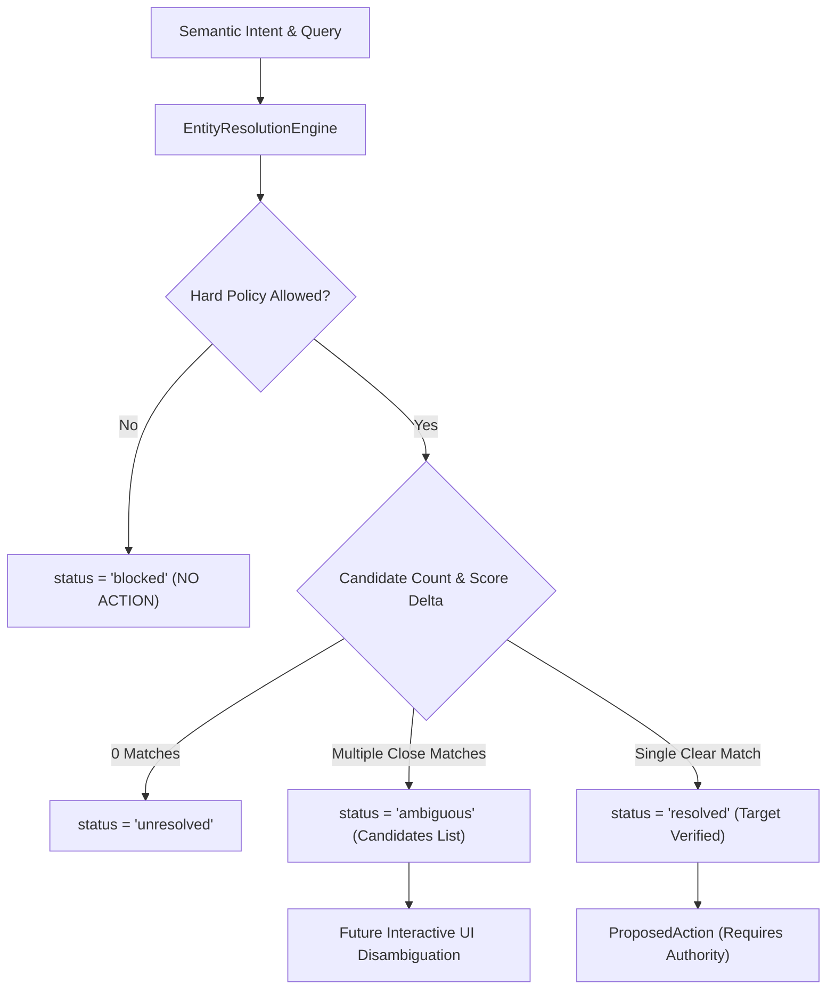

# Deterministic Entity Resolution Engine (v0.5)

> **Document Status**: APPROVED  
> **System Version**: AstraRun v0.5  
> **Scope**: Target Disambiguation, Project/File/Process Resolution, Hard Policy Enforcement  
> **Execution Authority**: ZERO (Shadow / Evaluation Only)  

---

## 1. Motivation & Purpose

Predicting a semantic intent (e.g., `open_project` or `process_action`) is only the first half of intelligent command handling. To execute a command safely, an agentic system must resolve abstract natural language entities (such as "server", "my app", "port 3000", or "yesterday's notes") into concrete, validated workstation targets.

AstraRun v0.5 introduces the **Entity Resolution Engine** (`src/astrarun/routing/entity_resolver.py`), providing:
1. **Deterministic Target Mapping**: Queries are mapped against workstation truth (the read-only `workspace.json` project registry, Start Menu apps, File Explorer known folders, and network socket patterns).
2. **Ambiguity Disambiguation**: When an entity cannot be uniquely identified, the engine emits `status="ambiguous"` with candidate options, preventing accidental execution of the wrong target.
3. **Hard Security Invariants**: Uncompromising rejection of dangerous shell patterns, protected system processes, and privileged operating system ports.

---

## 2. Entity Resolution Targets

| Intent | Resolution Data Source | Resolution Mechanism | Disambiguation Rule |
| :--- | :--- | :--- | :--- |
| `open_project` | `E:\Workspace\workspace.json` | Exact alias / ID match, tag lookup, fuzzy path match | If multiple projects score within $\Delta \le 0.15$, trigger `ambiguous` |
| `open_app` | `AppDiscoveryCache` | Installed Windows Start Menu and path executables | If multiple apps match query tokens, emit candidate matches |
| `open_folder` | `FolderResolver` | Platform known folders (`Downloads`, `Documents`, `Workspace`, `Desktop`) | Exact or substring path matching |
| `open_url` | Regex / Domain validation | URL schema (`https://`) or standard FQDN recognition | Must validate against valid host syntax |
| `process_action` | Port / Process Regex | Port number regex `(?::\|port\s*)(\d+)` or process name | Checks against protected system process & port registry |
| `system_action` | Operating System API | Power management, session locking, volume | Shutdown/reboot commands require explicit confirmation |

---

## 3. Workstation Safety Policy Boundaries

The Entity Resolution Engine enforces hard-coded policy constraints prior to generating any proposed action:

### 3.1 Protected System Processes
Workstation stability is paramount. The following processes are strictly protected from modification, termination, or suspension:
- `system`, `system idle process`, `registry`
- `smss.exe`, `csrss.exe`, `wininit.exe`
- `services.exe`, `lsass.exe`, `svchost.exe`
- `winlogon.exe`, `explorer.exe`, `dwm.exe`
- `spoolsv.exe`, `fontdrvhost.exe`

Attempts to target any protected process yield:
```python
ProposedAction(
    action_type="process_action",
    target=proc_name,
    status="blocked",
    policy_allowed=False,
    block_reason="Process '...' is a protected Windows system process"
)
```

### 3.2 Privileged Port Protection
Network socket interventions targeting ports $\le 1023$ (well-known system ports such as 22, 53, 80, 443) are rejected unconditionally:
```python
ProposedAction(
    action_type="process_action",
    target="80",
    status="blocked",
    policy_allowed=False,
    block_reason="Port 80 is a protected system port (<= 1023)"
)
```
Non-privileged developer ports (e.g. `3000`, `5000`, `8080`) resolve with `requires_confirmation=True`.

### 3.3 Destructive Shell Command Blacklist
Hard policy blocks known destructive patterns:
- `rmdir /s /q`
- `format [drive]:`
- `del ... system32`
- `reg delete HKLM`
- `diskpart`

---

## 4. Disambiguation Workflow



---

## 5. Execution Authority Status

> [!IMPORTANT]
> In AstraRun v0.5, the Entity Resolution Engine generates structured `ProposedAction` objects for evaluation, testing, and UI preview only. It **DOES NOT** execute tools or modify system state. Execution remains 100% governed by the deterministic router.
