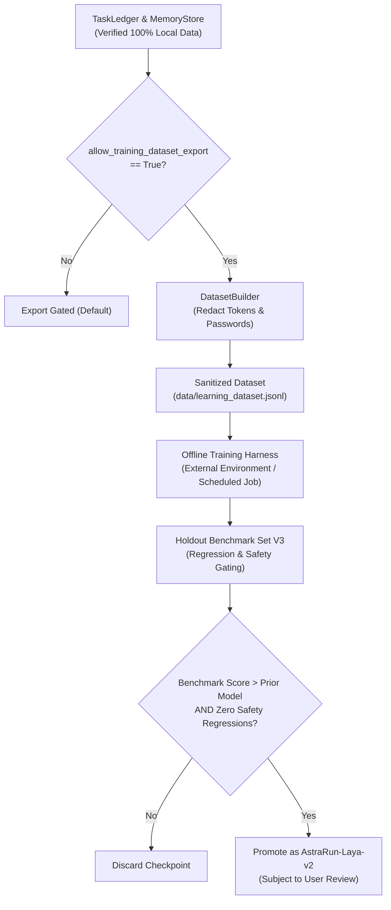

# Future Laya Domain Adaptation & Offline Fine-Tuning Strategy

> **Document**: `docs/FUTURE_LAYA_ADAPTATION.md`  
> **Milestone**: AstraRun v0.8.5 (Memory, Learning & Skill Foundation)  
> **Status**: APPROVED ROADMAP & STRATEGY  

---

## 1. Context: Zero Online Weight Updates

AstraRun v0.8.5 strictly enforces:
> **Zero online gradient descent, zero dynamic LoRA hot-patching, and zero live model mutation.**

Live weight updates in a desktop launcher introduce severe instability:
- Catastrophic forgetting on common vocabulary.
- Vulnerability to adversarial prompt injection poisoning model weights.
- Unpredictable GPU/CPU memory spikes during interactive usage.

---

## 2. The Offline Distillation Pipeline

Future milestones (v0.9+) will support periodic, offline adaptation of local semantic models (Laya 0.5B) via the following controlled pipeline:

---

## 3. Holdout Benchmark Gating & Safeguards

Before any new model checkpoint can be deployed into AstraRun:
1. **Safety Evaluation**: Evaluated against the 330-case Action Benchmark, 620-case NLP Benchmark, and 320-case Learning Benchmark.
2. **Regression Ceiling**:
   - False Execution Rate must remain strictly **0.00%**.
   - Negated Action Leakage Rate must remain strictly **0.00%**.
   - Security Block Recall must remain strictly **100.0%**.
3. **Rollback Guarantee**: Previous model weights (`convaiinnovations/laya`) remain pinned and accessible for instantaneous one-click rollback in settings.
