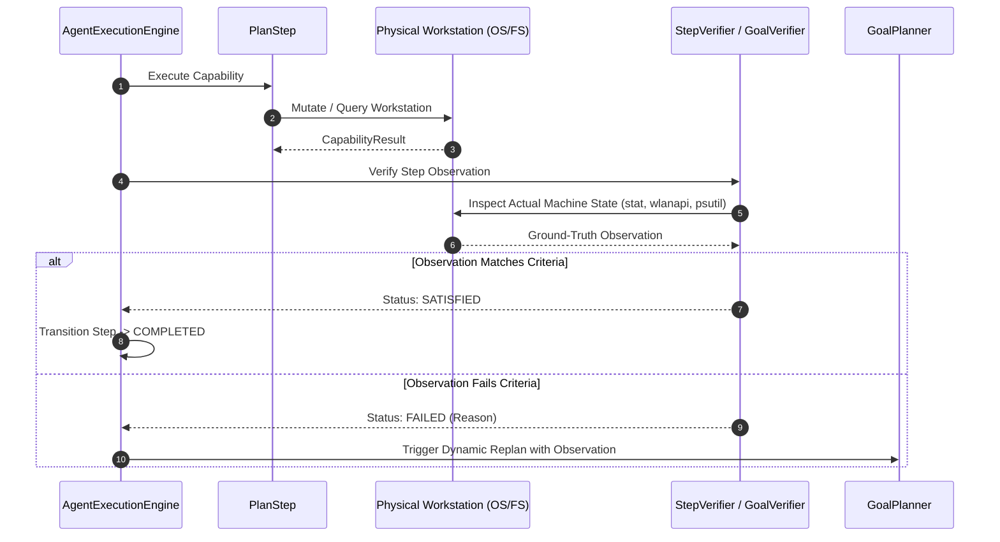

# Goal & Step Verification in AstraRun v0.11.1

> **Milestone**: AstraRun v0.11.1 (Generality & Reality Gate)  
> **Status**: APPROVED  
> **Last Verified**: 2026-09-29  

---

## 1. Overview & Verification Principle

A core distinction between a simple script runner and a workstation agent is **empirical verification**:
> **Truth in Verification Invariant**: AstraRun never marks a step or task as `COMPLETED` based solely on process exit codes or wishful assumptions. Success requires observing actual post-action machine state.

Verification is partitioned into two levels:
1. **[`StepVerifier`](file:///E:/Workspace/Active/AstraRun/src/astrarun/agent/verifier.py)**: Verifies the direct physical side effect of an individual capability execution.
2. **[`GoalVerifier`](file:///E:/Workspace/Active/AstraRun/src/astrarun/agent/verifier.py)**: Verifies the end-to-end condition specified by the user's high-level goal.

---

## 2. Supported Verifier Strategies

Defined in [`astrarun.capabilities.schema.VerifierStrategy`](file:///E:/Workspace/Active/AstraRun/src/astrarun/capabilities/schema.py):

| Strategy | Validation Method | Example Goal |
| :--- | :--- | :--- |
| `FILE_NON_EMPTY` | Checks that file exists on disk and `st_size > 0` | Battery report generation |
| `FILE_EXISTS` | Checks that target path exists in the filesystem | Document export or text saving |
| `NETWORK_SSID` | Queries `wlanapi.dll` to confirm target SSID connection | Wi-Fi connect to `'GS TECH F8'` |
| `WINDOW_TITLE` | Inspects Win32 window handles for matching active title | Focus application or window |
| `WINDOW_ACTIVE` | Confirms HWND matches `GetForegroundWindow()` | Switch window focus |
| `PROCESS_RUNNING` | Queries process table to verify target process is active | Launch desktop tool |
| `CONDITION_EXPR` | Evaluates typed [`PlanCondition`](file:///E:/Workspace/Active/AstraRun/src/astrarun/agent/models.py) expressions against output data | Metrics thresholds, count $> 0$ |

---

## 3. Verification Workflow & Adaptation

If an observation fails, the engine does not silently continue. It captures the observation into the task history and queries the planner for a dynamic replan or triggers safe rollback.
