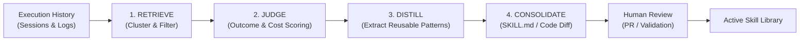

# Hermes Upstream Learning & Evolution Architecture Research

> **Document**: `docs/HERMES_LEARNING_RESEARCH.md`  
> **Milestone**: AstraRun v0.8.5 (Memory, Learning & Skill Foundation)  
> **Scope**: Comparative analysis of NousResearch `hermes-agent` and `hermes-agent-self-evolution`  
> **Status**: APPROVED RESEARCH & REFERENCE  

---

## 1. Executive Summary

As AstraRun expands from an intelligent command launcher and task runtime into an adaptive workstation operating layer, the central engineering challenge is: **How can a system learn durable user preferences, entity aliases, and reusable workflows without compromising system integrity, privacy, determinism, or safety?**

To address this challenge, we conducted deep research into the state of the art in open-source agent learning and self-improvement:
1. **NousResearch `hermes-agent`**: Production agent framework utilizing modular toolsets, trajectory compression, and SQLite-backed session persistence.
2. **NousResearch `hermes-agent-self-evolution`**: The evolutionary self-improvement companion repository utilizing **DSPy** and **GEPA** (Genetic Evolution of Prompt Architectures) via a 4-stage pipeline (**RETRIEVE ➔ JUDGE ➔ DISTILL ➔ CONSOLIDATE**).

This document analyzes the architecture, strengths, and failure modes of the upstream Hermes approach, and explicitly defines how AstraRun adapts these principles into a deterministic, workstation-safe foundation.

---

## 2. Upstream Architecture: `NousResearch/hermes-agent` & `hermes-agent-self-evolution`

### 2.1 The Core Evolutionary Cycle
In upstream Hermes self-evolution, the agent evolves its skills, prompt definitions, and tool orchestrations through a closed-loop empirical cycle:



1. **RETRIEVE**:
   - Gathers execution traces from SQLite session stores.
   - Filters traces by domain, tool usage, error density, and user satisfaction signals.
   - Deduplicates near-identical trajectories using vector or structural clustering.

2. **JUDGE**:
   - Evaluates trajectory quality along multiple axes: correctness, token/time cost, tool call count, and error recovery efficiency.
   - Distinguishes "accidental successes" (high backtracking, retries) from "canonical executions".
   - Identifies specific failure steps and user corrections (e.g. user intervened to provide the right path or flag).

3. **DISTILL**:
   - Condenses the multi-step trajectory into a generalized, reusable sequence.
   - Replaces literal variables (e.g. `/path/to/specific/repo` or PID `12345`) with typed template parameters (`{target_path}`, `{port}`).
   - Formulates step-by-step instructions, preconditions, and postconditions.

4. **CONSOLIDATE**:
   - Emits a structured `SKILL.md` specification containing YAML frontmatter and operational rules.
   - For agent code or prompt improvements, compiles test cases and runs Pareto evaluation via GEPA and DSPy.
   - Outputs versioned artifacts and diffs rather than hot-patching production memory silently.

### 2.2 Hermes Skill Specification Structure
Upstream Hermes standardizes skills as filesystem artifacts with strict YAML metadata:
```markdown
---
name: devops-docker-cleanup
description: Cleans unused Docker containers, dangling images, and build cache.
triggers:
  - clean docker
  - prune containers
parameters:
  - name: dry_run
    type: boolean
    default: true
---

# Instructions...
```

---

## 3. Comparative Analysis: Hermes vs AstraRun

While Hermes operates as an autonomous cloud/server coding agent with broad tool and code generation capabilities, AstraRun is a **desktop workstation orchestration platform** operating directly on the user's host Windows machine with hard real-time latency requirements.

| Dimension | NousResearch Hermes Agent | AstraRun v0.8.5 Learning Foundation |
| :--- | :--- | :--- |
| **Model Footprint** | Cloud frontier LLMs (Hermes 3, Claude, GPT-4) or large local LLMs (8B–70B) | Small local semantic models (Laya 0.5B, zero-shot/domain-adapted) + deterministic NLP |
| **Execution Authority** | Autonomous agent execution via bash/python tools | **ZERO neural or learned execution authority**. All actions gated by `ActionGate` and hard policy |
| **Learning Mechanism** | GEPA prompt optimization, DSPy program compile, online LoRA adapters | Deterministic evidence extraction, confidence aggregation, pattern mining, and human-confirmed skills |
| **Skill Implementation** | Free-form Python code or markdown prompts executed by an LLM | Strongly typed sequences of **registered Workstation Capabilities** (`CapabilityRegistry`) |
| **Storage Architecture** | SQLite `sessions.db` with FTS5 and vector embeddings | Two-database architecture: `astra_history.db` (episodic audit) + `astra_learning.db` (semantic & procedural) |
| **Safety Invariants** | Sandbox isolation / Container guards | Hardcoded OS policy boundaries (`NonLearnablePolicy`), zero raw shell execution, zero security bypass |
| **Latency Budget** | Seconds to minutes per turn | Hot path (`Alt+Space`): **< 10 ms**. Learning runs completely off hot path (background/idle) |

---

## 4. AstraRun Adaptation: Core Principles

AstraRun v0.8.5 extracts the best architectural insights from Hermes while rejecting dangerous autonomous self-modification:

### 4.1 Principle 1: Separation of Episodic Audit from Semantic Knowledge
- Upstream Hermes co-locates session logs, message trajectories, and runtime states.
- **AstraRun Solution**:
  - `data/astra_history.db`: Stores immutable task records, events, and message history. Subject to retention policies (e.g., prune after 30 days).
  - `data/astra_learning.db`: Stores learned aliases, user preferences, and skill candidates. Stores evidence *references* (task ID, event ID, safe hash) rather than duplicated raw payloads.
  - If history is pruned or cleared, learned knowledge remains intact with provenance flags marked `HISTORICAL_RECORD_PRUNED`.

### 4.2 Principle 2: Deterministic Evidence & Support Calculation
Instead of relying on an LLM to "hallucinate" whether a habit has formed, AstraRun uses a formal evidence accumulation function:
$$C = \frac{N_{\text{pos}}}{N_{\text{pos}} + 2 \cdot N_{\text{neg}}} \times \left(1 - e^{-\frac{N_{\text{pos}}}{\tau}}\right) \times D(\Delta t)$$
- $N_{\text{pos}}$: Verified successful executions, user confirmations, or explicit positive teaching.
- $N_{\text{neg}}$: User corrections, cancellations, or execution errors.
- $D(\Delta t)$: Time-decay factor ensuring inactive patterns naturally attenuate over time.
- Unconfirmed candidates require $C \ge 0.85$ and $N_{\text{pos}} \ge 3$ before promotion to `ACTIVE`.

### 4.3 Principle 3: Non-Learnable Security Policies
Upstream systems risk prompt injection or "jailbreak evolution" where the agent learns to bypass safety filters.
- **AstraRun Hard Guarantee**: Security policies are hardcoded in immutable Python modules (`ActionGate`, `CapabilityRegistry`).
- It is mathematically and architecturally impossible for a learned memory, alias, or skill to:
  1. Downgrade a `CONFIRM` or `BLOCK` policy to `AUTO`.
  2. Map an alias to a protected OS process (e.g. `lsass.exe`, `csrss.exe`).
  3. Execute arbitrary strings in `cmd.exe` or `powershell.exe`.
  4. Access directories outside workstation policy roots.

### 4.4 Principle 4: Declarative Skill Candidates with Human Review
- Upstream Hermes allows agents to author and execute new code files.
- **AstraRun Hard Guarantee**: Learned skills are **only** composed of registered, typed capabilities (`CapabilityRegistry`). A skill candidate is mined from frequent subgraphs, presented to the user via a structured PySide6 Review Dialog, and requires explicit user activation before it can be triggered.

---

## 5. Architectural Blueprint for v0.8.5

Based on this research, AstraRun v0.8.5 implements the following subsystem layout in `src/astrarun/learning/`:

```text
src/astrarun/learning/
├── __init__.py            # Public exports
├── models.py              # Strongly-typed domain models & enums
├── confidence.py          # Mathematical confidence & decay formulas
├── evidence.py            # Evidence extraction from TaskLedger & Context
├── memory.py              # SemanticMemoryStore (CRUD, conflicts, pruning)
├── aliases.py             # AliasManager (entity resolution integration)
├── patterns.py            # Sequential pattern miner (Apriori/PrefixSpan style)
├── skills.py              # SkillManager (SkillCandidate lifecycle & review)
├── persistence.py         # SQLite WAL storage for astra_learning.db
├── engine.py              # LearningEngine background orchestrator
├── dataset_builder.py     # Offline sanitized dataset exporter (training disabled)
└── debugger.py            # CLI diagnostic inspection tool
```

---

## 6. Verification & Conclusion

By synthesizing the distillation and consolidation pipeline of NousResearch Hermes with AstraRun's non-negotiable desktop safety invariants, AstraRun v0.8.5 establishes a disciplined, inspectable, and reversible learning foundation that powers user personalization without sacrificing the **0.00% False Execution Rate**.
