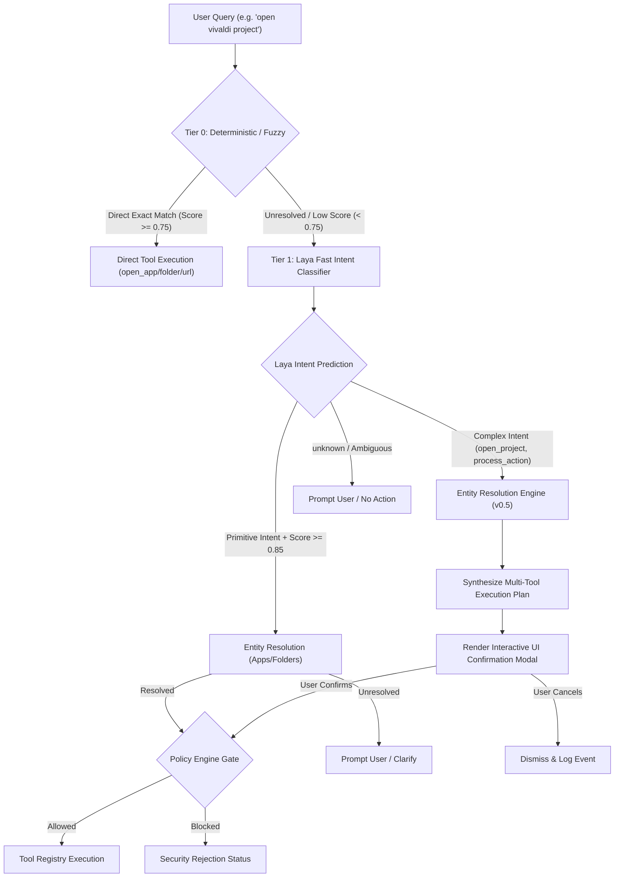

# Laya & Kev Integration Architecture Specification

> **Target Platform**: AstraRun Architecture Platform  
> **Status**: APPROVED ARCHITECTURAL SPECIFICATION  
> **Milestone**: v0.4 (Dual-Shadow Empirical Evaluation Complete)  

---

## 1. Architectural Roles & Taxonomy

AstraRun's long-term vision requires handling everything from microsecond exact keystrokes (`calc`) to complex multi-step workstation requests (`kill whatever process is using port 3000 and restart my backend`). 

No single model architecture is optimal for both extremes. In v0.4, we evaluated both **Laya** and **Kev** in strictly isolated shadow mode to determine their viability across the routing tiers:

| Tier | Component | Underlying Engine | Latency Target | Memory Footprint | Primary Responsibility | Production Authority |
| :--- | :--- | :--- | :--- | :--- | :--- | :--- |
| **Tier 0** | **Deterministic & Fuzzy Router** | `SearchIndex` + `FuzzyScorer` | **< 20 µs** (3.03ms with ranking) | ~5 MB RAM | Exact app, folder, URL, alias matches and single-drop typos | **FULL** (Immediate execution) |
| **Tier 1** | **Laya Fast Intent Classifier** | ModernBERT-large (421M params, RLCD) | **~500 ms** (ONNX CPU) | ~850 MB RAM | Zero-shot intent categorization across 10 fixed classes | **ZERO** (Shadow Mode in v0.4) |
| **Tier 2** | **Kev Decision Model** | Qwen3.5-0.8B LoRA + PointerHead | **~18,000 ms** (CPU PyTorch loop) | ~3.2 GB RAM | Single-pass pointer head choice selection | **ZERO** (Shadow Mode in v0.4) |

---

## 2. Empirical Architectural Comparison (v0.4 Findings)

During milestone v0.4, both models were benchmarked across two standardized datasets:
1. `benchmarks/routing/semantic_dataset.json` (325 queries)
2. `benchmarks/routing/semantic_holdout_v2.json` (260 blind holdout queries)

### 2.1. The CPU Latency Bottleneck
- **Laya**: Implemented on ONNX Runtime CPU. Evaluates a full 10-class intent distribution in **~508ms** per query on the Intel Core i5-12450H CPU.
- **Kev-0.8B**: Employs Qwen3.5 with Gated DeltaNet linear attention layers. Because optimized C++ kernels (`causal_conv1d` and `flash-linear-attention`) are unavailable for Windows CPU, PyTorch falls back to reference Python loops (`chunk_gated_delta_rule`). As a result, Kev requires **15,000ms – 23,000ms (~18s)** per query on the same CPU.
- **Result**: Laya demonstrates an insurmountable **~35x latency advantage** on host CPU hardware.

### 2.2. Memory & Hardware Constraints
- **Laya**: Consumes ~850MB RAM, allowing it to co-exist comfortably alongside active developer environments.
- **Kev-0.8B**: Consumes ~3.2GB RAM in FP32 on CPU.
- **Kev-4B**: Would require 8–16GB RAM, which would induce severe swap thrashing on this 16GB laptop (rejected in ADR-017).

### 2.3. Domain Specialization vs. Tool Calling
- Upstream creator Jared Palmer noted in the Kev model card: *"When2Call fell below guessing rate... Do not use this checkpoint for tool-call routing. Out of domain it is a sub-1B model."*
- Kev was trained on CFPB consumer finance complaint narratives and synthetic logic tasks, not desktop launcher intents.
- Its fitted temperature ($T \approx 2.351$) heavily scales down logits, causing conservative abstention on direct application queries (e.g., `open notepad` $\rightarrow$ `unknown`), while correctly identifying process and URL actions.

---

## 3. The Decision Cascade Flow

---

## 4. Operational Boundaries

### 4.1. Laya's Boundary Contract
1. **Non-Autoregressive Output**:
   - Laya outputs categorical choice probabilities across the 10 fixed intents (`open_app`, `open_folder`, `open_url`, `open_project`, `find_file`, `process_action`, `system_action`, `ai_query`, `browser_action`, `unknown`).
   - Laya **NEVER** outputs freeform file paths, URL strings, command-line arguments, or arbitrary shell commands.
2. **Authority Tagging**:
   - Every `LayaDecision` includes `is_executable_now` and `requires_resolution`.
   - Only primitive tool targets with verified parameters are marked `is_executable_now=True`.
3. **Shadow Mode in v0.4**:
   - Laya operates strictly under **Shadow Mode** (`"mode": "shadow"`). Its outputs are compared against Tier 0 decisions and logged to `data/laya_shadow_events.jsonl`, but never dispatched to OS handlers.

### 4.2. Kev's Boundary Contract
1. **Zero Execution Authority**:
   - Kev operates strictly under **Shadow Mode** (`"mode": "shadow"`).
   - Inferences are captured in `data/kev_shadow_events.jsonl` and never dispatched to the OS or ToolRegistry.
2. **Interactive Path Exclusion**:
   - Due to its 18-second CPU latency, Kev is excluded from interactive keystroke suggestion paths on this workstation.
   - Kev is retained for offline comparative evaluation, batch synthetic analysis, and future CUDA-accelerated experiments.

---

## 5. Security & Verification Policy

1. **Zero Raw Shell Ingestion Invariant**:
   - Neither Laya nor Kev may emit raw shell command strings (`cmd.exe /c ...`). All proposed actions must decompose into registered, typed tool invocations.
2. **Hard Policy Gatekeeping**:
   - The Policy Engine executes downstream of both models. All parameters must be verified against blocked commands, prohibited directories, and risk constraints before execution.
3. **Local Compute Guarantee**:
   - Both models run 100% locally from canonical cache (`E:\AI_Models\HF_CACHE`) without off-device data transmission.
