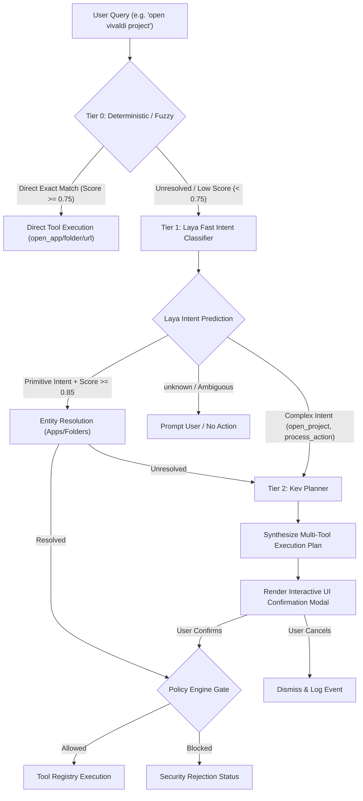

# Laya & Kev Integration Architecture Specification

> **Target Platform**: AstraRun Architecture Platform  
> **Status**: APPROVED ARCHITECTURE DRAFT  
> **Milestone Horizon**: v0.3 (Shadow) ➔ v0.4 (Entity Resolution) ➔ v0.5 (Kev Planning)  

---

## 1. Architectural Roles & Taxonomy

AstraRun's long-term vision requires handling everything from microsecond exact keystrokes (`calc`) to complex multi-step workstation requests (`kill whatever process is using port 3000 and restart my backend`). 

No single model architecture is optimal for both extremes. A three-tier cascaded architecture cleanly separates speed, intent categorization, entity resolution, and complex planning:

| Tier | Component | Underlying Engine | Latency Target | Primary Responsibility | Production Authority |
| :--- | :--- | :--- | :--- | :--- | :--- |
| **Tier 0** | **Deterministic & Fuzzy Router** | `SearchIndex` + `FuzzyScorer` | **< 20 µs** | Exact app, folder, URL, alias matches and single-drop typos | **FULL** (Immediate execution) |
| **Tier 1** | **Laya Fast Intent Classifier** | ModernBERT-large (421M params, RLCD) | **50 - 80 ms** | Zero-shot intent categorization across 10 fixed classes | **GATED** (Subject to entity resolution & policy) |
| **Tier 2** | **Kev Semantic Planner & Resolver** | Local SLM / Multi-Step Agent | **200 - 800 ms** | Disambiguation, entity extraction, multi-tool plan generation | **CONFIRMED** (Interactive user confirmation modal) |

---

## 2. The Decision Cascade Flow

---

## 3. Laya's Boundary Contract

Laya is an **intent discriminator**, not an execution planner or string generator:

1. **Non-Autoregressive Output**:
   - Laya outputs categorical choice probabilities across the 10 fixed intents (`open_app`, `open_folder`, `open_url`, `open_project`, `find_file`, `process_action`, `system_action`, `ai_query`, `browser_action`, `unknown`).
   - Laya **NEVER** outputs file paths, URL strings, command-line arguments, or arbitrary shell commands.
2. **Authority Tagging**:
   - Every `LayaDecision` includes `is_executable_now` and `requires_resolution`.
   - Only primitive tool targets with verified parameters are marked `is_executable_now=True`.
3. **Execution Prohibition in v0.3**:
   - In v0.3, Laya is constrained to **Shadow Mode** (`"mode": "shadow"`). Its outputs are compared against Tier 0 decisions and logged to `data/laya_shadow_events.jsonl`, but never dispatched to OS handlers.

---

## 4. Kev's Planned Boundary Contract

Kev will be introduced in milestone v0.5 to handle ambiguous, contextual, or multi-step intents:

1. **Contextual Memory & State**:
   - Kev receives contextual state from the workstation: active editor workspace, recently modified files, running processes, and browser tab titles.
2. **Entity Resolution Pipeline**:
   - For `open_project`: Kev scans `E:\Workspace\` and `workspace.json`, mapping semantic project names (`vivaldi project`) to absolute directory paths (`E:\Workspace\Active\vivaldi-ai`).
   - For `process_action`: Kev queries system network sockets (`netstat` / Win32 `GetExtendedTcpTable`), identifying the process holding port 3000 and presenting the exact PID and binary name to the user.
3. **Interactive Confirmation for Destructive Actions**:
   - Any plan containing actions classified as `ToolRisk.MEDIUM` or `ToolRisk.HIGH` (e.g. process termination, git branch switching) renders a structured preview widget in the AstraRun launcher with an explicit `[Execute] / [Cancel]` confirmation button.

---

## 5. Security & Verification Policy

1. **Zero Raw Shell Ingestion Invariant**:
   - Neither Laya nor Kev may emit raw shell command strings (`cmd.exe /c ...`). All proposed actions must decompose into registered, typed tool invocations.
2. **Hard Policy Gatekeeping**:
   - The Policy Engine executes downstream of both Laya and Kev. Even if Kev produces a multi-step plan, every step is individually validated against blocked commands, prohibited directories, and risk constraints before execution.
3. **Local Compute Guarantee**:
   - Both Laya (ModernBERT-large on CPU) and Kev (quantized local SLM) run 100% locally on the workstation without off-device data transmission.
