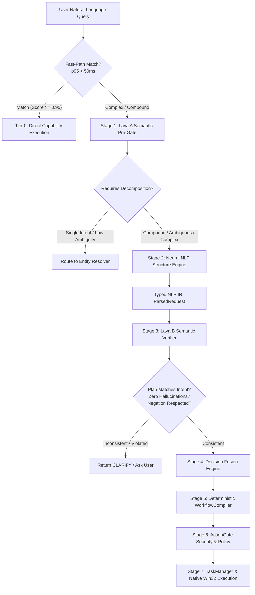

# AstraRun Laya Neural NLP Sandwich Architecture

> **Milestone**: AstraRun v0.10.3  
> **Status**: APPROVED  
> **Date**: 2026-09-28  

---

## 1. The Sandwich Concept

The Neural NLP Sandwich combines fast deterministic pattern matching, semantic classification, syntactic structure parsing, and safety verification into a unified multi-stage pipeline:

---

## 2. In-Memory Model Sharing Invariant

> [!IMPORTANT]
> **Single Model Instance Invariant**:  
> Laya A (Pre-Gate) and Laya B (Verifier) share the **exact same loaded `laya.load()` instance** in memory.
>
> Neither stage instantiates a secondary copy of the 421M ModernBERT weights. Both stages execute forward passes through the single resident agent using distinct query templates.

---

## 3. Detailed Stage Operations

### Stage 1: Laya A (Semantic Pre-Gate)
- **Inputs**: Raw query string.
- **Criteria**:
  - `domain`: `app_launch`, `window_control`, `keyboard_input`, `compound_sequence`, `system_query`, `unknown`.
  - `is_compound`: `single_action`, `multi_action`.
  - `ambiguity`: `clear`, `ambiguous`, `incomplete`.
  - `risk`: `safe`, `moderate`, `destructive`.
- **Output**: Calibrated probability vector and routing recommendation.

### Stage 2: Neural NLP Structure Engine
- **Engine**: `spaCy en_core_web_sm` syntactic span dependency extraction + linguistic heuristics.
- **Outputs**: Strictly typed `ParsedRequest` containing:
  - Sequence of `ParsedClause` objects.
  - Verbatim `LiteralPayload` preserving character offsets `[start:end]` without normalization.
  - `is_negated` flags on individual clauses.
  - Antecedent pointers for pronouns (`it` -> clause 0).

### Stage 3: Laya B (Semantic Post-Verifier)
- **Inputs**: Original raw query + compiled sequence of planned clause intents.
- **Criteria**:
  - `semantic_match`: Does the sequence of actions cover all user intentions?
  - `negation_consistency`: Are negated actions properly excluded from execution?
  - `hallucination_check`: Does the plan contain extraneous actions not requested by the user?
- **Behavior**: If divergence is detected or negation is violated, the pipeline rejects the plan or presents a `DisambiguationCard`.

### Stage 4: Decision Fusion Engine
- Combines Tier 0 deterministic confidence, Laya A domain probability, Neural IR clause structure, and Laya B verification score.
- Implements JS-divergence safety threshold: if semantic entropy > 0.45, demotes to `CLARIFY`.
