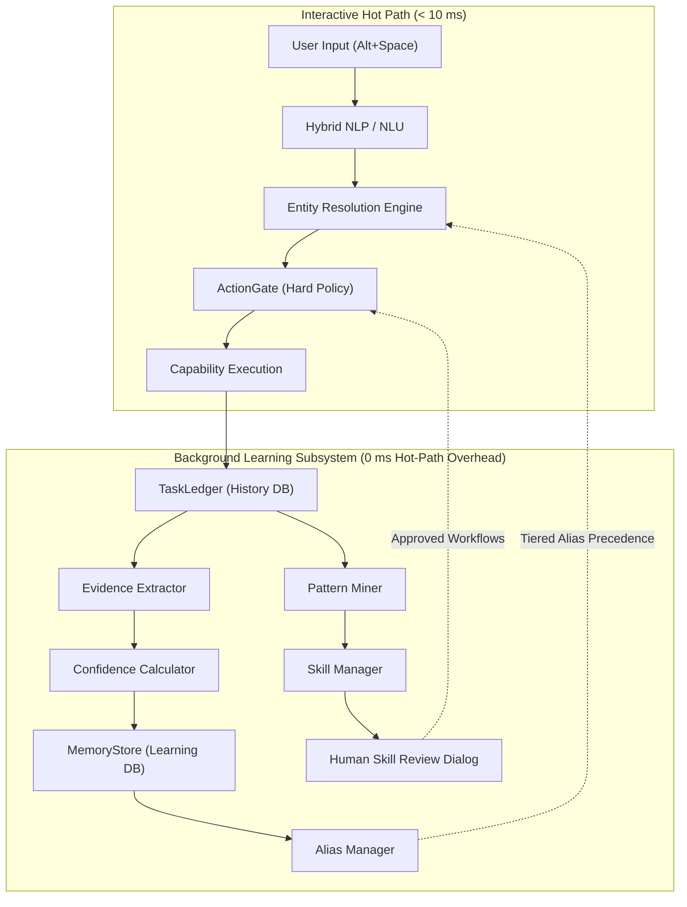

# AstraRun Learning Subsystem Architecture

> **Document**: `docs/LEARNING_ARCHITECTURE.md`  
> **Milestone**: AstraRun v0.8.5 (Memory, Learning & Skill Foundation)  
> **Status**: APPROVED ARCHITECTURE SPECIFICATION  

---

## 1. System Intent & Philosophy

Workstation environments are deeply idiosyncratic. Users possess customized alias vocabularies ("calc", "ide", "notes"), preferred desktop tooling (VS Code vs Neovim, Vivaldi vs Chrome), recurring multi-step operational patterns (opening a project then launching development servers), and unique directory hierarchies.

However, traditional LLM learning solutions pose severe workstation hazards:
- Autonomous self-modifying code or shell script generation risks irreparable filesystem destruction.
- Online prompt or weight fine-tuning risks catastrophic forgetting and prompt injection vulnerabilities.
- Unbounded memory clouds violate workstation privacy and leak credentials.

AstraRun v0.8.5 solves this by establishing a **deterministic, empirical, and strictly gated Learning Foundation**:
$$\text{Task History} \xrightarrow{\text{Evidence Extraction}} \text{Candidate Facts} \xrightarrow{\text{Confidence \& Decay}} \text{Semantic Memory} \xrightarrow{\text{Human Gating}} \text{Active Knowledge}$$

---

## 2. Core Architectural Pillars

### 2.1 Complete Hot-Path Decoupling
The user launcher experience (`Alt+Space`) has a strict sub-10ms latency budget. The Learning Subsystem runs **entirely off the hot path**:
- Ingestion occurs asynchronously via daemon threads or background idle loops.
- Memory lookups during entity resolution leverage in-memory caches backed by SQLite WAL with $O(1)$ indexed key lookups ($< 0.1\text{ ms}$).

### 2.2 Dual Database Isolation
AstraRun strictly separates historical execution telemetry from durable learned knowledge:
1. **`data/astra_history.db`**: Stores raw tasks, status transitions, timestamps, and execution events. Managed by `TaskLedger` and subject to 30-day retention pruning.
2. **`data/astra_learning.db`**: Stores durable semantic memories, user-confirmed aliases, learned preferences, mined skills, and audit trails. Retained independently of raw task history.
   - Provenance is maintained via immutable `EvidenceReference` hashes and IDs rather than duplicating large task payloads.

### 2.3 Strict Multi-Tier Precedence
Learned knowledge never ambiguously overrides explicit user instructions or static configurations. Precedence is deterministic:
1. **Explicit Entity in Query**: If the user specifies an unambiguous path or application name, it wins unconditionally.
2. **Static Config Alias**: Configurations in `config/aliases.json` take absolute precedence over learned inferences.
3. **User-Confirmed Learned Alias**: Knowledge explicitly confirmed or taught by the user ($C \ge 0.95$, `user_confirmed=True`).
4. **High-Confidence Learned Alias**: Empirically verified habits ($C \ge 0.85$, $N_{\text{pos}} \ge 3$, 0 contradictions).
5. **Fuzzy / Heuristic Matching**: Fallback lexical matching.
6. **Probabilistic Semantic Inference**: Laya ensemble decisions.

### 2.4 Non-Learnable Security Invariants
Security policies in AstraRun are **architecturally non-learnable**:
- Habitual user confirmation of a high-risk capability (such as `capability.processes.terminate`) can **never** downgrade `CONFIRM` to `AUTO`.
- No alias or memory can map to a protected system process (`lsass.exe`, `csrss.exe`, `wininit.exe`, `services.exe`).
- No memory can execute raw shell strings (`cmd.exe`, `powershell.exe`) or dangerous patterns (`format c:`, `rmdir /s`).
- The `ActionGate` evaluates every single action independently of its origin or frequency.
