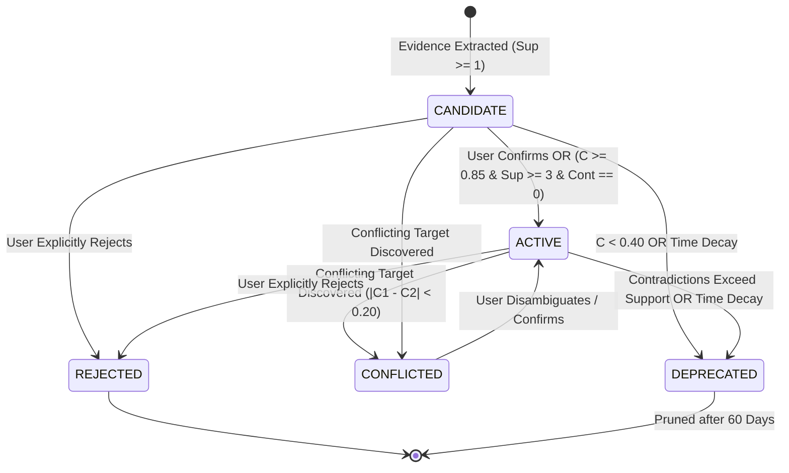

# AstraRun Semantic Memory Model

> **Document**: `docs/MEMORY_MODEL.md`  
> **Milestone**: AstraRun v0.8.5 (Memory, Learning & Skill Foundation)  
> **Status**: APPROVED DATA CONTRACT SPECIFICATION  

---

## 1. Domain Namespaces

To prevent cross-domain contamination and type confusion, semantic knowledge is strictly partitioned into five distinct `MemoryNamespace` domains:

| Namespace | Intended Scope | Example Key | Example Value | Target Type |
| :--- | :--- | :--- | :--- | :--- |
| **`ALIAS`** | Workstation shorthand names for desktop applications, projects, or folders | `"code"` | `"code.exe"` | `"application"` |
| **`PREFERENCE`** | User tool defaults for common conceptual tasks | `"editor"` | `"notepad"` | `"preference"` |
| **`WORKFLOW`** | High-level triggers mapped to compound capability routines | `"clean-build"` | `"skill_build_clean_id"` | `"workflow"` |
| **`ENTITY_ATTRIBUTE`** | Discovered or taught properties of workstation entities | `"astra_port"` | `8000` | `"port"` |
| **`TEACHING`** | Direct, verbatim natural language rules taught by the user | `"when I say test"` | `"pytest -q"` | `"teaching"` |

---

## 2. Memory Lifecycle Finite State Machine

Semantic memories transition through five formal lifecycle states:



1. **`CANDIDATE`**:
   - Initial state for newly discovered facts.
   - Requires additional positive evidence or explicit user confirmation before influencing automated resolution.
2. **`ACTIVE`**:
   - Verified workstation fact.
   - Participates in `AliasManager` and `EntityResolutionEngine`.
   - Attained via explicit user confirmation (`user_confirmed=True`) or automated empirical confidence ($C \ge 0.85$, $N_{\text{pos}} \ge 3$, $N_{\text{neg}} = 0$).
3. **`CONFLICTED`**:
   - Multiple conflicting targets exist for the same `(namespace, key)` with narrow confidence margins ($|C_1 - C_2| < 0.20$).
   - Resolution is immediately gated; triggers disambiguation (`CLARIFY`) UI.
4. **`DEPRECATED`**:
   - Confidence attenuated below 0.40 due to inactivity or contradictions.
   - Retained for historical audit; ignored during resolution.
5. **`REJECTED`**:
   - User explicitly clicked "Reject" or dismissed proposal.
   - Confidence set to 0.0; permanently suppressed from resolution.

---

## 3. Schema & Data Contracts

### 3.1 SQLite Storage Schema
Stored in `data/astra_learning.db` (`PRAGMA user_version = 1`):

```sql
CREATE TABLE semantic_memories (
    id TEXT PRIMARY KEY,
    namespace TEXT NOT NULL,
    key TEXT NOT NULL,
    value_json TEXT NOT NULL,
    target_type TEXT NOT NULL,
    status TEXT NOT NULL,
    confidence REAL NOT NULL,
    support_count INTEGER NOT NULL,
    contradiction_count INTEGER NOT NULL,
    created_at REAL NOT NULL,
    updated_at REAL NOT NULL,
    last_used_at REAL NOT NULL,
    user_confirmed INTEGER NOT NULL DEFAULT 0,
    pinned INTEGER NOT NULL DEFAULT 0,
    metadata_json TEXT NOT NULL DEFAULT '{}'
);

CREATE INDEX idx_memories_ns_key ON semantic_memories(namespace, key);
CREATE INDEX idx_memories_status ON semantic_memories(status);
```
