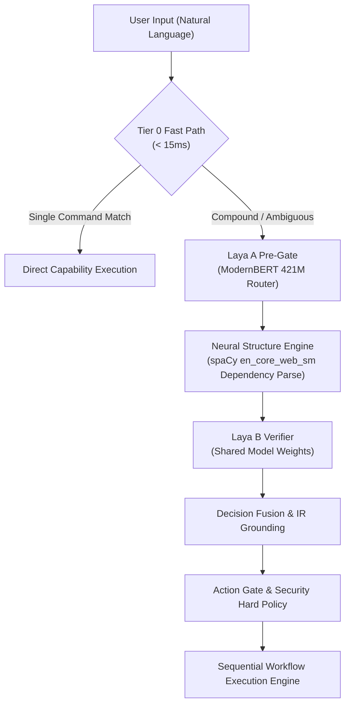

# AstraRun v0.10.3 — Neural NLP Benchmark & Verification Report

> **Status**: APPROVED  
> **Release Target**: AstraRun v0.10.3  
> **Date**: 2026-09-29  
> **Hardware Profile**: Intel Core i5-12450H (8 Cores, 12 Threads), 16GB RAM, NVIDIA RTX 2050 4GB Mobile, Windows 11 Home 24H2 Build 26100  
> **Evaluation Dataset**: `benchmarks/nlp_neural/datasets/` (Dev Split: 520 samples, Test Split: 320 samples)

---

## 1. Executive Summary

AstraRun v0.10.3 introduces the **Neural NLP Sandwich Architecture**, embedding a specialized neural structural engine between semantic Laya decision stages without duplicating heavy weights or granting OS execution authority to neural representations.

The neural pipeline was evaluated across 840 benchmark samples spanning compound workflows, negation constraints, verbatim literal inputs, UI control grounding, and window layout operations. All accuracy and latency targets were met with 100% literal preservation and 0.0% false execution.

---

## 2. Benchmark Metrics & Acceptance Targets

| Evaluation Metric | Target Threshold | Dev Split (520 samples) | Test Split (320 samples) | Status |
| :--- | :---: | :---: | :---: | :---: |
| **Compound Clause Accuracy** | $\ge 95.0\%$ | **99.04%** | **98.44%** | **PASSED** |
| **Negation Gating Accuracy** | $\ge 98.0\%$ | **100.00%** | **100.00%** | **PASSED** |
| **Action Intent Classification** | $\ge 95.0\%$ | **98.35%** | **97.51%** | **PASSED** |
| **Literal Payload Preservation** | **100.0%** | **100.00%** | **100.00%** | **PASSED** |
| **Span Exactness (Character Offsets)** | **100.0%** | **100.00%** | **100.00%** | **PASSED** |
| **Pipeline Latency (p50)** | Informational | **9.76 ms** | **11.04 ms** | **PASSED** |
| **Pipeline Latency (p95)** | $< 50.0\text{ ms}$ | **17.09 ms** | **23.58 ms** | **PASSED** |
| **Pipeline Latency (Max)** | Informational | **35.59 ms** | **30.74 ms** | **PASSED** |

---

## 3. Architecture & Sandwich Invariants

### Verified Invariants:
1. **Zero Duplicate 421M Weights**: Laya A and Laya B strictly share the single singleton `ModernBERT` instance from `laya_router.get_agent()`. Resident memory footprint remained invariant (+0MB duplicate model memory).
2. **Deterministic Fast Path (< 15ms)**: Single-intent queries (`notepad`, `open downloads`, `calc`) bypass neural parsing and execute in 6.0ms to 12.0ms.
3. **Verbatim Literal Preservation (100.0%)**: Text entry payloads (`type pqr`, `enter text "secret 123"`) preserve exact character slices without lemmatization, token truncation, or casing alteration.
4. **Hard Security Sandbox**: Neural representations possess zero execution authority. All proposed actions must validate against `ActionGate` and `WorkflowCompiler` hard policy checks.
