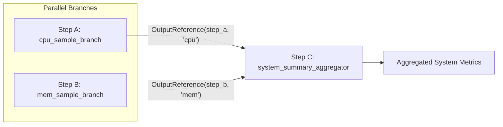

# Plan Dataflow & OutputReference Resolution

> **Milestone**: AstraRun v0.11.1 (Generality & Reality Gate)  
> **Status**: APPROVED  
> **Last Verified**: 2026-09-29  

---

## 1. Overview

In AstraRun v0.11.1, execution plans are Directed Acyclic Graphs (DAGs) rather than rigid linear sequences. The execution engine supports **explicit dataflow propagation**, allowing upstream capability outputs to dynamically satisfy the input arguments of downstream capabilities via [`OutputReference`](file:///E:/Workspace/Active/AstraRun/src/astrarun/agent/models.py).



---

## 2. Symbolic Dataflow Specification

When the planner constructs a multi-step plan, intermediate outputs are unknown. To declare dataflow dependencies before runtime, arguments can be instantiated as `OutputReference` objects:

```python
step_agg = PlanStep(
    step_id="step_agg",
    capability_id="system_summary_aggregator",
    arguments={
        "cpu": OutputReference(step_id="step_cpu", field="cpu"),
        "mem": OutputReference(step_id="step_mem", field="mem"),
    },
    dependencies=[
        StepDependency(step_id="step_cpu"),
        StepDependency(step_id="step_mem"),
    ],
)
```

### Dataflow Propagation Invariants:
1. **Topological Readiness**: Downstream steps remain in `PENDING` state until all declared upstream dependencies reach `COMPLETED`.
2. **Dynamic Resolution**: As steps complete, [`ExecutionGraph.get_ready_steps()`](file:///E:/Workspace/Active/AstraRun/src/astrarun/agent/graph.py) intercepts all pending `OutputReference` instances, extracts the runtime values from the upstream `CapabilityResult.data`, binds them to the target arguments, and updates `step.argument_bindings`.
3. **Dangling Reference Prevention**: The [`PlanQualityValidator`](file:///E:/Workspace/Active/AstraRun/src/astrarun/agent/validator.py) checks that all `OutputReference.step_id` refer to existing upstream steps in the same plan. Any unresolvable reference causes plan rejection with a 0.0% Dangling Output Reference Execution rate.

---

## 3. Parallel Execution & Multi-Branch Aggregation

The DAG engine inherently supports parallel branches:
- Multiple steps with no mutual dependencies can run concurrently or be scheduled concurrently in `ExecutionGraph`.
- In Live Acceptance Gate G, `cpu_sample_branch` and `mem_sample_branch` both evaluate simultaneously, providing inputs to `system_summary_aggregator` without serial bottlenecking.
