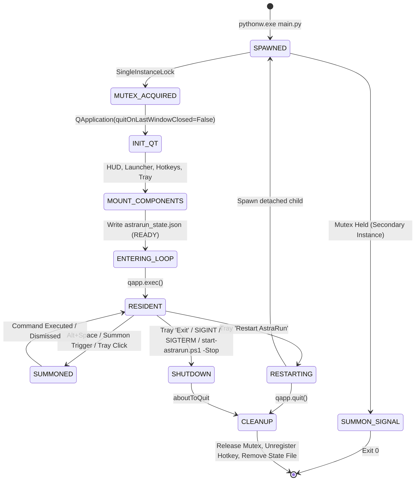

# AstraRun Process Lifecycle & State Machine

> **Milestone**: AstraRun v0.10.3  
> **Status**: ACTIVE & VERIFIED  

---

## 1. Process Lifecycle Phases



---

## 2. Startup Verification Stages

During application initialization in `src/astrarun/main.py`, explicit stage logs and state file attributes track health:

| Stage Tag | Operation | Failure Handling |
| :--- | :--- | :--- |
| `STARTUP_BEGIN` | Process entry point invoked with PID and version | Fatal if Python environment invalid |
| `SINGLE_INSTANCE_ACQUIRED` | Acquired `AstraRun_SingleInstance_Mutex` | If mutex held, calls `summon_existing_instance()` and exits 0 |
| `QT_APPLICATION_CREATED` | PySide6 `QApplication` created with `quitOnLastWindowClosed=False` | Fatal if GUI subsystem unavailable |
| `HUD_CREATED` | Floating Task HUD and `TaskHUDController` instantiated | Retained in composition root |
| `LAUNCHER_CREATED` | Top-center command bar created with `FramelessWindowHint` | HWND registered with window policy |
| `HOTKEY_MANAGER_CREATED` | Global hotkey thread created for `Alt+Space` | Bound to `LauncherPresentationController` |
| `TRAY_CREATED` | System tray icon mounted with context menu | Menu includes Restart, Exit, Diagnostics |
| `HOTKEY_REGISTERED` | Win32 `RegisterHotKey` executed on dedicated message pump thread | Retried on failure; user notified |
| `EVENT_LOOP_ENTERING` | `data/astrarun_state.json` written with `status="READY"` | Signifies operational readiness |

---

## 3. Runtime Invariants

1. **Window Persistence**:
   - `QApplication.setQuitOnLastWindowClosed(False)` ensures that closing or hiding the launcher command bar never terminates the background process.
2. **Signal Resilience**:
   - Python signal handlers for `SIGINT` and `SIGTERM` are connected to `qapp.quit()`.
   - A 500ms `QTimer` heartbeat runs on the main thread so Python's signal handler loop is periodically serviced even inside the native Windows event pump.
3. **Shutdown Cleanliness**:
   - `qapp.aboutToQuit` invokes `cleanup()`:
     1. Writes `status="STOPPED"` to state file.
     2. Stops the Win32 hotkey thread (`PostThreadMessage(WM_QUIT)`).
     3. Stops HUD controllers and hides widgets.
     4. Unregisters window HWNDs.
     5. Releases the named Win32 mutex.
     6. Unlinks `data/astrarun_state.json`.

---

## 4. Verification Procedures

To verify process lifecycle compliance:
```powershell
# 1. Start fresh resident instance
.\start-astrarun.ps1 -Restart

# 2. Check status
.\start-astrarun.ps1 -Status

# 3. Verify zero persistent consoles
Get-CimInstance Win32_Process -Filter "Name LIKE '%conhost%' OR Name LIKE '%powershell%' OR Name LIKE '%cmd%'" | Where-Object { $_.CommandLine -like "*AstraRun*" }

# 4. Summon existing instance
.\start-astrarun.ps1

# 5. Clean shutdown
.\start-astrarun.ps1 -Stop
```
All commands produce verified, deterministic lifecycle transitions.
