# AstraRun Evolution Roadmap

> **Status**: APPROVED  
> **Horizon**: v0.1 -> Workstation Control Platform  
> **Note on Terminology**: Early roadmap drafts referred to "AI Bridge" as if it were an internal AstraRun reasoning subsystem. This has been corrected: the user has an independent platform project named `AI-Bridge`. AstraRun refers to external reasoning interfaces generically as **Reasoning Providers** or **Reasoning Gateways**. External integrations (including any optional future integration with AI-Bridge, local LLMs, or cloud models) are strictly decoupled and deferred to v0.12.

---

## Stage Progression

```mermaid
flowchart LR
    v1["v0.1: Deterministic Core"] --> v2["v0.2: Discovery & Fuzzy Match"]
    v2 --> v3["v0.3: Laya Fast Classifier"]
    v3 --> v4["v0.4: Kev Semantic Router"]
    v4 --> v5["v0.5: Laya Ensemble & Adaptation"]
    v5 --> v6["v0.6: Actions & Context Engine"]
    v6 --> v65["v0.6.5: Hybrid NLP Engine"]
    v65 --> v7["v0.7: Workstation Capabilities"]
    v7 --> v8["v0.8: Task Runtime & History"]
    v8 --> v85["v0.8.5: Memory, Learning & Skills"]
    v85 --> v9["v0.9: Window Management"]
    v9 --> v10["v0.10: Application Interaction"]
    v10 --> v11["v0.11: Daemon & Rich Context"]
    v11 --> v12["v0.12: Optional Reasoning Providers"]
    v12 --> vFinal["v1.0: AI Workstation Control Plane"]
```

---

### v0.1 — Deterministic Launcher (Complete)
- Native PySide6 frameless window centered on active display.
- Global `Alt+Space` hotkey backed by non-blocking Win32 `RegisterHotKey`.
- Deterministic router with prefix & verb normalization (`open`, `launch`, `start`, `show`, `go to`).
- Dynamic Windows User Shell Folders discovery (Downloads, Documents, Desktop, Pictures, Videos, Workspace).
- Application discovery from App Paths registry and PATH (Notepad, Calculator, VS Code, Vivaldi, Terminal, PowerShell, CMD).
- Configurable URL aliases (`github`, `youtube`, `google`).
- Strict typed tool registry with zero raw shell execution.
- Human-editable JSON configurations and rotating structured file logs.

---

### v0.2 — Discovery & Fuzzy Matching (Complete — 2026-09-27)
- Multi-signal fuzzy matching engine (exact, prefix, word-token, acronym, single-drop typo, subsequence, edit-distance, bounded usage boost).
- Precomputed candidate terms (`PrecomputedTerm`) delivering 3.03ms mean search latency across ~400+ candidates.
- Interactive ranked suggestions list with visual category badges (`APP`, `FOLDER`, `WEB`, `COMMAND`).
- Keyboard navigation: `Up`/`Down` selection, `Tab` input completion, and `Enter` execution.
- Strict auto-execution confidence threshold (`0.75`), resulting in an empirical **0.0% False Execution Rate**.
- Foreground-window-aware monitor placement via Win32 `GetForegroundWindow` / `MonitorFromWindow`.
- Expanded Windows application discovery: User & System Start Menu shortcuts, App Paths, PATH (~400 apps cached).
- Local-only privacy-preserving telemetry (`data/routing_events.jsonl`) with defensive credential redaction.
- Standardized 88-query evaluation benchmark suite (`benchmarks/routing/run_benchmark.py`).

---

### v0.3 — Laya Shadow Router & Semantic Decision Benchmark (Complete — 2026-09-27)
- Integration of **Laya** (`convaiinnovations/laya`, 421M parameter ModernBERT-large) on CPU with zero VRAM overhead.
- Strict **Shadow Mode** isolation: Laya evaluates input in real-time or asynchronously on daemon threads with **ZERO production execution authority**.
- 10-class mutual exclusive Intent Taxonomy (`open_app`, `open_folder`, `open_url`, `open_project`, `find_file`, `process_action`, `system_action`, `ai_query`, `browser_action`, `unknown`).
- Execution authority separation: only primitive tools (`open_app`, `open_folder`, `open_url`) map to `is_executable_now=True`; all complex intents map to `requires_resolution=True`.
- Dual-track privacy-preserving shadow event telemetry in `data/laya_shadow_events.jsonl` with regex credential redaction.
- Canonical AI model storage adhering to Platform Rule 9 (`E:\AI_Models\HF_CACHE`).
- Comprehensive 325-query semantic evaluation benchmark suite across 15 categories (`benchmarks/routing/run_semantic_benchmark.py`).
- Full empirical calibration analysis (ECE = 0.0443, Brier score = 0.7450) and automation trade-off curve documented in `docs/LAYA_BENCHMARK.md` and `docs/LAYA_CALIBRATION.md`.
- Formal architectural decision records ADR-010 through ADR-014.

---

### v0.4 — Kev Shadow Router & Laya-vs-Kev Decision Model Evaluation (Complete — 2026-09-27)
- Integration of **Kev** (`jaredpalmer/kev-0.8b`, PEFT LoRA adapter on `Qwen/Qwen3.5-0.8B-Base` backbone with 256-dim dot-product `PointerHead` and temperature $T \approx 2.351$) on CPU in canonical cache (`E:\AI_Models\HF_CACHE`).
- Strict **Shadow Mode** isolation: Kev operates under **ZERO production execution authority** (0.0% False Execution Rate).
- Blind holdout evaluation dataset (`benchmarks/routing/semantic_holdout_v2.json`, 260 curated queries across 15 categories, 75 unknown queries, SHA256 verified).
- Multi-model shadow event telemetry (`data/kev_shadow_events.jsonl` and `data/laya_shadow_events.jsonl`) with regex credential redaction.
- Unified comparative benchmark harness (`benchmarks/routing/run_comparative_benchmark.py`) evaluating Deterministic vs. Laya vs. Kev vs. Cascades across both datasets.
- Critical architectural and empirical findings:
  - **Latency**: Laya (~500ms on ONNX CPU) exhibits a **~35x latency advantage** over Kev (~18,000ms on CPU reference loops lacking `flash-linear-attention`).
  - **Memory Footprint**: Laya requires ~850MB RAM vs. Kev-0.8B ~3.2GB RAM. Kev-4B was formally rejected due to host memory limits (ADR-017).
  - **Domain Alignment**: Kev was trained on CFPB consumer finance narratives and logic puzzles; without fine-tuning, its high temperature causes heavy abstention on launcher commands, whereas Laya demonstrates higher intent recall.
  - **Conclusion**: Laya remains the superior baseline model for AstraRun on this workstation architecture.
- 9 dedicated unit and safety tests in `tests/test_kev_router.py`, expanding the automated test suite to **61 passing tests**.
- Formal decision records ADR-015 through ADR-020.

---

### v0.5 — Laya Ensemble, Domain Adaptation, Entity Resolution & Jev Reference (Complete — 2026-09-27)
- Parameter-efficient domain adaptation of Laya (`convaiinnovations/laya`, ModernBERT-large) on 250 curated workstation commands with frozen 394.8M parameter encoder and fine-tuned 26.5M parameter decision head.
- Saved canonical domain-adapted model to `E:\AI_Models\AstraRun-Laya` with zero version control contamination.
- Dramatic accuracy and calibration gains: intent accuracy +7.20% (to 44.0%), consequence risk accuracy +43.20% (to 78.4%).
- Multi-question System One decomposition: simultaneously evaluates intent, ambiguity, and risk in a single shared forward pass.
- Decision Fusion Engine (`src/astrarun/routing/fusion.py`) supporting ensemble modes E0 through E5 with active Jensen-Shannon divergence gating ($D_{\text{JS}} \le 0.25$) and Shannon entropy measurement.
- Deterministic Entity Resolution Engine (`src/astrarun/routing/entity_resolver.py`): binds semantic intents to concrete targets (`workspace.json` projects, Start Menu apps, File Explorer folders, ports, processes) with explicit disambiguation logic and candidate matches for ambiguous requests.
- Hard policy operating system boundaries: protected system processes (`system`, `registry`, `lsass`, `csrss`, etc.), privileged system ports ($\le 1023$), and destructive command pattern interception.
- External reference judge adapter (`src/astrarun/routing/jev.py`) for TypeSafe Jev System One with strict telemetry quarantine and zero execution authority.
- Comprehensive 10-configuration benchmark suite (`benchmarks/routing/run_v05_benchmark.py`) evaluated across validation holdout (N=125) and locked test set v3 (N=400, 30% unknown rate).
- Production safe cascade B9 achieves **100.0% SFAR** and **0.0% False Execution Rate**.
- Automated test suite expanded to **79 passing tests** with 18 dedicated v0.5 ensemble and safety tests.
- Formal architectural decision records ADR-021 through ADR-026.

---

### v0.6 — Gated Workstation Actions, Context Engine & Workflow Orchestration (Complete — 2026-09-27)
- **Action Gate Multi-Tier Safety Layer**: Evaluates every proposed action across Tier 0 (Hard Policy), Tier 1 (Ambiguity & Disagreement), Tier 2 (Tool Registry Validation), and Tier 3 (Confirmation vs. Direct Allowance).
- **Workstation Context Engine**: Captures lightweight local machine state (foreground window, title, PID via Win32 ctypes, and dev listening ports via psutil). Tracks project recency (24h TTL) and ephemeral process/port references (300s TTL). Bounded storage (30 items, 48h retention) with zero surveillance (no keystroke logging, no screenshots). Rejects adversarial context injection.
- **TOCTOU Process Protection**: Cryptographic confirmation tokens (`secrets.token_hex(16)`) binding target PID, kernel `create_time`, and process name. Revalidation immediately prior to execution prevents PID recycling race conditions and argument tampering.
- **Project Registry**: Strictly read-only catalog over `E:\Workspace\workspace.json` (28 cataloged projects) with dynamic workspace discovery fallback and multi-tier fuzzy matching.
- **Workflow Engine**: Structured execution of typed multi-step workflows (`open_project`, `open_project_in_vscode`, `inspect_dev_port`) with fail-fast partial failure handling and immutable audit logging in `data/workflow_audit.jsonl`.
- **Confirmation & Disambiguation UI Cards**: Keyboard-safe PySide6 cards where single `Enter` is suppressed on HIGH risk (requires `Ctrl+Enter` or click), `Esc` cancels, and Up/Down arrows navigate ambiguous entity matches.
- **Reasoning Provider Boundary**: Clean `ReasoningProvider` interface connecting AstraRun to external reasoning models with zero direct cloud API calls inside AstraRun.
- **Action Benchmark V1 (330 queries)**: Achieved 100.0% Intent Accuracy, 100.0% Gate Accuracy, 100.0% Tool Accuracy, 0.00% False Execution Rate, 100.0% Block Recall, 100.0% Confirmation Recall, and 0.077 ms mean latency.
- **97 Passing Automated Tests**: 79 baseline regression tests + 18 v0.6 tests passing cleanly in ~8.5s.
- Formal architectural decision records ADR-027 through ADR-032.

---

### v0.6.5 — Hybrid NLP Understanding Engine (Complete — 2026-09-27)
- **Multi-Layer Hybrid NLU Architecture**: Blends deterministic extractors (< 0.05 ms), clause decomposition & ordering grammar (< 0.08 ms), workstation local-time temporal engine (< 0.04 ms), and optional spaCy linguistic tagging (7.16 ms) with zero execution authority.
- **Typed Intermediate Representation (`StructuredUtterance`)**: Decomposes natural language requests into structured `Clause` objects, typed `NLPEntity` spans (13 types), directed `Relation`s, `TemporalExpression` bounds, `ContextualReference` tokens, and `Constraint` modifiers.
- **Deterministic Evidence Precedence**: Immutable conflict resolution hierarchy ($Deterministic > Catalog > Statistical > Probabilistic$). No silent resolution; unresolvable conflicts emit `CLARIFY`.
- **Absolute Negation Safety**: Scopes negative polarity per clause. `verify_negation_safety()` strictly forbids any proposal step from originating from a negated clause (**0.00% Negated Action Leakage Rate**).
- **Workstation Local Timezone Resolution**: Evaluates `yesterday`, `today`, `last night`, `recent`, and `most recent` in local time (`datetime.now().astimezone()`), avoiding UTC day-boundary drift.
- **Syntactic Coreference Grounding**: Isolates pronoun recognition in NLP (`it`, `that`, `that process`), delegating final state binding to `WorkstationContextEngine` with mandatory disambiguation upon multiple candidates.
- **Safe Workflow Compiler**: Compiles `StructuredUtterance` into `WorkflowProposal`. Conservative multi-clause policy: any blocked clause immediately blocks the entire request (`status="BLOCKED"`). Distinguishes `PARTIALLY_SUPPORTED` requests with itemized capability reporting.
- **Developer Debugger CLI**: `python -m astrarun.nlp.debugger "<utterance>"` providing real-time parse tree, entity span, relation, and workflow preview inspection.
- **Reasoning Provider Escalation (`ReasoningRequired`)**: Emits structured handoff envelopes for complex context restoration, open-ended diagnostic reasoning, and high-ambiguity requests without invoking LLMs.
- **NLP Benchmark V1 (620 queries)**: 100.0% Intent Accuracy, 95.2% Clause Segmentation Acc, 100.0% Multi-Action Match, 100.0% Negation Acc, 0.00% Negated Action Leakage Rate, 100.0% Block Recall, and 0.394 ms mean latency (rules) / 7.157 ms (spaCy hybrid).
- **126 Passing Automated Tests**: 97 baseline tests + 29 dedicated v0.6.5 NLP tests passing cleanly in ~6.4s.
- Formal architectural decision records ADR-033 through ADR-039.

---

### v0.7 — Workstation Capability Expansion (Complete — 2026-09-27)
- Expand deterministic, typed, policy-controlled OS capabilities across Applications, Files, Processes, Network, System, and Projects.
- **Capability Registry**: Evolved typed abstraction with risk metadata, read-only flags, confirmation requirements, context effects, and unified `CapabilityResult`.
- **Read-Only First Principle**: Focus on discover, inspect, and query before modify or terminate.
- **Application Capabilities**: Running app enumeration, graceful window close (`WM_CLOSE`), safe single-window focus with disambiguation on multiple windows.
- **Bounded File Discovery**: Metadata-only index over user roots (`Workspace`, `Downloads`, `Documents`, `Desktop`, `Pictures`). Screenshot discovery, document & source code search, recent/latest modifiers. Generic file opening blocks executable scripts (`.exe`, `.bat`, `.ps1`). Reparse point / junction traversal protection.
- **Process & Network Capabilities**: Extended resource metrics (CPU%, RSS, threads, start time), process sorting, parent/child relationships, listening port discovery, sanitized command line privacy.
- **System & Audio Status**: Structured CPU/RAM/disk metrics, graceful GPU & battery fallback, safe audio volume inspection foundation.
- **Window Discovery Foundation**: Read-only enumeration (`WindowEntity`) preparing for v0.9 window management.
- **ResultCard UI**: Compact informational presentation mode with keyboard dismissal and safe action buttons.
- **Observation Model**: Structured OS observations stored in-memory for future reasoning handoffs.
- **Zero Raw Shell & Zero Reasoning Invocation**: All operations are typed adapters; no external reasoning calls.
- **Capability Benchmark V1 (520 cases)**: 100.0% Capability Acc, 100.0% Permission Acc, 100.0% Block Recall, 0.561 ms latency.
- **169 Passing Automated Tests**.

---

### v0.8 — Task Runtime, Activity Timeline & Conversation History (Complete — 2026-09-27)
- **Task Runtime & Lifecycle Authority**: Centrally governed by `TaskManager` across a formal 14-state directed Finite State Machine (`TaskStatus`).
- **Cooperative Cancellation**: Graceful abort mechanism governed by `CancellationToken` checkpoints.
- **Observable Event Bus**: High-performance in-memory event broker (`TaskEventBus`) supporting 31 strongly-typed observable events (`TaskEventType`). Strict observation-only invariant (Rule #59).
- **Persistent SQLite Task Ledger**: Production SQLite engine (`data/astra_history.db`) in Write-Ahead Logging (WAL) mode supporting 99,000+ rows/sec ingestion, startup crash recovery (`INTERRUPTED` states), and automatic corruption repair.
- **Conversation & Message History**: Multi-turn dialogue threading (`Conversation`) and chronological audit messaging (`ConversationMessage`).
- **Dedicated History & Audit UI**: Split-view `HistoryView` featuring instant substring search across past requests, quick date/status filter chips, timeline inspection, and safe semantic re-runs.
- **Semantic Re-Run Safety Invariant**: Historical re-runs strictly spawn a brand-new task using the original semantic request text, re-evaluating against real-time workstation state with zero stale argument replay.
- **Privacy & Redaction Controls**: Automatic regex redaction of API keys, tokens, and passwords; SHA-256 request hashing; and bounded capability payloads.
- **Task Benchmark V1 (300 cases)**: 100.0% Status Accuracy, 100.0% Sequence Accuracy, 100.0% Persistence Accuracy.
- **197 Passing Automated Tests**.

---

### v0.8.5 — Memory, Learning & Skill Foundation (Complete — 2026-09-27)
- **Zero Neural / Learned Execution Authority**: Learning never grants direct computer control. Pipeline remains strictly gated: `Learned Memory -> NLP / Entity Resolution -> Proposed Action -> ActionGate -> Hard Policy -> CapabilityRegistry -> OS`.
- **Non-Learnable Security Policies**: High-risk capability confirmation requirements, ActionGate safeguards, protected system processes (`lsass.exe`, `csrss.exe`), and dangerous shell commands can **NEVER** be weakened or bypassed by learning.
- **Dual-Database Architecture**: Physical separation between ephemeral execution tracking (`data/astra_history.db`, 30-day retention) and durable workstation knowledge (`data/astra_learning.db`, WAL mode, `PRAGMA user_version = 1`, append-only audit trail).
- **Mathematical Confidence Engine**: Combines positive evidence weights, asymmetric contradiction penalties, asymptotic support saturation, 70-day exponential time decay, and pinned fact guarantees ($\ge 0.95$).
- **Evidence Extraction & Teaching Parser**: Parses natural language instructions (*"remember that foo is bar"*, *"always use code for editing"*) and detects user corrections across a 120-second temporal sliding window.
- **Multi-Tier Alias Precedence**: Deterministic resolution order: `Static Config > Conflicted Gating > User-Confirmed Learned > High-Confidence Habit > Fuzzy Fallback`. Conflicting candidates automatically yield safe disambiguation.
- **Declarative Pattern Mining & Skill Synthesis**: Discovers recurring capability n-grams ($L \in [2, 5]$, support $\ge 3$) from task history, parameterizes variable tokens (`{target_project}`), and enforces maximum step risk inheritance.
- **Memory Inspector & Skill Review UI**: PySide6 split-view inspector (`MemoryView`) with full provenance audit and candidate skill review dialog (`SkillReviewWidget`) requiring explicit human approval prior to activation.
- **Offline Training Dataset Exporter**: Offline dataset generator (`dataset_builder.py`) sanitizing queries with regex credential redaction and platform path normalization, gated behind `allow_training_dataset_export: true`.
- **Learning Benchmark V1 (320 cases)**: 100.0% Accuracy, 0.00% False Memory Activation Rate, 100.0% Security Invariant Enforcement Rate, 25.28 ms mean latency.
- **215 Passing Automated Tests**: 197 baseline tests + 18 dedicated v0.8.5 learning and safety tests passing cleanly.
- Formal architectural decision records ADR-056 through ADR-065.

---

### v0.9 — Daily Driver Integration & Window Intelligence (Complete — 2026-09-27)
- **Native Win32 Window Intelligence Subsystem**: 12 new capabilities expanding the platform to 59 typed workstation capabilities across 9 categories with zero external GUI automation dependencies.
- **The Origin Window Invariant**: Pre-focus capture of foreground `HWND` on `Alt+Space`, grounding implicit actions (`snap left`, `maximize window`) and deictic pronouns (`this window`, `it`) with automatic focus restoration.
- **Self-Targeting Window Immunity**: `_ASTRARUN_HWNDS` registry unconditionally prevents AstraRun from modifying, snapping, or closing its own resident windows.
- **Deterministic Desktop Tiling Mathematics**: 11 layout algorithms (`FULL`, `LEFT_HALF`, `RIGHT_HALF`, `TOP_HALF`, `BOTTOM_HALF`, `TOP_LEFT`, `TOP_RIGHT`, `BOTTOM_LEFT`, `BOTTOM_RIGHT`, `LEFT_TWO_THIRDS`, `RIGHT_ONE_THIRD`) and atomic multi-window arrangement (`arrange_desktop`).
- **Bounded LIFO Window Restore Stack**: Thread-safe undo history (depth 20, 600s TTL) enabling instantaneous 1-click or voice `undo` in 0.06 ms.
- **Multi-Monitor Geometry & DPI Awareness**: Multi-monitor enumeration via `EnumDisplayMonitors` with Per-Monitor DPI v2 awareness and work area boundary compliance.
- **Canonical Composition Root (`AstraApplication`)**: Single pipeline unifying all 14 platform subsystems, enforcing direct navigation, sub-3ms fast-path launcher routing (0.47 ms measured), rich NLP, ActionGate safety, and background learning.
- **Ambient Resident UI & System Tray**: Windows named mutex single-instance lock (`Local\AstraRun_SingleInstance_Mutex`), programmatically rendered high-DPI Catppuccin Mocha tray icon, interactive Diagnostics Dialog, and Settings Dialog.
- **Window Benchmark V1 (330 cases)**: 100.0% Accuracy, 0.00% Wrong Window Action Rate, 0 policy violations, 0.0229 ms mean latency.
- **Product Benchmark V1 (220 cases)**: 100.0% Accuracy, 0.00% False Execution Rate, 0.4699 ms fast-path routing latency (< 3ms invariant verified).
- **252 Passing Automated Tests**: 215 prior tests + 37 dedicated daily driver and window tests passing cleanly.
- Formal architectural decision records ADR-066 through ADR-075.

---

### v0.9.5 — Browser + File Intelligence
- Deep browser integration (Vivaldi tabs, Chromium devtools protocol, active tab URL inspection).
- Deeper file content indexing, document structure extraction, and code search without heavy embeddings.

---

### v0.10 — Application Interaction & Control Grounding (Complete — 2026-09-28)
- **Semantic UI Automation Subsystem (`astrarun.interaction`)**: 11 new workstation capabilities expanding the platform to **70 typed capabilities across 10 categories**.
- **COM MTA Worker Architecture**: Dedicated `UIAutomationWorker` thread isolating COM UI Automation calls (`comtypes`) from the PySide6 main event loop, preventing UI deadlocks during deep accessibility tree traversals.
- **Pattern-Driven Control Mutation**: Enforces $\text{UIA Patterns} > \text{Win32 Control Messages} > \text{SendInput Shortcuts} > \text{Coordinate Clicks (PERMANENTLY PROHIBITED)}$. Support for `InvokePattern`, `ValuePattern`, `TogglePattern`, `SelectionItemPattern`, `ScrollPattern`, and `ExpandCollapsePattern`.
- **Bounded Element Traversal**: Tree depth bounding, max elements capping, and timeouts preventing traversal freezes on complex web or electron application trees.
- **Robust Multi-Stage Element Resolver**: `AutomationId exact > Name exact > ControlType + Name > word boundary > synonym > fuzzy` with interactive control boosts (+0.04) and ambiguity clarification cards (`CLARIFY`).
- **Safe 64-bit SendInput & Clipboard Memory ABI**: Full 40-byte union alignment (`sizeof(INPUT) == 40`) for reliable Unicode typing and shortcut dispatch (`Ctrl+C`, `Ctrl+V`, `Alt+F4`, etc.). Safe 64-bit memory handles for clipboard copying.
- **Text Payload as Data Invariant**: Inputs such as `type "format c:" into notepad` are treated purely as literal data payloads, strictly shielded from shell evaluation.
- **Password Masking & Privacy Invariant**: Password fields (`is_password=True`) are completely masked at discovery and logging layers, preventing credential leakage in SQLite Task Ledger, telemetry, or activity timelines.
- **Destructive Button Gating**: Destructive actions (`delete`, `remove`, `format`, `drop`, `wipe`, `purge`, `reset`, `buy`, `terminate`) are caught upfront and gated behind `ActionGate` user confirmation prompts.
- **Interaction Benchmark V1 (405 cases)**: 100.0% Accuracy, 0.00% WEAR (Wrong Element Action Rate), 0 password leaks, 100.0% destructive block recall, 100.0% ambiguity recall, 0.0621 ms mean latency.
- **Product Benchmark V2 (280 cases)**: 100.0% Accuracy, 0.00% False Execution Rate, 0 safety violations, 0.5983 ms fast-path routing latency (< 3ms invariant verified).
- **293 Passing Automated Tests**: 252 prior tests + 41 dedicated interaction and control grounding tests passing cleanly in 30.76s.
- **Live Acceptance Suite (25 / 25 Passed)**: 100.0% pass rate across `SIMULATED`, `LIVE_FIXTURE`, and `LIVE_WORKSTATION` tests (`docs/V0.10_LIVE_ACCEPTANCE.md`).
- **30-Minute Resident Dogfooding**: Zero hotkey drops, zero crashes, 0.0% idle CPU, resident RAM plateaued at ~69.2 MB (`docs/V0.10_DOGFOOD.md`).
- Formal architectural decision records ADR-076 through ADR-078.

---

### v0.11 — Workstation Daemon / Rich Context
- Resident system tray daemon with background event monitoring, context synthesis, proactive alerts, and dev port recovery.

---

### v0.12 — Optional Reasoning Providers
- Connect `ReasoningProvider` interface to optional external reasoning gateways (e.g. independent `AI-Bridge` service, local LLM, cloud provider).
- Consume structured `Observation` envelopes to diagnose crashes and formulate complex multi-step plans.
- Deep reasoning remains strictly non-authoritative: output re-enters `EntityResolver` -> `ActionGate` -> `CapabilityRegistry`.

---

### v1.0 — AI Workstation Control Plane
- Unified workstation control plane combining fast deterministic capabilities, rich local context, and deep reasoning assistance.
