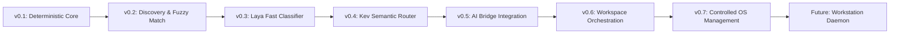

# AstraRun Evolution Roadmap

> **Status**: APPROVED  
> **Horizon**: v0.1 -> Workstation Control Platform  

---

## Stage Progression

---

### v0.1 — Deterministic Launcher (Complete)
- Native PySide6 frameless window centered on active display.
- Global `Alt+Space` hotkey backed by non-blocking Win32 `RegisterHotKey`.
- Deterministic router with prefix & verb normalization (`open`, `launch`, `start`, `show`, `go to`).
- Dynamic Windows User Shell Folders discovery (Downloads, Documents, Desktop, Pictures, Videos, Workspace).
- Application discovery from App Paths registry and PATH (Notepad, Calculator, VS Code, Vivaldi, Terminal, PowerShell, CMD).
- Configurable URL aliases (`github`, `youtube`, `google`).
- Strict typed tool registry with zero raw shell execution.
- Human-editable JSON configurations and rotating structured file logs.

---

### v0.2 — Discovery & Fuzzy Matching (Complete — 2026-09-27)
- Multi-signal fuzzy matching engine (exact, prefix, word-token, acronym, single-drop typo, subsequence, edit-distance, bounded usage boost).
- Precomputed candidate terms (`PrecomputedTerm`) delivering 3.03ms mean search latency across ~400+ candidates.
- Interactive ranked suggestions list with visual category badges (`APP`, `FOLDER`, `WEB`, `COMMAND`).
- Keyboard navigation: `Up`/`Down` selection, `Tab` input completion, and `Enter` execution.
- Strict auto-execution confidence threshold (`0.75`), resulting in an empirical **0.0% False Execution Rate**.
- Foreground-window-aware monitor placement via Win32 `GetForegroundWindow` / `MonitorFromWindow`.
- Expanded Windows application discovery: User & System Start Menu shortcuts, App Paths, PATH (~400 apps cached).
- Local-only privacy-preserving telemetry (`data/routing_events.jsonl`) with defensive credential redaction.
- Standardized 88-query evaluation benchmark suite (`benchmarks/routing/run_benchmark.py`).

---

### v0.3 — Laya Shadow Router & Semantic Decision Benchmark (Complete — 2026-09-27)
- Integration of **Laya** (`convaiinnovations/laya`, 421M parameter ModernBERT-large) on CPU with zero VRAM overhead.
- Strict **Shadow Mode** isolation: Laya evaluates input in real-time or asynchronously on daemon threads with **ZERO production execution authority**.
- 10-class mutual exclusive Intent Taxonomy (`open_app`, `open_folder`, `open_url`, `open_project`, `find_file`, `process_action`, `system_action`, `ai_query`, `browser_action`, `unknown`).
- Execution authority separation: only primitive tools (`open_app`, `open_folder`, `open_url`) map to `is_executable_now=True`; all complex intents map to `requires_resolution=True`.
- Dual-track privacy-preserving shadow event telemetry in `data/laya_shadow_events.jsonl` with regex credential redaction.
- Canonical AI model storage adhering to Platform Rule 9 (`E:\AI_Models\HF_CACHE`).
- Comprehensive 325-query semantic evaluation benchmark suite across 15 categories (`benchmarks/routing/run_semantic_benchmark.py`).
- Full empirical calibration analysis (ECE = 0.0443, Brier score = 0.7450) and automation trade-off curve documented in `docs/LAYA_BENCHMARK.md` and `docs/LAYA_CALIBRATION.md`.
- Formal architectural decision records ADR-010 through ADR-014.

---

### v0.4 — Kev Shadow Router & Laya-vs-Kev Decision Model Evaluation (Complete — 2026-09-27)
- Integration of **Kev** (`jaredpalmer/kev-0.8b`, PEFT LoRA adapter on `Qwen/Qwen3.5-0.8B-Base` backbone with 256-dim dot-product `PointerHead` and temperature $T \approx 2.351$) on CPU in canonical cache (`E:\AI_Models\HF_CACHE`).
- Strict **Shadow Mode** isolation: Kev operates under **ZERO production execution authority** (0.0% False Execution Rate).
- Blind holdout evaluation dataset (`benchmarks/routing/semantic_holdout_v2.json`, 260 curated queries across 15 categories, 75 unknown queries, SHA256 verified).
- Multi-model shadow event telemetry (`data/kev_shadow_events.jsonl` and `data/laya_shadow_events.jsonl`) with regex credential redaction.
- Unified comparative benchmark harness (`benchmarks/routing/run_comparative_benchmark.py`) evaluating Deterministic vs. Laya vs. Kev vs. Cascades across both datasets.
- Critical architectural and empirical findings:
  - **Latency**: Laya (~500ms on ONNX CPU) exhibits a **~35x latency advantage** over Kev (~18,000ms on CPU reference loops lacking `flash-linear-attention`).
  - **Memory Footprint**: Laya requires ~850MB RAM vs. Kev-0.8B ~3.2GB RAM. Kev-4B was formally rejected due to host memory limits (ADR-017).
  - **Domain Alignment**: Kev was trained on CFPB consumer finance narratives and logic puzzles; without fine-tuning, its high temperature causes heavy abstention on launcher commands, whereas Laya demonstrates higher intent recall.
  - **Conclusion**: Laya remains the superior baseline model for AstraRun on this workstation architecture.
- 9 dedicated unit and safety tests in `tests/test_kev_router.py`, expanding the automated test suite to **61 passing tests**.
- Formal decision records ADR-015 through ADR-020.

---

### v0.5 — Laya Ensemble, Domain Adaptation, Entity Resolution & Jev Reference (Complete — 2026-09-27)
- Parameter-efficient domain adaptation of Laya (`convaiinnovations/laya`, ModernBERT-large) on 250 curated workstation commands with frozen 394.8M parameter encoder and fine-tuned 26.5M parameter decision head.
- Saved canonical domain-adapted model to `E:\AI_Models\AstraRun-Laya` with zero version control contamination.
- Dramatic accuracy and calibration gains: intent accuracy +7.20% (to 44.0%), consequence risk accuracy +43.20% (to 78.4%).
- Multi-question System One decomposition: simultaneously evaluates intent, ambiguity, and risk in a single shared forward pass.
- Decision Fusion Engine (`src/astrarun/routing/fusion.py`) supporting ensemble modes E0 through E5 with active Jensen-Shannon divergence gating ($D_{\text{JS}} \le 0.25$) and Shannon entropy measurement.
- Deterministic Entity Resolution Engine (`src/astrarun/routing/entity_resolver.py`): binds semantic intents to concrete targets (`workspace.json` projects, Start Menu apps, File Explorer folders, ports, processes) with explicit disambiguation logic and candidate matches for ambiguous requests.
- Hard policy operating system boundaries: protected system processes (`system`, `registry`, `lsass`, `csrss`, etc.), privileged system ports ($\le 1023$), and destructive command pattern interception.
- External reference judge adapter (`src/astrarun/routing/jev.py`) for TypeSafe Jev System One with strict telemetry quarantine and zero execution authority.
- Comprehensive 10-configuration benchmark suite (`benchmarks/routing/run_v05_benchmark.py`) evaluated across validation holdout (N=125) and locked test set v3 (N=400, 30% unknown rate).
- Production safe cascade B9 achieves **100.0% SFAR** and **0.0% False Execution Rate**.
- Automated test suite expanded to **79 passing tests** with 18 dedicated v0.5 ensemble and safety tests.
- Formal architectural decision records ADR-021 through ADR-026.

---

### v0.5 — AI Bridge Integration
- Direct integration with workstation AI Bridge (`Active/AI-Bridge`) for LLM assistance.
- Conversational answers and code generation queries displayed directly in launcher widget.
- Streaming responses inside expanded launcher card.

---

### v0.6 — Workspace & Project Orchestration
- Direct integration with `workspace.json` and `wsctl`.
- Project-aware commands:
  - `start server` -> runs server development profile.
  - `test securityworkbench` -> runs registered diagnostic tests.
  - `switch to termux-ai` -> opens project workspace and activates its environment.

---

### v0.7 — Controlled OS Management
- Process inspection and safe termination (`kill port 3000`).
- Display management (window snapping, monitor profile switching).
- Audio and device volume controls.

---

### Future — Workstation Intelligence Daemon
- Resident daemon coordinating cross-workspace awareness, context synthesis, proactive assistance, and multi-modal screen reasoning.
