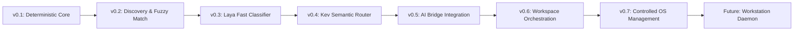

# AstraRun Evolution Roadmap

> **Status**: APPROVED  
> **Horizon**: v0.1 -> Workstation Control Platform  

---

## Stage Progression

---

### v0.1 — Deterministic Launcher (Current Phase)
- Native PySide6 frameless window centered on active display.
- Global `Alt+Space` hotkey backed by non-blocking Win32 `RegisterHotKey`.
- Deterministic router with prefix & verb normalization (`open`, `launch`, `start`, `show`, `go to`).
- Dynamic Windows User Shell Folders discovery (Downloads, Documents, Desktop, Pictures, Videos, Workspace).
- Application discovery from App Paths registry and PATH (Notepad, Calculator, VS Code, Vivaldi, Terminal, PowerShell, CMD).
- Configurable URL aliases (`github`, `youtube`, `google`).
- Strict typed tool registry with zero raw shell execution.
- Human-editable JSON configurations and rotating structured file logs.

---

### v0.2 — Discovery & Fuzzy Matching
- Real-time prefix suggestions and fuzzy search autocomplete (e.g. `note` -> `Notepad`).
- Asynchronous filesystem indexer for user documents and recent projects.
- UI keyboard navigation for suggestion lists (`Up`/`Down`/`Tab`).
- Multi-monitor explicit active-window monitor detection.

---

### v0.3 — Laya Fast Classifier
- Integration of Laya (lightweight local classifier for microsecond intent classification).
- Fallback chain: Deterministic Router -> Laya.
- Structured classification for common natural utterances ("jump into my downloads folder", "fire up vscode").
- Zero cloud latency.

---

### v0.4 — Kev Semantic Router
- Integration of Kev (local semantic embedding and reasoning router).
- Disambiguation of complex queries and intent negotiation ("open the project I worked on yesterday").
- Confirmation flow in UI for ambiguous matches.

---

### v0.5 — AI Bridge Integration
- Direct integration with workstation AI Bridge (`Active/AI-Bridge`) for LLM assistance.
- Conversational answers and code generation queries displayed directly in launcher widget.
- Streaming responses inside expanded launcher card.

---

### v0.6 — Workspace & Project Orchestration
- Direct integration with `workspace.json` and `wsctl`.
- Project-aware commands:
  - `start server` -> runs server development profile.
  - `test securityworkbench` -> runs registered diagnostic tests.
  - `switch to termux-ai` -> opens project workspace and activates its environment.

---

### v0.7 — Controlled OS Management
- Process inspection and safe termination (`kill port 3000`).
- Display management (window snapping, monitor profile switching).
- Audio and device volume controls.

---

### Future — Workstation Intelligence Daemon
- Resident daemon coordinating cross-workspace awareness, context synthesis, proactive assistance, and multi-modal screen reasoning.
