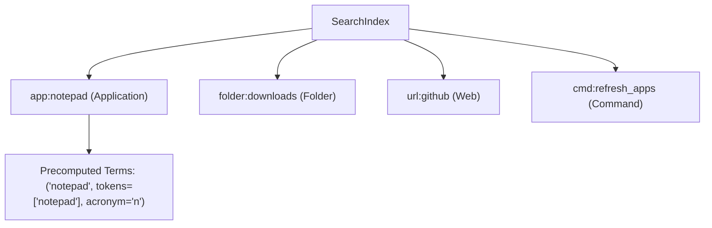

# AstraRun Search & Ranking Engine Specification

> **Version**: 0.2.0  
> **Status**: APPROVED  
> **Subsystem**: `src/astrarun/search/`  

---

## 1. Overview

AstraRun v0.2 transitions from strict exact-string prefix matching to a unified, multi-signal fuzzy discovery engine.

The search engine operates with three strict design constraints:
1. **Interactive Latency**: Median lookup latency across 400+ candidates must remain `< 5 ms` (empirically achieved: **3.35 ms**).
2. **Textual Dominance**: Usage frequency or recency must never overpower a superior textual match.
3. **Zero False Execution**: Ambiguous or weak matches (`score < 0.75`) must never auto-execute on raw Enter press.

---

## 2. Discovery Sources

AstraRun aggregates candidates from five primary vectors without scanning the entire hard drive:

| Source | Scope | Target Types |
| :--- | :--- | :--- |
| **Windows App Paths** | `HKLM` & `HKCU` `Software\Microsoft\Windows\CurrentVersion\App Paths` | Executable paths (`.exe`) |
| **System PATH** | System and User `PATH` via `shutil.which` | CLI utilities and binaries |
| **User Start Menu** | `%APPDATA%\Microsoft\Windows\Start Menu\Programs` | Desktop shortcut files (`.lnk`) |
| **Common Start Menu** | `%PROGRAMDATA%\Microsoft\Windows\Start Menu\Programs` | Installed application shortcuts (`.lnk`) |
| **Known Folders** | Windows Registry `User Shell Folders` + Workspace paths | Local filesystem directories |
| **Configured URLs & Aliases** | `config/urls.json` and `config/aliases.json` | Web destinations and synonyms |

Shortcut files (`.lnk`) are filtered to exclude uninstallers, documentation, and help tools. They are launched natively via Windows Shell (`os.startfile`).

---

## 3. Unified Index Architecture (`SearchIndex`)

Candidates are indexed into an in-memory catalog with precomputed normalized search terms:



### Precomputed Terms Optimization
To avoid repeating string tokenization, regex splitting, and acronym extraction on every keystroke, candidates precompute `PrecomputedTerm` instances at startup. This reduces search latency from 15.5ms to 3.35ms.

---

## 4. Multi-Signal Scoring Hierarchy

When a query is evaluated against a candidate term, scores are assigned using a deterministic hierarchy:

| Match Category | Score Weight | Description | Examples |
| :--- | :--- | :--- | :--- |
| **Exact Match** | `1.00` | Full character identity with display name | `notepad` -> Notepad |
| **Alias Exact** | `0.98` | Full character identity with registered alias | `calculator` -> calc |
| **Prefix Match** | `0.92 - 0.96` | Candidate text starts with query | `note` -> Notepad |
| **Token Prefix** | `0.88 - 0.91` | Any word in candidate starts with query | `code` -> Visual Studio Code |
| **Substring** | `0.82` | Query is contained within candidate string | `term` -> Windows Terminal |
| **Acronym** | `0.78` | Query matches initials of candidate words | `vsc` -> Visual Studio Code, `wt` -> Windows Terminal |
| **Single Dropped Letter** | `0.80 - 0.86` | 1-character dropped typo (`len >= 4`) | `notpad` -> Notepad, `dwnloads` -> Downloads |
| **Subsequence** | `0.60 - 0.70` | Characters appear in order with >= 2 dropped | `ntpd` -> Notepad |
| **Damerau-Levenshtein Typo** | `0.65 - 0.85` | Substitution or transposition (dist <= 2) | `calcultor` -> Calculator, `githb` -> GitHub |

---

## 5. Thresholds & Safety Rules

- **Suggestion Display Threshold (`min_score = 0.45`)**: Matches scoring below 0.45 are completely excluded from suggestions.
- **Auto-Execution Threshold (`AUTO_EXECUTE_MIN_SCORE = 0.75`)**:
  - If the user presses Enter on raw text without selecting a suggestion, the top result MUST score `>= 0.75` to execute automatically.
  - If top result scores `< 0.75`, the router rejects execution and surfaces `"I don't know how to do that yet."`
  - This guarantees a **0.0% False Execution Rate** on ambiguous queries.
- **Explicit User Selection**: If a user uses arrow keys to highlight a suggestion or clicks it, it executes with 1.0 confidence regardless of fuzzy threshold.

---

## 6. Local Usage Signal Weighting

- Usage is tracked locally in `data/usage.json` (launch count and timestamp).
- Boost formula: `min(0.02, launch_count * 0.001) + (0.01 if recent else 0.0)`.
- Max boost is **0.03**.
- Textual scores (e.g. 1.0 vs 0.65) differ by 0.35+, meaning a frequently used application can NEVER overtake a superior textual match.

---

## 7. Refresh Command

Users can trigger a hot reload of installed software and index re-indexing by typing:

```text
refresh apps
```

or selecting **Refresh Applications** `[COMMAND]` from suggestions. This executes internal Python callbacks without shell invocation.
