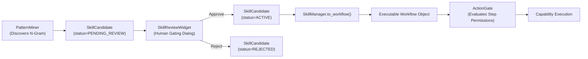

# AstraRun Skill Foundation & Workflow Lifecycle

> **Document**: `docs/SKILL_LEARNING.md`  
> **Milestone**: AstraRun v0.8.5 (Memory, Learning & Skill Foundation)  
> **Status**: APPROVED LIFECYCLE SPECIFICATION  

---

## 1. Definition of a Skill in AstraRun

Unlike autonomous agent frameworks where skills are unverified Python scripts or arbitrary shell files, in AstraRun:
> **A Skill is a versioned, parameterized, human-approved sequence of registered Workstation Capabilities (`CapabilityRegistry`) that compiles directly to a deterministic `Workflow` object.**



---

## 2. Skill Candidate Structure

```python
@dataclass
class SkillCandidate:
    id: str
    name: str
    description: str
    trigger_phrases: list[str]
    parameters: list[dict[str, Any]]
    steps: list[SkillStep]
    status: SkillStatus = SkillStatus.CANDIDATE
    support_count: int = 1
    confidence: float = 0.0
    version: int = 1
    created_at: float
    updated_at: float
    evidence_task_ids: list[str]
    author: str = "pattern_miner"
    review_notes: Optional[str] = None
```

---

## 3. Human Review & Activation Gate

A candidate skill can **never** be executed while in `CANDIDATE` or `PENDING_REVIEW` status:
- Calling `SkillManager.to_workflow()` on an unapproved skill raises a `ValueError`.
- The user is presented with the `SkillReviewWidget` dialog, which renders:
  1. The proposed skill name and description.
  2. The supporting evidence count (number of observed historical runs).
  3. The exact sequence of capabilities to be executed.
  4. Explicit risk badges for each step (`[LOW]`, `[MEDIUM]`, `[HIGH]`, `[BLOCKED]`).
  5. Configurable default parameter values.
- Only when the user clicks **"Approve & Activate"** does the skill transition to `ACTIVE` and become invocable via launcher trigger phrases.

---

## 4. Versioning & Rollback

- Any modifications to skill steps (e.g. adding a flag or changing order) increment `skill.version` and log an audit event in `data/astra_learning.db`.
- Users can disable a skill at any time via `SkillManager.disable_skill(skill_id)` without losing its historical configuration.
