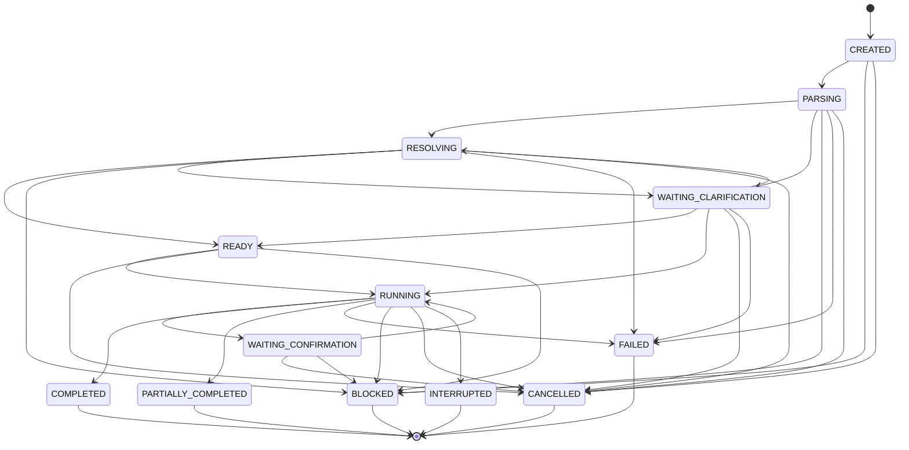

# AstraRun Task Domain Model & State Machine

## 1. Formal 14-State Finite State Machine (FSM)
AstraRun tasks progress through an explicit 14-state directed graph. Any invalid transition raises `InvalidStateTransitionError`.

---

## 2. State Classification
| State | Category | Description |
|---|---|---|
| `CREATED` | Active | Initialized, persisted in SQLite ledger, awaiting parse. |
| `PARSING` | Active | Natural language decomposition and entity extraction. |
| `RESOLVING` | Active | Workstation entity binding (apps, files, PIDs, ports). |
| `READY` | Active | Fully resolved and vetted through ActionGate policy. |
| `RUNNING` | Active | Executing capabilities or workflow steps on the OS. |
| `WAITING_CONFIRMATION` | Waiting | Suspended awaiting explicit user confirmation for high-risk action. |
| `WAITING_CLARIFICATION` | Waiting | Suspended awaiting user disambiguation among candidate entities. |
| `WAITING_USER` | Waiting | Suspended awaiting external user feedback or manual action. |
| `COMPLETED` | Terminal | Succeeded completely; all capabilities executed as expected. |
| `PARTIALLY_COMPLETED` | Terminal | Succeeded partially; subsequent non-fatal step failed. |
| `FAILED` | Terminal | Operation failed with structured `TaskError`. |
| `BLOCKED` | Terminal | Blocked by hard security policy (prohibited operations). |
| `CANCELLED` | Terminal | Aborted cooperatively by user or caller. |
| `INTERRUPTED` | Terminal | Recovered after application crash or abrupt workstation shutdown. |

---

## 3. Domain Entities

### `Task`
- `id: str` (UUIDv4)
- `conversation_id: str`
- `request_text: Optional[str]` (Sanitized user request)
- `request_hash: str` (SHA-256 for privacy indexing)
- `source: str` (`"launcher"`, `"hotkey"`, `"re_run"`, etc.)
- `created_at: float`, `started_at: Optional[float]`, `completed_at: Optional[float]`
- `status: TaskStatus`
- `events: list[TaskEvent]`
- `final_result: Optional[TaskResult]`
- `parent_task_id: Optional[str]`
- `metadata: dict[str, Any]`

### `TaskResult`
- `task_id: str`
- `success: bool`
- `status: TaskStatus`
- `message: str`
- `summary: str`
- `data: dict[str, Any]` (Sanitized payload)
- `capabilities_used: list[str]`
- `duration_ms: float`
- `error: Optional[TaskError]`

### `TaskError`
- `code: str` (`"POLICY_BLOCKED"`, `"CONNECTION_REFUSED"`, `"STEP_FAILED"`, `"CANCELLED"`, `"INTERRUPTED"`)
- `message: str`
- `capability: Optional[str]`
- `recoverable: bool`
