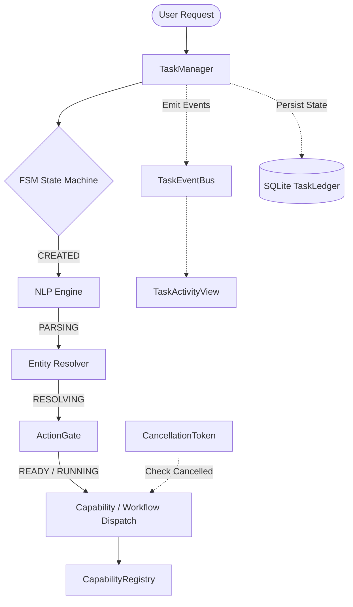

# AstraRun Task Runtime Architecture

## 1. Overview & Purpose
AstraRun v0.8 transitions from a stateless, fire-and-forget launcher into an observable, persistent **workstation assistant runtime**.
The Task Runtime provides:
- Strongly-typed `Task` lifecycles governed by an explicit Finite State Machine (FSM).
- Centralized task authority via `TaskManager`.
- High-throughput asynchronous event dispatching via `TaskEventBus`.
- Cooperative cancellation through `CancellationToken` checkpoints.
- Persistent auditability via SQLite WAL `TaskLedger`.

---

## 2. Core Architectural Separation
AstraRun enforces an absolute four-way architectural boundary across memory and execution:
1. **Observation (`ObservationStore`)**: Ephemeral, in-memory facts read from the OS (e.g., CPU load, listening ports). Pure facts; zero execution authority.
2. **Context (`WorkstationContextEngine`)**: Working memory tracking active applications, recent files, and user focus. Read-only inputs for entity resolution.
3. **Task Events (`TaskEventBus` & `TaskEvent`)**: Internal machine-level occurrences emitted during task processing (e.g., `NLP_PARSE_STARTED`, `CAPABILITY_COMPLETED`). Strictly observational.
4. **Conversation Threads (`Conversation` & `ConversationMessage`)**: User-facing conversation sequences and dialogue turns.

---

## 3. Lifecycle Authority: `TaskManager`
`TaskManager` is the single source of truth for task state transitions, capability execution, cancellation checking, and persistent event emission:
- **`create_task(request_text, conversation_id, source)`**: Allocates a new UUIDv4 task, computes SHA-256 request hash, logs initial `TASK_CREATED` event, and commits to SQLite.
- **`start_task(task_id)`**: Transitions task to `RUNNING` with state transition validation.
- **`execute_capability(task_id, capability_id, args, registry)`**: Checks cancellation before dispatch, emits `CAPABILITY_STARTED`, executes typed capability, checks cancellation post-dispatch, records execution latency, and emits `CAPABILITY_COMPLETED` or `CAPABILITY_FAILED`.
- **`complete_task(task_id, result)`**: Records final `TaskResult`, emits `TASK_COMPLETED`, logs user-facing conversation message, and prunes in-memory active tracking.
- **`fail_task(task_id, error)`**: Transitions task to `FAILED` with structured error codes (`TaskError`).
- **`block_task(task_id, reason, capability_id)`**: Transitions task to `BLOCKED` on hard security policy interception.
- **`cancel_task(task_id, reason)`**: Sets cancellation token, emits `TASK_CANCEL_REQUESTED`, transitions task to `CANCELLED`, and emits `TASK_CANCELLED`.
- **`re_run_task(task_id)`**: Strictly spawns a **brand-new** task with the original user request text; forbids replaying stale arguments.

---

## 4. Thread Safety & Concurrency
- `TaskManager` uses thread-safe locks (`threading.Lock`) guarding active tasks and tokens.
- `TaskLedger` maintains isolated connection pools with WAL mode (`PRAGMA journal_mode = WAL;`) allowing concurrent reads during writes.
- `TaskEventBus` thread-safe dispatch ensures UI updates occur safely across Qt signal bridges (`event_dispatched.emit()`).
