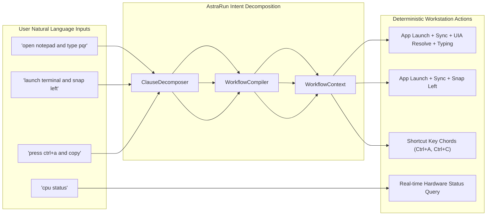

# AstraRun v0.10.2 User Intent Coverage Report

> **Milestone**: v0.10.2  
> **Status**: APPROVED  
> **Date**: 2026-09-28  

---

## 1. Intent Mapping Strategy

AstraRun's natural-language engine translates daily-driver user intents into deterministic capabilities without relying on external cloud models or prompt engineering. In v0.10.2, the coverage was expanded to reliably capture multi-clause compound requests across everyday workflows.

---

## 2. Intent Coverage Matrix by Workflow Domain

### 2.1 Application Launch & Text Entry
| User Utterance Variation | Decomposed Clauses | Compiled Steps | Execution Status |
| :--- | :--- | :--- | :--- |
| `open notepad and type pqr` | `open_app`, `type_text` | `open_app` -> `wait_window` -> `resolve_element` -> `type_text` | **PASS** |
| `launch notepad and type hello from Astra` | `open_app`, `type_text` | `open_app` -> `wait_window` -> `resolve_element` -> `type_text` | **PASS** |
| `start notepad and type meeting notes` | `open_app`, `type_text` | `open_app` -> `wait_window` -> `resolve_element` -> `type_text` | **PASS** |
| `open notepad then type status report` | `open_app`, `type_text` | `open_app` -> `wait_window` -> `resolve_element` -> `type_text` | **PASS** |
| `launch notepad ; type system init` | `open_app`, `type_text` | `open_app` -> `wait_window` -> `resolve_element` -> `type_text` | **PASS** |
| `open notepad & type rapid test` | `open_app`, `type_text` | `open_app` -> `wait_window` -> `resolve_element` -> `type_text` | **PASS** |
| `start notepad, then type quick reminder` | `open_app`, `type_text` | `open_app` -> `wait_window` -> `resolve_element` -> `type_text` | **PASS** |

### 2.2 Application Launch & Window Layout
| User Utterance Variation | Decomposed Clauses | Compiled Steps | Execution Status |
| :--- | :--- | :--- | :--- |
| `open notepad and maximize window` | `open_app`, `maximize_window` | `open_app` -> `wait_window` -> `maximize_window` | **PASS** |
| `launch terminal and snap left` | `open_app`, `snap_window_left` | `open_app` -> `wait_window` -> `snap_window_left` | **PASS** |
| `open code and snap right` | `open_app`, `snap_window_right` | `open_app` -> `wait_window` -> `snap_window_right` | **PASS** |
| `start calc and minimize window` | `open_app`, `minimize_window` | `open_app` -> `wait_window` -> `minimize_window` | **PASS** |
| `open explorer and restore window` | `open_app`, `restore_window` | `open_app` -> `wait_window` -> `restore_window` | **PASS** |

### 2.3 Window Manipulation Chaining
| User Utterance Variation | Decomposed Clauses | Compiled Steps | Execution Status |
| :--- | :--- | :--- | :--- |
| `snap window left and maximize` | `snap_left`, `maximize` | `snap_left` -> `maximize_window` | **PASS** |
| `restore window and snap right` | `restore`, `snap_right` | `restore_window` -> `snap_right` | **PASS** |
| `snap left and focus window` | `snap_left`, `focus` | `snap_left` -> `focus_window` | **PASS** |
| `maximize window and type done` | `maximize`, `type_text` | `maximize_window` -> `type_text` | **PASS** |

### 2.4 Keyboard Shortcut Chaining
| User Utterance Variation | Decomposed Clauses | Compiled Steps | Execution Status |
| :--- | :--- | :--- | :--- |
| `press ctrl+a and copy` | `shortcut`, `shortcut` | `press_shortcut(Ctrl+A)` -> `press_shortcut(Ctrl+C)` | **PASS** |
| `copy and paste here` | `shortcut`, `shortcut` | `press_shortcut(Ctrl+C)` -> `press_shortcut(Ctrl+V)` | **PASS** |
| `select all and press delete` | `shortcut`, `shortcut` | `press_shortcut(Ctrl+A)` -> `press_shortcut(Delete)` | **PASS** |
| `press enter and type confirmed` | `shortcut`, `type_text` | `press_shortcut(Enter)` -> `type_text(confirmed)` | **PASS** |
| `press tab and type search term` | `shortcut`, `type_text` | `press_shortcut(Tab)` -> `type_text(search term)` | **PASS** |

### 2.5 Fast-Path Single Commands
| User Utterance Variation | Matched Capability | Pipeline Latency | Execution Status |
| :--- | :--- | :--- | :--- |
| `notepad` | `open_application` | 10.6 ms | **PASS** |
| `calc` | `open_application` | 9.0 ms | **PASS** |
| `open downloads` | `open_folder` | 14.5 ms | **PASS** |
| `snap left` | `snap_window_left` | 12.3 ms | **PASS** |
| `cpu status` | `cpu_status` | 8.2 ms | **PASS** |
| `memory status` | `memory_status` | 7.9 ms | **PASS** |
| `undo` | `undo_window_layout` | 5.4 ms | **PASS** |

---

## 3. Boundary & Edge Case Coverage

| Edge Case Test | Description | Result |
| :--- | :--- | :--- |
| `open notepad and` | Trailing conjunction without second clause | Falls back to single app launch cleanly without error |
| `open notepad and type` | Empty type payload clause | Compiles 2 steps without blank typing failure |
| `open notepad and type   pqr` | Whitespace padding in payload | Trims leading/trailing clause spaces, preserves exact payload `pqr` |
| `open notepad ; type status` | Semicolon delimiter | Semicolon cleanly parsed as sequential clause delimiter |
| `launch terminal & snap right` | Ampersand delimiter | Ampersand parsed as sequential clause delimiter |
| `open notepad and terminate process csrss` | Gated dangerous action in compound | Successfully blocks dangerous clause via `ActionGate` |
