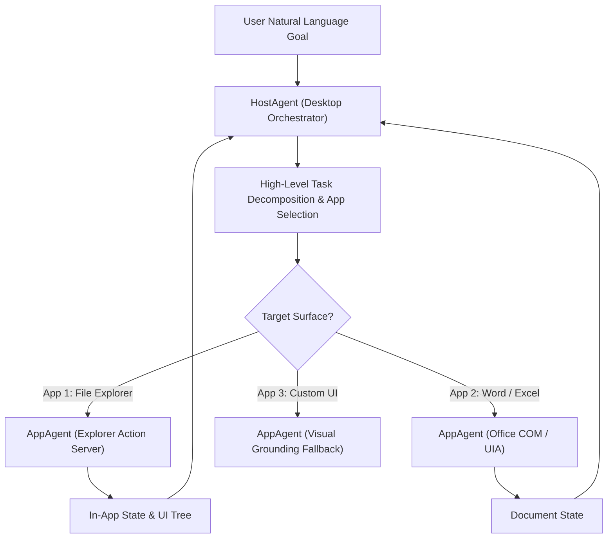

# 07 — Deep Dive: Microsoft UFO² & UFO³ Architecture

> **Primary Source**: `microsoft/UFO` (GitHub), Microsoft Research Technical Reports  
> **License**: MIT License  
> **Evidence Source**: `UPSTREAM_PRIMARY_SOURCE` & `INDEPENDENT_RESEARCH`  
> **Date**: 2026-09-30  

---

## 1. Architectural Anatomy: The Dual-Agent Pattern

Microsoft UFO pioneered the **Dual-Agent Architecture** specifically optimized for the Windows operating system:

### 1.1 HostAgent (Desktop Orchestration Layer)
- Evaluates the macro-level goal across multiple applications.
- Manages desktop window focus, application launching, inter-application file handoffs, and global task completion verification.
- Emits structured sub-goals to specific `AppAgent` instances.

### 1.2 AppAgent (In-Application Execution Layer)
- Instantiated per active target application.
- Utilizes an **Application Action Server** tailored to the application's capabilities:
  - *Office Apps*: Leverages native `WinCOM` / `pywin32` APIs (e.g. Word/Excel automation) for 100% deterministic manipulation.
  - *Win32 / UWP Apps*: Leverages Windows `UIAutomationCore` (`pywinauto`) to traverse control trees and invoke control patterns (`InvokePattern`, `ValuePattern`).
  - *Custom / Web Surfaces*: Leverages visual cropping and multimodal vision models when accessibility trees are incomplete or missing.

---

## 2. UFO² vs UFO³ Evolution

- **UFO² (2025)**: Introduced "Windows Desktop AgentOS" concept, hybrid GUI/API action dispatch, Picture-in-Picture (PiP) task monitoring, and execution checkpointing.
- **UFO³ (2025+)**: Introduced the **Galaxy Framework**, scaling the HostAgent/AppAgent protocol across heterogeneous multi-device endpoints (Windows + Linux) using persistent RPC/WebSocket communication.

---

## 3. Critical Critique & Relevance to AstraRun

### A. What AstraRun Should Adopt `[INFERENCE]`
1. **Host vs Surface Separation**: AstraRun's `GoalPlanner` operates as a Host-level orchestrator, delegating in-app steps to surface adapters (Browser CDP adapter, Win32 window adapter, UIA adapter).
2. **Hybrid Action Layer**: UFO confirms that 100% vision is an anti-pattern. Structured OS and COM APIs must always precede visual fallback.
3. **MIT License**: Permissive reuse of architectural patterns, prompt structures, and WinCOM wrappers.

### B. What AstraRun Must Avoid `[INDEPENDENT_RESEARCH]`
1. **Massive Cloud Token Overhead**: UFO requires cloud GPT-4V/GPT-4o calls for nearly every AppAgent step, incurring massive token costs and 3–8 second per-step latencies. AstraRun requires sub-100ms local execution for routine steps.
2. **Heavy Python Footprint**: UFO was built as a research prototype with sprawling dependencies (~2 GB). AstraRun must maintain an ultra-lean resident footprint ($< 100\,\text{MB}$).
3. **Lack of Strict Action Gating**: UFO relies on prompt guidelines for safety; AstraRun enforces an immutable `ActionGate` with tokenized confirmation cards.
