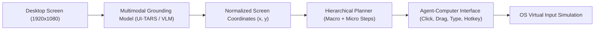

# 08 — Deep Dive: Agent S & OSWorld Visual Grounding

> **Primary Source**: Simular AI (`simular-ai/Agent-S`), OSWorld Benchmark  
> **License**: Apache 2.0  
> **Evidence Source**: `UPSTREAM_PRIMARY_SOURCE` & `INDEPENDENT_RESEARCH`  
> **Date**: 2026-09-30  

---

## 1. Architectural Overview: Visual-First Agent-Computer Interface (ACI)

Agent S is engineered to operate on any desktop OS by simulating human perceptual and motor faculties:

---

## 2. Key Technical Innovations

1. **Experience-Augmented Hierarchical Planning**:
   - Decomposes long-horizon goals into sub-goals.
   - Maintains an episodic trajectory memory store, retrieving past successful interaction traces to guide current planning.
2. **UI-TARS Grounding Integration**:
   - Pairs with specialized GUI grounding models (e.g. `UI-TARS`) trained specifically on screenshot-to-coordinate datasets.
   - Produces normalized bounding boxes and click points for arbitrary visual elements (icons, custom canvases, un-annotated buttons).
3. **OSWorld SOTA Benchmark Performance**:
   - Evaluated against the demanding **OSWorld** benchmark, achieving top-tier task completion rates on complex real-world workflows.

---

## 3. Analysis & Relevance to AstraRun

### A. Strengths to Learn From `[INFERENCE]`
- **The Absolute Fallback**: When an application provides zero UIA elements and zero CDP access (e.g. games, legacy Win32 custom controls, remote desktop windows), visual coordinate grounding via an ACI is the *only* viable path.
- **Trajectory Memory Representation**: Agent S's schema for recording visual sub-goals and actions provides a clean model for AstraRun's procedural skill recording.

### B. Why Agent S Cannot Be AstraRun's Primary Engine `[MACHINE_MEASURED & INDEPENDENT_RESEARCH]`
1. **Hardware Incompatibility**: UI-TARS and multimodal grounding models require 7B–14B parameters and $> 8–16\,\text{GB}$ VRAM for local execution. On Astra's 4 GB RTX 2050 and 3.3 GB free RAM, running continuous local visual grounding models is physically impossible without catastrophic paging or offload failures.
2. **Extreme Latency**: Capturing, downsampling, and inferring a full HD screenshot via a VLM takes $1.8–4.5\,\text{s}$ per step. AstraRun's typed Win32 and CDP actions execute in $< 50\,\text{ms}$ (a $50\times$ speed advantage).
3. **Zero Typed Verification**: Visual-only agents cannot verify file sizes, port states, or network SSIDs directly—they must visually inspect icons or terminal text.
4. **Takeaway for AstraRun**: Adopt visual grounding strictly as an **on-demand Tier E fallback**, never as the primary execution engine.
