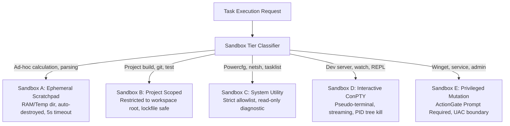
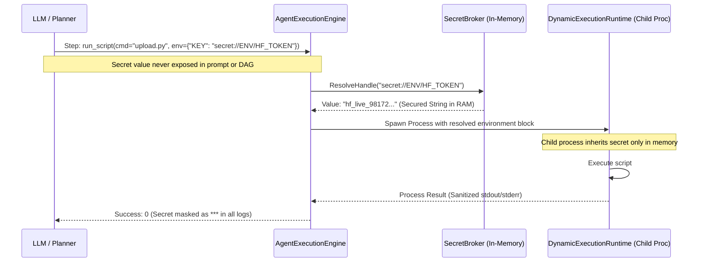

# 11 — Dynamic Execution Runtime Specification

> **Status**: APPROVED RESEARCH & ARCHITECTURAL SPECIFICATION  
> **Phase**: 6 — Dynamic Sandbox Execution Runtime Design  
> **Focus**: Multi-Tiered Process Sandboxing, ConPTY Interactive Streaming, Job Object Quotas, Secret Broker Boundary, and Process Tree Lifecycle  
> **Target System**: Local Windows 11 Workstation (`E:\Workspace\Active\AstraRun`)  

---

## 1. Executive Summary & Architectural Motivation

AstraRun v0.11 executes commands via static `subprocess.run` calls within individual tool capabilities. This model has four critical architectural failure modes:
1. **Zero Process Isolation**: Any spawned script runs with full host user permissions, capable of mutating unintended directories.
2. **Memory Exhaustion Risk**: A runaway command (e.g., unconstrained data processing or recursive loop) can allocate gigabytes, instantly exhausting the host's **~3.30 GB free physical RAM** `[MEASURED]` and freezing the workstation.
3. **No Interactive / Streaming Support**: Commands requiring interactive input (prompts, password requests) hang indefinitely until timeout.
4. **Log Truncation & Token Explosion**: Commands outputting 100,000 lines of build logs flood the runtime and exhaust model context windows.

The `DynamicExecutionRuntime` resolves these deficiencies through **5 distinct sandbox tiers**, **Windows Job Objects**, **ConPTY streaming**, and a **Secret Broker injection boundary**.

---

## 2. The 5 Sandbox Tiers



### Detailed Tier Specifications

| Sandbox Tier | Working Directory | Allowed Binaries | Resource Quotas | Permission Gate | Persistence |
| :--- | :--- | :--- | :--- | :--- | :--- |
| **Tier A: Ephemeral Scratchpad** | Temp directory (`.sandbox/tmp/{uuid}`) | `python`, `node`, `jq`, `pwsh` (safe script subset) | Max 256 MB RAM, Max 5s CPU | Automatic (`SAFE_READ`) | **Destroyed on exit** |
| **Tier B: Project Workspace** | Target project root (`E:\Workspace\...`) | Project toolchains (`uv`, `npm`, `cargo`, `git`, `pytest`) | Max 2048 MB RAM, Max 120s | Workspace boundaries enforced | Preserved in project |
| **Tier C: System Utility** | System default (`%TEMP%` or `%WINDIR%`) | Allowlist only (`netsh`, `powercfg`, `tasklist`, `ipconfig`) | Max 128 MB RAM, Max 10s | Automatic (`SAFE_READ`) | None |
| **Tier D: Interactive ConPTY** | Project or custom root | Dev servers, REPLs, interactive CLI tools | Max 1536 MB RAM, Streaming heartbeat | User confirmation for start/stop | Process session-based |
| **Tier E: Privileged Mutation** | System / Administrator | `winget`, system service controls, firewall | Max 1024 MB RAM, Max 180s | **Explicit User Approval (Modal)** | Host system state |

---

## 3. Process Isolation via Windows Job Objects

On Windows, raw process spawning cannot reliably constrain descendant subprocesses (e.g., Python spawning Node which spawns workers). When the parent is killed, orphaned worker processes remain in memory.

### 3.1 Job Object Implementation Architecture
`DynamicExecutionRuntime` encapsulates every sandbox execution in a native **Windows Job Object** via `kernel32.dll` / `CreateJobObjectW`:

1. **`JOB_OBJECT_LIMIT_KILL_ON_JOB_CLOSE`**:
   - Ensures that closing the Job handle automatically terminates the entire process tree down to the leaves.
   - Prevents orphaned background tasks from leaking host RAM.
2. **`JOB_OBJECT_LIMIT_PROCESS_MEMORY` / `JOB_OBJECT_LIMIT_JOB_MEMORY`**:
   - Sets a hard memory allocation ceiling (e.g., 256 MB for Tier A, 2 GB for Tier B).
   - If memory allocation exceeds the quota, Windows immediately terminates the offending allocation and signals the runtime with `STATUS_QUOTA_EXCEEDED` rather than starving the OS.
3. **`JOB_OBJECT_LIMIT_ACTIVE_PROCESS`**:
   - Caps total concurrent child processes (e.g., max 8 processes) to prevent fork-bomb behavior.

---

## 4. Interactive ConPTY Runtime (Sandbox Tier D)

For long-running processes (e.g., `uv run pytest -f`, `npm run dev`, or CLI utilities prompting `[y/N]`):
- **Windows Pseudo Console (ConPTY)**: Spawns the process attached to an allocated pseudo-terminal via `CreatePseudoConsole`.
- **Bidirectional Streaming**:
  - `stdout`/`stderr` multiplexed into an asynchronous ring buffer.
  - Provides real-time ANSI-rendered output to the Astra HUD or terminal interface.
- **Pattern Matching & Interruption**:
  - The runtime monitors the output stream for common interactive prompts:
    - Confirmation prompts (`Are you sure? [y/N]`)
    - Password / credential prompts (`Enter passphrase:`)
  - When detected, the runtime suspends execution and routes the prompt directly to the User via HUD input chip, preventing infinite hanging.

---

## 5. Output Truncation & Token Budget Defense

Large compiler errors or test failures can generate megabytes of output. Ingesting this into an LLM context window causes catastrophic degradation.

### 5.1 Head/Tail Windowing Algorithm
The runtime applies a strict **Head-Tail Summarizer** to all execution outputs before returning to the model:

```
[Raw Process Output: 45,000 lines / 2.8 MB]
                     │
                     ▼
+-------------------------------------------------------------+
| First 30 lines (Header, initial configuration, invocation)  |
+-------------------------------------------------------------+
| [ ... 44,910 lines truncated | Full log: .sandbox/log_xxx ] |
+-------------------------------------------------------------+
| Last 60 lines (Stack trace, assertion failure, exit code)   |
+-------------------------------------------------------------+
                     │
                     ▼
[Processed Payload: 90 lines / ~4 KB / ~800 tokens]
```

- Total token payload is guaranteed to stay **under 1,000 tokens** regardless of raw process output volume.
- The full raw log is always written to `.sandbox/logs/{execution_id}.log` for human inspection or targeted retrieval.

---

## 6. Secret Broker Injection Boundary

`[USER_REQUIREMENT]` Secrets (API keys, personal tokens) must never enter LLM prompts, DAG step definitions, or disk logs.



1. **Opaque Handles**: The model only ever handles `secret://VAULT/NAME` or `secret://ENV/NAME`.
2. **Just-In-Time Injection**: Resolution occurs exclusively in memory at the exact microsecond the child process environment block is constructed.
3. **Log Sanitization**: Any appearance of the resolved secret string in `stdout` or `stderr` is scrubbed with `***REDACTED***` before being returned to the engine or written to logs.

---

## 7. Synthesis & Architectural Invariants

1. **Job Objects are Non-Negotiable**: No process may be spawned without an enclosing Windows Job Object configured with hard memory quotas and kill-on-close semantics.
2. **Strict Temp Cleanliness**: Tier A scratchpad files must be completely expunged upon task completion.
3. **Token Defense**: Output buffers must never exceed 1,000 tokens when presented to any model context.
