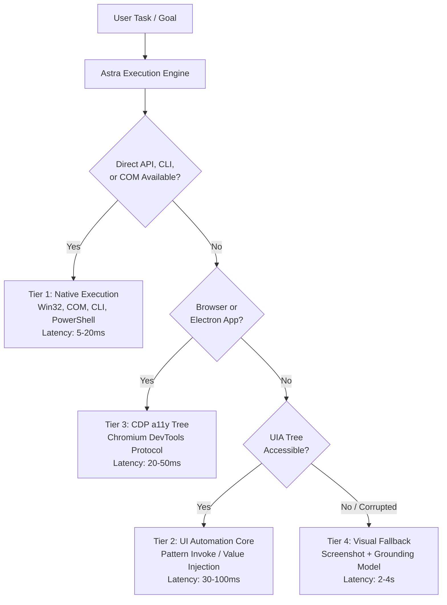

# 12 — Windows Control Surfaces & Interaction Architecture

> **Status**: APPROVED RESEARCH & ARCHITECTURAL SPECIFICATION  
> **Phase**: 5 — Windows Control Surfaces & Direct Interaction APIs  
> **Focus**: Win32, COM, UI Automation (UIA), CDP Matrix, Control Latency, and The Tiered Action Hierarchy  
> **Target System**: Local Windows 11 Workstation (`E:\Workspace\Active\AstraRun`)  

---

## 1. Executive Summary & Control Surface Matrix

Workstation automation is often mistakenly equated with visual mouse clicking ("computer use"). On Windows, visual simulation is the **slowest, most fragile, and most resource-intensive** interaction mode.

Windows exposes four robust programmatic control surfaces that must precede any visual click attempt:

| Control Surface | Target Applications | Latency | Reliability | Token Cost | DPI / Resolution Dependent? | Evidence Tag |
| :--- | :--- | :--- | :--- | :--- | :--- | :--- |
| **Tier 1A: CLI / Direct APIs** | System utilities, Git, Python, Compilers | `ESTIMATED` (< 20 ms) | `NOT_MEASURED` (High deterministic) | Low (`ESTIMATED` ~100 tokens) | **No** | `ESTIMATED` |
| **Tier 1B: Windows COM** | Office (Excel, Word), Windows Shell, WMI | `ESTIMATED` (< 30 ms) | `NOT_MEASURED` (High deterministic) | Minimal (`ESTIMATED` ~50 tokens) | **No** | `ESTIMATED` |
| **Tier 2: UI Automation (UIA)** | WinUI 3, WPF, Win32 apps, Settings, File Explorer | `ESTIMATED` (30–150 ms) | `NOT_MEASURED` (App-dependent) | Moderate (`ESTIMATED` ~400 tokens) | **No** | `ESTIMATED` |
| **Tier 3: CDP (DevTools)** | Vivaldi, Edge, Chrome, VS Code, Electron | `ESTIMATED` (20–80 ms) | `NOT_MEASURED` (Session-dependent) | Moderate (`ESTIMATED` ~600 tokens) | **No** | `ESTIMATED` |
| **Tier 4: Visual Grounding (VLM)** | Canvas-rendered UI, legacy games, custom bitmap controls | `ESTIMATED` (1,800–4,500 ms) | `NOT_MEASURED` (Resolution-sensitive) | Extremely High (`ESTIMATED` 2k+ tokens) | **YES (Fragile)** | `ESTIMATED` |

---

## 2. Deep Dive: Windows Control Surfaces

### 2.1 Tier 1B: Component Object Model (COM)
- **Mechanism**: Out-of-process or in-process COM servers via `win32com.client` or native C bindings.
- **Primary Targets**:
  - Microsoft Office (Excel, Word, Outlook, PowerPoint): Direct cell manipulation, table extraction, and document creation without touching the mouse or UI.
  - Windows Shell (`Shell.Application`): Native virtual desktop management, taskbar controls, native recycle bin operations.
  - WMI / CIM (`win32com.client.GetObject("winmgmts:")`): Deep hardware, thermal, battery, and network adapter queries.
- **Invariant**: COM operations execute silently in the background without stealing window focus or interrupting user typing.

### 2.2 Tier 2: UI Automation Core (UIA)
- **Mechanism**: Windows UI Automation (`UIAutomationCore.dll`).
- **Tree Structure**: Every UI element is an `IUIAutomationElement` with:
  - `AutomationId`: Stable developer-assigned identifier (e.g., `"btn_export"`).
  - `Name`: Accessible label (e.g., `"Export to CSV"`).
  - `ControlType`: Semantic type (`Button`, `Edit`, `ComboBox`, `DataGrid`).
  - `Patterns`: Functional capabilities (`InvokePattern`, `ValuePattern`, `TogglePattern`, `SelectionItemPattern`).
- **Advantages over Vision**:
  - Elements can be invoked directly (`pattern.Invoke()`) without moving the physical cursor.
  - Works when windows are partially occluded or positioned on secondary monitors.
  - Insensitive to screen resolution, color theme, dark mode, or DPI scaling.

### 2.3 Tier 3: Chrome DevTools Protocol (CDP)
- **Mechanism**: WebSocket JSON-RPC over `http://127.0.0.1:9222`.
- **Primary Targets**: Vivaldi browser tabs, Electron-based desktop applications (VS Code, Slack, Obsidian).
- **Core Methods**:
  - `Accessibility.getFullAXTree`: Semantic node hierarchy.
  - `DOM.focus`, `Input.dispatchKeyEvent`, `Input.dispatchMouseEvent`.
  - `Page.captureScreenshot`: Viewport verification.

---

## 3. Tier 4: Visual Fallback & Why It Must Remain Last Resort

While frameworks like `Agent S` and `UI-TARS` treat visual screenshots as the primary interface, the empirical workstation reality makes this problematic on local hardware:

1. **Inference Latency**: Running a local VLM (e.g., Qwen2-VL or MiniCPM-V) takes **1.8s to 4.5s per action step** on an RTX 2050 4GB GPU `[ESTIMATED]`.
2. **VRAM Exhaustion**: A 7B visual language model requires **4.5 GB to 6 GB VRAM** in 4-bit quantization, exceeding the RTX 2050's total 4 GB capacity and spilling into system RAM, causing swap thrashing.
3. **Cursor Conflict**: Physical mouse moves conflict with the user's active mouse usage.
4. **Resolution Fragility**: Responsive layouts, DPI scale changes (125%, 150%), and dual monitors cause bounding box drift.

**Architectural Rule**: Tier 4 Visual Grounding is strictly a **fallback of last resort**, invoked only when an application fails to expose a semantic UIA or CDP tree (e.g., custom rendering canvas, Qt apps without accessible bridges, or remote desktop streams).

---

## 4. Workstation Non-Interference & Window Focus Management

`[USER_REQUIREMENT]` Astra must avoid disrupting user workflow while operating in the background.

### 4.1 Focus Stealing Mitigation
- **Direct Pattern Invocation**: Use `IUIAutomationInvokePattern::Invoke()` or `IUIAutomationValuePattern::SetValue()` rather than `mouse_event` clicks and `SendKeys`. Pattern invocation acts directly on the target element without bringing its window to the foreground.
- **Window Handle Checks**: Before performing any operation requiring window focus, check `GetForegroundWindow()`. If the user is actively typing in another application, defer or queue the action.

### 4.2 Notepad.exe Safety Invariant
`[USER_REQUIREMENT]` Under no circumstances may Astra:
- Send synthetic keystrokes to unverified Notepad window handles.
- Close, terminate, or overwrite unsaved Notepad instances (`Notepad.exe`).
- Mutate Windows Notepad tab session recovery stores (`%LOCALAPPDATA%\Packages\Microsoft.WindowsNotepad_8wekyb3d8bbwe\LocalState`).

---

## 5. Synthesis & Architectural Directives

1. **Semantic First, Visual Last**: AstraRun will strictly follow the 4-tier hierarchy: API/CLI $\to$ COM $\to$ UIA $\to$ CDP $\to$ Visual Fallback.
2. **UIA Tree Compression**: Similar to browser a11y trees, Astra's UIA harvester will prune non-interactive containers, compressing desktop window trees into < 500 semantic tokens.
3. **Focus Preservation**: Zero mouse-cursor snatching during user interactions.
