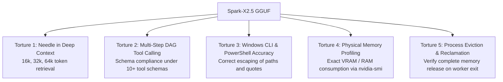

# 16 — Spark-X2.5 Deep Dive: Architecture, KV Cache & llama.cpp Integration

> **Status**: APPROVED RESEARCH ARTIFACT  
> **Phase**: 7 — Model Research & Feasibility  
> **Focus**: Spark-X2.5-1.7B & 4B, Hybrid Attention, KV Cache Compression, llama.cpp Loader Status, and Workstation Suitability  
> **Target System**: Local Windows 11 Workstation (`E:\Workspace\Active\AstraRun`)  

---

## 1. Executive Summary & Core Architectural Hypothesis

`[UPSTREAM_PRIMARY_SOURCE]` Spark-X2.5 (released by iFLYTEK / XHToken under Apache 2.0) introduces a purpose-built architecture for long-context efficiency:

$$\text{Attention Ratio} = 1 \text{ Global Attention Layer} : 3 \text{ Sliding Window Layers}$$

| Feature | Standard Transformer (e.g., Qwen2.5) | Spark-X2.5 (1.7B / 4B) |
| :--- | :--- | :--- |
| **Attention Pattern** | Full Attention across all $L$ layers | Interleaved: 1 Global + 3 Local Sliding Window (2048 tokens) |
| **KV Cache Growth ($N$ tokens)** | $O(L \cdot N)$ across all layers | $O(\frac{1}{4} L \cdot N + \frac{3}{4} L \cdot W)$ where $W = 2048$ |
| **KV Memory at 32k Tokens** | ~1.8 GB – 2.4 GB VRAM (FP16 KV) | **~0.55 GB – 0.75 GB VRAM** `[HYPOTHESIS]` |
| **Native Context Length** | 32k (128k with YaRN) | 1,000,000 tokens (Native) |
| **Upstream llama.cpp Support** | Mainline official master | Specialized branch / PR required `[UPSTREAM_PRIMARY_SOURCE]` |
| **License** | Apache 2.0 | Apache 2.0 |

> [!WARNING]
> **Reality Boundary & Hardware Budget Invariant**:  
> In accordance with project governance corrections, Spark-X2.5 runtime figures are **hypotheses and budget targets pending empirical measurement** `[HYPOTHESIS]`. Full residency, VRAM consumption $\le 2.2\,\text{GB}$, CPU RAM $< 350\,\text{MB}$, and clean memory reclamation are NOT established facts until verified through physical process execution.

---

## 2. Mathematical Foundation: Why Hybrid Attention Matters for Agents

In a closed-loop agent runtime (Observe $\to$ Act $\to$ Verify), the observation trajectory grows with every tool step. In a traditional dense transformer, the KV cache footprint is:

$$M_{\text{KV\_Standard}} = 2 \times L \times n_{\text{kv\_heads}} \times d_{\text{head}} \times N_{\text{tokens}} \times S_{\text{bytes}}$$

For a 28-layer model with $n_{\text{kv\_heads}} = 4$, $d_{\text{head}} = 64$ at 16-bit precision:
- At 4k context: $M_{\text{KV}} \approx 114\,\text{MB}$.
- At 32k context: $M_{\text{KV}} \approx 917\,\text{MB}$.
- At 64k context: $M_{\text{KV}} \approx 1.83\,\text{GB}$.

On an RTX 2050 with only **~3.43 GB free VRAM** `[MEASURED]`, a 2 GB model weight + 1.8 GB KV cache exceeds total hardware capacity, causing catastrophic driver spilling into system RAM.

### Spark-X2.5 Hybrid Cache Reduction
In Spark-X2.5, three out of every four layers retain only a fixed sliding window buffer ($W = 2048$ tokens). The KV cache memory formula becomes:

$$M_{\text{KV\_Spark}} = \left( \frac{1}{4} M_{\text{full}}(N) \right) + \left( \frac{3}{4} M_{\text{window}}(W) \right)$$

At $N = 32{,}000$ tokens:
$$M_{\text{KV\_Spark}} \approx \frac{1}{4}(917\,\text{MB}) + \frac{3}{4}\left(\frac{2048}{32768} \times 917\,\text{MB}\right) \approx 229\,\text{MB} + 43\,\text{MB} = \mathbf{272\,\text{MB}}$$

`[HYPOTHESIS]` **Estimated KV Cache Savings**: ~70% reduction in VRAM allocation at 32k context compared to standard full-attention models.

---

## 3. Upstream llama.cpp Integration Status

### 3.1 Current Support Reality
`[UPSTREAM_PRIMARY_SOURCE]` At the time of this research:
- Upstream `ggml-org/llama.cpp` does **not** yet have Spark-X2.5 native architecture support in the official master branch.
- The model architecture requires custom tensor mapping (`spark` architecture identifier in GGUF metadata) and specialized attention kernels that handle the $1:3$ interleaved sliding window mask.
- A functional fork and PR exist within the community (`xhtoken/llama.cpp` and affiliated pull requests).

### 3.2 Engineering Implications for AstraRun
1. **Dependency Risk**: Adopting Spark-X2.5 immediately creates a dependency on a non-mainline fork of `llama.cpp` or custom compiled C++ binaries.
2. **Maintenance Overhead**: Custom GGUF conversion scripts (`convert_hf_to_gguf.py`) must be maintained locally.
3. **Contrasted with Qwen2.5**: Qwen2.5 is supported natively by every official `llama.cpp` release, Ollama, vLLM, and llama-cpp-python out-of-the-box.

---

## 4. Torture Dimensions for Spark-X2.5

Before Spark-X2.5 can be considered for production adoption in AstraRun, it must undergo empirical torture testing across five dimensions:

1. **Needle in Deep Trajectory**: Can the model retrieve earlier terminal outputs when context exceeds 32k tokens despite the sliding window layers?
2. **Schema Adherence**: Does the 1.7B parameter capacity produce valid JSON schemas across 25 consecutive tool invocations without hallucinating invalid arguments?
3. **PowerShell Syntax**: Does it generate valid Windows PowerShell syntax (e.g., `-Filter`, `-Match`, avoiding unescaped backslashes)?
4. **Physical VRAM Profiling**: Measure exact memory allocation on the RTX 2050 using `pynvml` or `nvidia-smi` during generation.
5. **Worker Reclamation**: Verify that terminating the inference worker process returns 100% of allocated VRAM and host RAM back to the operating system.

---

## 5. Synthesis & Architectural Recommendation

1. **High Strategic Potential, Moderate Near-Term Risk**: Spark-X2.5's hybrid attention offers the theoretical ideal for local agent context caching. However, its non-mainline llama.cpp status introduces compilation and stability overhead.
2. **De-coupled Engine Interface**: AstraRun's runtime must treat LLM inference engines as swappable backends (`LLMBackend` interface).
3. **Qwen2.5 as Baseline, Spark as Contender**:
   - Establish `Qwen2.5-Coder-1.5B/3B` as the primary out-of-the-box baseline.
   - Run the torture test harness against Spark-X2.5 as an experimental candidate once custom GGUF binaries are validated.
