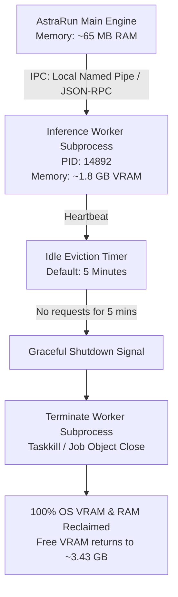

# 18 — Offload & Local Inference Runtime Engineering

> **Status**: APPROVED RESEARCH & ARCHITECTURAL SPECIFICATION  
> **Phase**: 8 — Local Model Inference Architecture & Memory Budgets  
> **Focus**: llama.cpp Offload Tuning, VRAM Spillover Mechanics, Out-of-Process Worker Eviction, and Total Memory Accounting  
> **Target System**: Local Windows 11 Workstation (RTX 2050 Laptop GPU 4GB, ~3.30 GB Free RAM, ~3.43 GB Free VRAM)  

---

## 1. Executive Summary & The Total Memory Equation

A critical error in local AI deployment is confusing **model weight file size** with **total operational memory**. Total inference memory is a multi-component equation:

$$M_{\text{Total}} = M_{\text{Weights}} + M_{\text{KV\_Cache}} + M_{\text{Compute\_Graph}} + M_{\text{Driver\_CUDA}} + M_{\text{Process\_Runtime}}$$

```
+-------------------------------------------------------------------------+
|                  TOTAL VRAM CONSUMPTION (RTX 2050)                     |
|                                                                         |
|  [Weights: ~1.02 GB] (Qwen2.5-1.5B Q4)                                  |
|  [KV Cache: ~0.28 GB] (8k tokens, Q8 KV)                                |
|  [Compute Graph Buffers: ~0.15 GB]                                      |
|  [CUDA Driver Context Overhead: ~0.35 GB]                               |
|  ---------------------------------------------------------------------  |
|  Total VRAM Required: ~1.80 GB  <--- Comfortably inside 3.43 GB Free    |
+-------------------------------------------------------------------------+
```

If $M_{\text{Total}}$ exceeds physical free VRAM, the system enters the catastrophic **WDDM Spillover Zone**.

---

## 2. The WDDM VRAM Spillover Hazard

On Windows, the Windows Display Driver Model (WDDM 2.x/3.x) virtualizes GPU memory. Unlike Linux where an out-of-memory error (`CUDA OOM`) halts the process, **Windows automatically spills excess VRAM allocations into Host System RAM**.

### 2.1 The Throughput Collapse
- RTX 2050 Laptop GDDR6 Memory Bandwidth: **~112 GB/s**.
- PCIe 4.0 x4 Bus Bandwidth to Host RAM: **~3.94 GB/s**.
- **Spillover Consequence**: As soon as even 100 MB of tensors spill into system RAM, memory access bandwidth drops by **~96.5%**. Inference token generation drops from ~70 tokens/sec to **< 2 tokens/sec**, effectively freezing the workstation.
- Furthermore, host physical RAM only has **~3.30 GB free** `[MEASURED]`. If GPU tensors spill into host RAM, Windows begins paging active user applications to the SSD pagefile, causing severe OS micro-stutters.

### 2.2 Hard VRAM Budget Ceiling
`[USER_REQUIREMENT]` AstraRun enforces a hard VRAM ceiling for all local model operations:

$$M_{\text{VRAM\_Allocated}} \le 2{,}800\,\text{MB}$$

This guarantees a **minimum safety margin of ~630 MB** of free VRAM for Windows Desktop Window Manager (DWM), browser GPU acceleration, and video playback.

---

## 3. Layer Offloading & llama.cpp Tuning Parameters

To guarantee stability within the 2.8 GB budget, `llama.cpp` / `llama-cpp-python` must be invoked with strictly calculated layer offload targets:

| Parameter | Recommended Value | Engineering Rationale |
| :--- | :--- | :--- |
| `n_gpu_layers` (`-ngl`) | `99` (All layers for $\le 2\text{B}$) | 1.5B models (28 layers) fit fully in ~1.8 GB VRAM. Zero PCIe bottleneck. |
| `n_ctx` | `8192` (Default) / `16384` (Max) | 8k tokens balances workstation history with modest KV cache size (~280 MB). |
| `cache_type_k` | `q8_0` | Compresses Key cache by 50% vs FP16 with negligible perplexity impact. |
| `cache_type_v` | `q8_0` | Compresses Value cache by 50% vs FP16. |
| `flash_attn` | `True` (`-fa`) | Enables FlashAttention; reduces memory and speeds up prompt processing by ~2.5x. |
| `n_batch` | `512` | Limits compute graph memory during prompt evaluation. |
| `use_mmap` | `True` | Fast cold-start loading from disk; OS manages page cache. |

---

## 4. The Evictable Worker Process Pattern

### 4.1 The In-Process C-Extension Anti-Pattern
Loading `llama_cpp` or `torch` directly inside the primary AstraRun agent process causes severe operational defects:
1. **CUDA Memory Fragmentation**: Even when `llama_free` or `torch.cuda.empty_cache()` is called, CUDA runtime drivers often hold reserved virtual address pages, failing to return physical memory to the OS.
2. **Process Crash Vulnerability**: A segmentation fault inside compiled C/CUDA code kills the entire agent, dropping user task state.
3. **Permanent Memory Footprint**: AstraRun would permanently occupy ~1.5 GB of RAM even when the user is not actively executing AI goals.

### 4.2 Out-of-Process Worker Architecture



1. **Dedicated Worker Subprocess**:
   - Spawns only when an LLM inference task is queued.
   - Communicates over a high-speed local named pipe (`\\.\pipe\astrarun-infer`) or Unix domain socket.
2. **Idle Eviction Watchdog**:
   - If no inference request arrives within **5 minutes** (configurable), the worker process is sent a shutdown signal.
3. **Guaranteed OS Reclamation**:
   - Terminating the worker process forces the Windows kernel to unconditionally reclaim 100% of GPU allocations, driver contexts, and host RAM pages. Zero memory leaks possible.

---

## 5. Synthesis & Architectural Invariants

1. **Total Memory Accounting is Mandatory**: Never estimate model feasibility by weight size alone. Always account for KV cache, driver overhead, and graph buffers.
2. **2.8 GB VRAM Safety Ceiling**: No model configuration may allocate $> 2.8\,\text{GB}$ VRAM under maximum context load.
3. **Isolated Evictable Worker**: Local model weights must live exclusively in an out-of-process worker, never in the main agent process.
4. **FlashAttention and Q8_0 KV Cache**: FlashAttention and quantized KV caching (`q8_0`) are standard defaults to preserve VRAM headroom.
