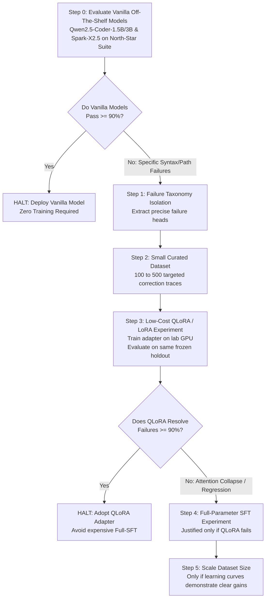

# 20 — Conditional Distillation & Fine-Tuning Strategy

> **Status**: PROVISIONAL RESEARCH & EXPERIMENTAL LADDER SPECIFICATION  
> **Phase**: 10 — Training, Distillation & Synthetic Trajectory Strategy  
> **Focus**: The Conditional Training Ladder: Vanilla Baseline $\to$ Error Taxonomy $\to$ Curated Dataset $\to$ QLoRA $\to$ Full SFT  
> **Governing Principle**: Zero training compute is committed until vanilla off-the-shelf model failures physically justify it.  

---

## 1. The Conditional Training Ladder

AstraRun does **not** commit to immediate multi-GPU fine-tuning, full-parameter SFT, or massive synthetic dataset generation. Instead, all fine-tuning follows a strict empirical progression ladder:

---

## 2. Step-by-Step Training Ladder Specifications

### Step 0: Vanilla Off-The-Shelf Baseline Evaluation
- **Action**: Test unmodified open-weights GGUF releases of `Qwen2.5-Coder-1.5B-Instruct`, `Qwen2.5-Coder-3B-Instruct`, and `Spark-X2.5-1.7B` against the 25 North-Star tasks.
- **Outcome Assessment**:
  - If vanilla models achieve $\ge 90\%$ pass rate across the 12 cognitive roles, training is **completely bypassed**.

### Step 1: Failure Taxonomy Construction
- If vanilla models fail:
  - Categorize failures into specific buckets:
    - Path backslash unescaping (`C:\Users` interpreted as `\U` unicode escape).
    - Pydantic schema nesting violations.
    - Hallucinated argument names.
    - Repetitive command looping upon error return.

### Step 2: Curated Micro-Dataset (100–500 Traces)
- `[HYPOTHESIS]` Rather than generating 50,000 blind synthetic examples, a tightly curated set of **100 to 500 high-fidelity traces** specifically targeting the identified failure heads is sufficient to teach small models proper formatting.

### Step 3: Parameter-Efficient Fine-Tuning (QLoRA / LoRA)
- Train low-rank adapters (`rank=16`, `alpha=32`) targeting attention projections (`q_proj`, `v_proj`, `k_proj`, `o_proj`).
- Measure memory and compute: can be trained on a single modest GPU in < 2 hours.
- Re-run identical frozen holdout benchmark.

### Step 4: Full-Parameter SFT (Conditional Fallback)
- **Only** if QLoRA demonstrates schema degradation, catastrophic forgetting, or inability to learn strict XML tags:
- Execute full-parameter SFT in BF16 on an external 80GB VRAM GPU.
- Compute requirements: $\sim 26\,\text{GB VRAM}$ for a 1.5B model in BF16 with AdamW `[CALCULATED]`.

---

## 3. Loss Masking & Optimization Invariants

If and when training occurs, loss masking is strictly enforced:
- Loss computed **only** on agent thoughts (`<thought>`) and tool calls (`<tool_call>`).
- Injected observations (`<tool_response>`) and environment state dumps are masked (Loss = 0).

---

## 4. Synthesis & Governance Invariants

1. **No Speculative Training**: No training jobs will be launched without documented failure logs from Step 0.
2. **LoRA Precedes Full-SFT**: Parameter-efficient methods must be evaluated and proven inadequate before full-parameter fine-tuning is considered.
3. **Data Efficiency Over Volume**: 500 verified, execution-tested traces take precedence over 50,000 unverified synthetic traces.
