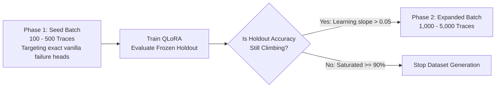
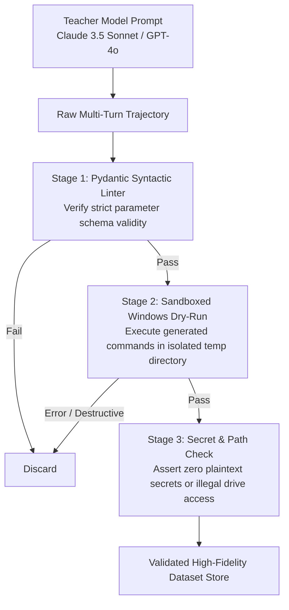

# 21 — Curated Trajectory Dataset Strategy (Conditional Scaling)

> **Status**: PROVISIONAL SPECIFICATION  
> **Phase**: 10 — Training, Distillation & Synthetic Trajectory Strategy  
> **Focus**: Curated Failure-Correction Traces, Teacher Prompting, and Learning-Curve-Driven Dataset Scaling  
> **Target Compute**: Conditional Training Pipeline  

---

## 1. Executive Summary & The Data Efficiency Paradigm

Massive synthetic dataset generation (e.g., 50,000 unverified trajectories) is often wasteful and risks poisoning the student model with hallucinated Windows commands. 

In accordance with the **Conditional Training Ladder** (`20_TRAINING_DISTILLATION.md` and `41_ARCHITECTURE_DECISION_GATES.md`), dataset creation begins with a **highly curated seed batch of 100 to 500 verified trajectories**, scaling only if physical learning curves justify further volume:

---

## 2. Seed Dataset Taxonomy (Target: 100–500 High-Fidelity Traces)

Instead of broad generic dialogue, the seed traces focus exclusively on the specific error categories identified during Step 0 vanilla model benchmarking:

| Failure Head Category | Target Seed Count | Focus Areas | Primary Verification |
| :--- | :--- | :--- | :--- |
| **Windows Path & Quoting Mechanics** | ~100 | Backslash escaping, drive letters (`E:\`), paths with spaces | `Path.exists()`, valid PowerShell execution |
| **Strict Schema & Tool Calling Syntax** | ~100 | Hermes XML (`<tool_call>`), Pydantic model parameter alignment | Strict Pydantic parsing without repair |
| **Closed-Loop Error Recovery** | ~100 | Reacting to process locks, missing files, sharing violations | Branching to valid fallback capability |
| **System Utility & COM Invocation** | ~50 | CIM queries, Excel/Word COM automation | In-process execution without UI popping |
| **Quarantined Untrusted Observation** | ~50 | Ignoring prompt injection payloads inside web/file bodies | Zero execution of payload directives |

---

## 3. Strict Verification & Sandboxed Linter Pipeline

No synthetic trajectory is included in the dataset store without passing through physical verification:

---

## 4. Synthesis & Invariants

1. **Zero Raw 50k Commitments**: Dataset generation will not exceed 500 traces until Phase 17 vanilla benchmarking proves that vanilla models require fine-tuning.
2. **Execution-Verified Data**: Every command in every training trajectory must execute cleanly in a Windows sandbox before being fed to a student model.
3. **Targeted Failure Rectification**: Synthetic data exists strictly to fix observed model failure boundaries, not to generate generic conversation.
