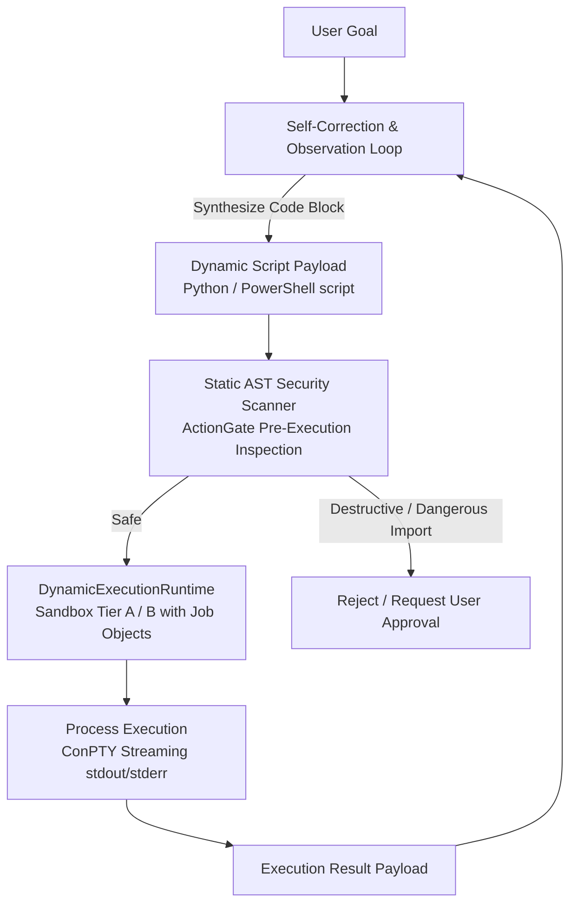

# 28 — Architecture D: Dynamic Code/Terminal-Centric Agent

> **Status**: APPROVED ARCHITECTURAL SPECIFICATION & EVALUATION  
> **Phase**: 14 — Competing Architecture Formulations  
> **Concept**: The agent solves workstation goals by synthesizing and executing dynamic Python and PowerShell code blocks directly within sandboxes, rather than relying on predefined JSON tool schemas  
> **Target Compute**: Local Workstation (Inspired by Open Interpreter & Voyager)  

---

## 1. Architectural Blueprint

In Architecture D, the agent does not navigate an explicit catalog of 30 rigid tool schemas. Instead:
1. **Code as Universal Tool**: The model synthesizes executable Python scripts or PowerShell one-liners to perform tasks.
2. **Dynamic Adaptation**: Can compose arbitrary loops, regex matching, file transformations, and calculations in a single turn without round-tripping through the planner.
3. **Execution Runtime**: Scripts run inside `DynamicExecutionRuntime` (Sandbox Tiers A or B) under strict memory and timeout constraints.

---

## 2. Resource & Memory Footprint

| Component | Technology | Memory Footprint `[ESTIMATED]` | Residency |
| :--- | :--- | :--- | :--- |
| **Model Weights** | Qwen2.5-Coder-1.5B (Q5_K_M) | **~1.18 GB VRAM** | Out-of-Process Worker |
| **KV Cache & Runtime** | 8192 context, Q8_0 KV | **~280 MB VRAM** | Worker process |
| **Execution Sandboxes** | Windows Job Object + Python Subproc | **Max 256 MB RAM** (Tier A) | Ephemeral (Auto-destroyed) |
| **Total VRAM Footprint** | Active inference | **~1.81 GB VRAM** | Fully safe on RTX 2050 4GB |

---

## 3. Analysis & Evaluation

### Strengths
1. **Unbounded Compositional Power**: Highly complex data transformations (e.g., parsing 100 CSVs, joining tables, computing statistical deviations) can be expressed in 15 lines of Python code, executed in 200 ms in a single step, rather than requiring 50 sequential tool turns.
2. **Coder Model Alignment**: Models like `Qwen2.5-Coder` are pre-trained predominantly on code. They are often significantly more reliable at generating valid Python code than following complex synthetic JSON tool schemas.
3. **Natural Skill Compilation**: Successful dynamic scripts are already 90% ready to be saved directly into `.skills/` as procedural capabilities.

### Weaknesses & Failure Modes
1. **Security & AST Audit Complexity**: Classifying whether an arbitrary 40-line Python script is `SAFE_READ` or `IRREVERSIBLE_MUTATION` requires sophisticated Abstract Syntax Tree (AST) analysis. A subtle `shutil.rmtree` disguised inside a helper function can bypass naive keyword checks.
2. **Library Hallucinations**: Small 1.5B models frequently invent non-existent Python package names (`pip install windows-power-helper`) or invent fictional method signatures.
3. **Debugging Overhead**: If a synthesized script encounters a syntax error or runtime traceback, the agent spends turns debugging its own script rather than executing the user's task.

---

## 4. Verdict & Fit for AstraRun

Architecture D is extraordinarily powerful for data manipulation, mathematical computation, and custom script execution (Tier A Ephemeral Scratchpad). However, as a universal primary interface for Windows OS management, it carries excessive safety and verification risks compared to structured capability schemas.
