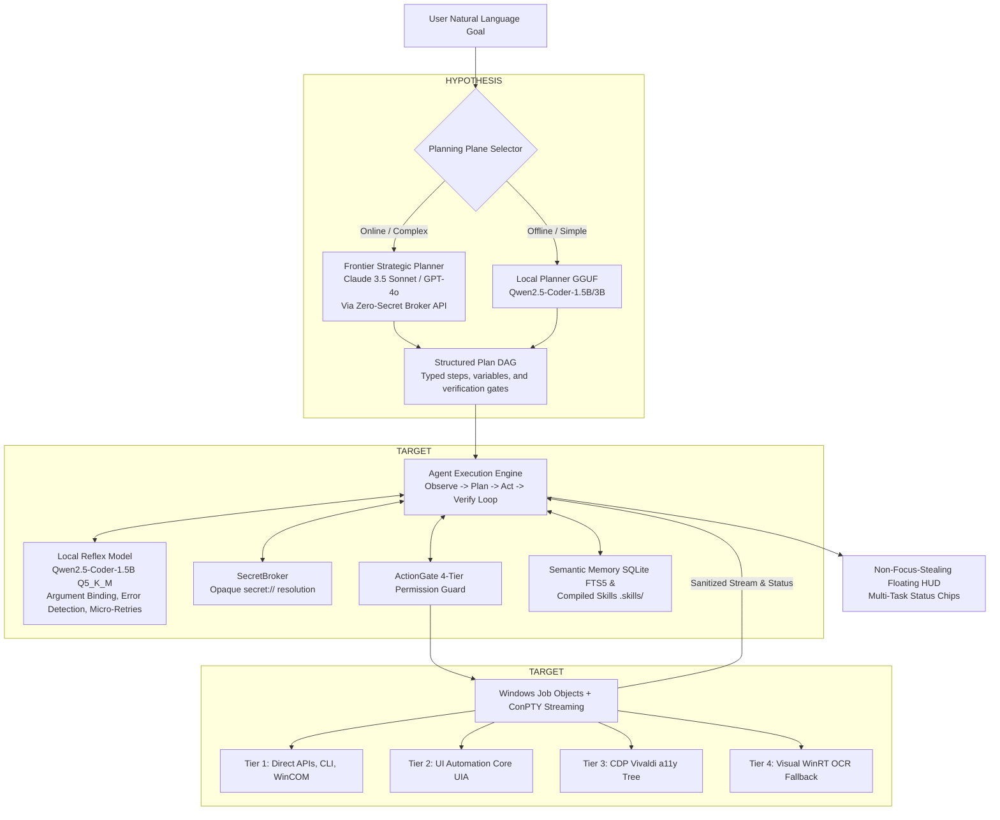

# 30 — Provisional Architecture: Asymmetric Hybrid Workstation Engine (Architecture B+)

> **Status**: PROVISIONAL LEADING HYPOTHESIS (Pending Phase 17 Empirical Validation)  
> **Phase**: 15 — Architecture Synthesis & Provisional Selection  
> **Evaluation Mode**: Active Falsification Target for Phase 17  
> **Target System**: Local Windows 11 Workstation (RTX 2050 4GB, ~3.30 GB Free RAM, ~3.43 GB Free VRAM `[MEASURED_LOCAL]`)  

---

## 1. Executive Summary & Provisional Architectural Formula

Following initial reality audits and framework research, **Architecture B+** is formulated as the **Provisional Leading Hypothesis** for AstraRun. 

$$\mathbf{AstraRun\ B^+} = \text{Macro Strategic Planner} + \text{Local Reflex Executor} + \text{Dynamic Sandbox Runtime} + \text{Compiled Skill Optimization}$$

> [!IMPORTANT]
> **Falsification Directive**:  
> Phase 17 does not exist to rubber-stamp Architecture B+. Its explicit goal is to stress-test, benchmark, and attempt to **falsify** the assumptions of Architecture B+ across real-world physical workloads.

---

## 2. Core Hypotheses Comprising Architecture B+

| Hypothesis | Description | Current Evidence Status | Target Validation Experiment |
| :--- | :--- | :--- | :--- |
| **H1: Macro/Micro Split** | Separating macro-DAG generation from micro-execution improves overall task success vs single small model. | `HYPOTHESIS` | Model Tournament (A vs B on 25 North-Star tasks) |
| **H2: Out-of-Process Worker** | Running local inference in an evictable subprocess prevents CUDA memory fragmentation and guarantees 100% reclamation. | `HYPOTHESIS` | Hardware Profiling Lab (Worker termination delta) |
| **H3: A11y Tree Token Savings** | Extracting Chromium accessibility trees achieves $>90\%$ token reduction vs raw DOM without losing interaction anchors. | `REPORTED_UPSTREAM` / `HYPOTHESIS` | Vivaldi CDP Lab |
| **H4: WinRT OCR Zero-Overhead** | Native Windows OS OCR provides sub-50ms text extraction with zero VRAM allocation. | `REPORTED_UPSTREAM` / `ESTIMATED` | OCR Lab |
| **H5: Skills as Compute Optimization** | Compiling multi-step trajectories into deterministic `SKILL.md` bundles reduces repeat task latency by $>90\%$. | `HYPOTHESIS` | Skill Compilation Lab |
| **H6: Secret Broker Zero-Leak** | JIT child process injection + Aho-Corasick stream scrubbing prevents 100% of credential leaks in logs/context. | `TARGET` | Dynamic Runtime Lab |

---

## 3. Hardware Budget Targets vs. Measured Baseline

| Hardware Dimension | Measured Machine Baseline | Architecture B+ Target Budget | Margin of Safety | Status |
| :--- | :--- | :--- | :--- | :--- |
| **GPU VRAM** | **3,430 MB Free** `[MEASURED_LOCAL]` | **$\le 1,810$ MB** peak `[TARGET]` | +1,620 MB Headroom | `TARGET` (Pending Lab C) |
| **Host System RAM** | **3,300 MB Free** `[MEASURED_LOCAL]` | **$\le 150$ MB** resident `[TARGET]` | +3,150 MB Headroom | `TARGET` (Pending Lab C) |
| **Inference Offload** | RTX 2050 4GB Laptop | 100% GPU offload (28 layers) `[TARGET]` | Zero PCIe bottleneck | `TARGET` (Pending Lab C) |
| **Idle Eviction** | 0 MB background load | Reclaim 100% within 5 min `[TARGET]` | Clean host recovery | `TARGET` (Pending Lab C) |

---

## 4. Phase 17 Falsification Criteria for Architecture B+

Architecture B+ will be deemed **falsified or fundamentally redesigned** if Phase 17 experiments reveal any of the following:
1. **Single Local Model Parity**: If a standalone local 1.5B or 3B model (Architecture A) achieves $\ge 90\%$ pass rate on the 25 North-Star tasks without external macro planning, the complexity of the asymmetric hybrid split is unjustified.
2. **Worker Memory Leak**: If terminating the out-of-process inference worker leaves $> 25\,\text{MB}$ unreleased VRAM or zombie handles in Windows, the process isolation model must be re-engineered.
3. **CDP Inaccessibility**: If Vivaldi strictly refuses CDP connection to active user sessions without a disruptive restart, the browser integration strategy must pivot.
4. **WinRT OCR Precision Deficit**: If WinRT OCR achieves $< 90\%$ word accuracy on anti-aliased desktop UI text, a local neural vision model becomes mandatory.
