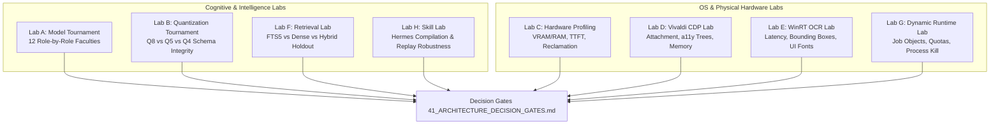

# 34 — Phase 17: Empirical Architecture Validation Plan

> **Scope**: Pre-Implementation Falsification & Empirical Benchmarking  
> **Status**: APPROVED VALIDATION MASTER PLAN  
> **Governance Invariant**: STRICT NON-IMPLEMENTATION IN PRODUCTION CODE  
> **Target System**: Local Windows 11 Workstation (`E:\Workspace\Active\AstraRun`)  

---

## 1. Purpose & Falsification Charter

Phase 17 exists to **replace all unmeasured claims, theoretical models, and README assumptions with physical workstation evidence**. 

Our objective is **not** to defend Architecture B+. Our mandate is to **actively attempt to falsify it**:
- If a single local model handles 100% of North-Star tasks without degradation $\to$ Architecture B+ is over-engineered.
- If Vivaldi cannot attach to existing sessions via CDP without restarting $\to$ the browser integration model must pivot.
- If out-of-process workers leak CUDA contexts on Windows $\to$ process isolation fails.
- If WinRT OCR fails on thin UI fonts $\to$ a neural vision model becomes mandatory.

---

## 2. The 8 Isolated Validation Labs

All experimental harnesses, scripts, fixtures, and logs reside in an isolated test environment under `tests/benchmarks/phase17/`. Zero files in `src/astrarun/` will be modified.



---

## 3. Detailed Scope of the 8 Labs

### Lab A: Model Tournament
- **Candidates**:
  - `Qwen2.5-Coder-1.5B-Instruct` (GGUF)
  - `Qwen2.5-Coder-3B-Instruct` (GGUF)
  - `Spark-X2.5-1.7B` (GGUF)
  - `FunctionGemma-270M` (if role-appropriate for argument binding)
  - `SmolLM2-1.7B-Instruct` (GGUF baseline)
- **Role-by-Role Independent Evaluation**:
  1. *Intent Interpretation*
  2. *Tool Retrieval*
  3. *Argument Binding*
  4. *Tool Calling (Hermes XML vs JSON)*
  5. *DAG Planning*
  6. *Replanning on Error*
  7. *Clarification Triggering*
  8. *Goal Verification*
  9. *Skill Adaptation*
  10. *Python/PowerShell Coding*
  11. *Safety Criticism / ActionGate Respect*
  12. *Long-Horizon Trajectory Reasoning*

### Lab B: Quantization Tournament
- Evaluates `Q8_0`, `Q5_K_M`, `Q4_K_M`, and `Q3_K_M` (where available) against a frozen 100-case JSON schema adherence test suite.
- Measures exact Pydantic parsing failure rates and path-escaping errors.

### Lab C: Hardware & Memory Profiling
- Uses `pynvml` and Windows CIM to measure:
  - Cold load latency (ms).
  - Peak resident VRAM (MB) across 4k, 8k, and 16k contexts.
  - Peak resident RAM (MB).
  - Time To First Token (TTFT) and Tokens Per Second (TPS).
  - Worker process termination: post-kill VRAM and RAM delta measured 1000ms after kill.

### Lab D: Vivaldi / Browser CDP Lab
- Tests attachment to running Vivaldi processes without restart.
- Tests launching with `--remote-debugging-port=9222` and separate `--user-data-dir`.
- Measures exact token count of Chromium Accessibility Tree vs raw DOM on test fixtures (safe local HTML + public pages).
- Measures memory overhead of CDP WebSocket listener.

### Lab E: WinRT OCR Lab
- Evaluates Windows native `Windows.Media.Ocr` on 50 controlled screenshot fixtures (dark mode, light mode, 100%/125%/150% DPI, thin UI fonts, code snippets, error popups).
- Measures execution latency (ms) and word-level accuracy against ground truth.

### Lab F: Retrieval Lab
- Compares:
  1. SQLite FTS5 (BM25 keyword search)
  2. Dense vector search (`bge-small-en-v1.5` ONNX)
  3. Hybrid (FTS5 + `bge-small` via Reciprocal Rank Fusion)
  4. Current AstraRun semantic index baseline
- Evaluated on holdout capability sets with strict linguistic paraphrase tests (zero lexical overlap).

### Lab G: Dynamic Runtime Lab
- Prototypes and stress-tests:
  - Windows Job Object creation and memory quota enforcement (`STATUS_QUOTA_EXCEEDED`).
  - Recursive process-tree termination (`JOB_OBJECT_LIMIT_KILL_ON_JOB_CLOSE`).
  - Interactive ConPTY streaming and cancellation.
  - Aho-Corasick in-memory secret token redaction (`***REDACTED***`).

### Lab H: Skill Compilation Lab
- Takes a verified 3-step reasoning trajectory from North-Star tasks.
- Synthesizes a parameterized `SKILL.md` + `run.py`.
- Replays with varied parameters and injected failure conditions.
- Evaluates whether deterministic execution holds or requires dynamic preconditions and adaptation guards.

---

## 4. Execution Sequence & Strict User Authorization Gate

```
Step 1: Execute Zero-Download Labs (Labs D, E, F, G)
        - Uses existing Windows OS runtimes, SQLite, and local test fixtures.
        - Zero gigabytes downloaded.
        
Step 2: Present Zero-Download Results & Request Model Download Approval
        - Present exact candidate GGUF files, repository URLs, SHA256 hashes, and download sizes.
        - Total disk budget explicitly stated.
        - STOP and wait for user authorization.

Step 3: Execute Model & Hardware Labs (Labs A, B, C, H)
        - Run frozen model tournament and torture suite.
        - Synthesize physical evidence into final Architecture Decision Gates.
```
