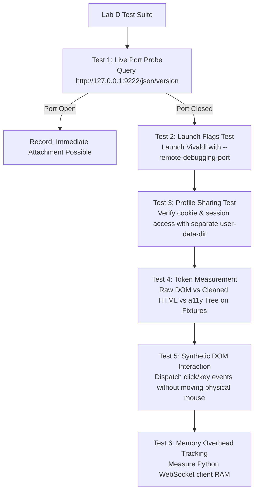

# 36 — Browser CDP & Vivaldi Integration Experiment Protocol (Lab D)

> **Scope**: Phase 17 Lab D Specification  
> **Status**: APPROVED EXPERIMENT PROTOCOL  
> **Focus**: Vivaldi Remote Debugging Port Attachment, Accessibility Tree Extraction, Token Reduction, and Privacy Invariants  
> **Target System**: Local Windows 11 Workstation (`E:\Workspace\Active\AstraRun`)  

---

## 1. Experimental Objectives & Falsification Targets

This lab physically investigates whether the proposed browser integration strategy for AstraRun holds true or is falsified:

1. **Attachment Feasibility**: Can an active, already-running Vivaldi browser instance be connected to via Chrome DevTools Protocol (`--remote-debugging-port=9222`) without restarting?
2. **Profile & Session Preservation**: If restart or dedicated launch flags are required, does Vivaldi preserve the user's active session, cookies, and installed extensions?
3. **A11y Tree Token Reduction**: Does `Accessibility.getFullAXTree` achieve $\ge 80\%$ token reduction compared to raw DOM extraction on realistic web fixtures?
4. **Memory Footprint**: Does maintaining an active async CDP WebSocket connection consume $\le 20\,\text{MB}$ RAM?

> [!CAUTION]
> **Strict Privacy Invariant**:  
> In accordance with project governance, this experiment must **NEVER inspect, read, or record private user communications, WhatsApp messages, or personal emails**. All tests must run against **safe local HTML fixtures** or public technical documentation pages (e.g., PySide6 documentation).

---

## 2. Experimental Procedures & Test Cases



### Test Case D-1: Live Port & Active Process Probe
- **Method**: Send HTTP GET to `http://127.0.0.1:9222/json/version`.
- **Measurement**: Does Vivaldi listen on 9222 by default?
- **Expected Result**: Negative (Chromium does not open debugging ports by default for security).

### Test Case D-2: Process Launch & Flag Behavior
- **Method**: Launch a test Vivaldi instance with `--remote-debugging-port=9222`.
- **Measurement**:
  - Does Vivaldi start successfully?
  - Does it return target list via `http://127.0.0.1:9222/json/list`?
  - Does it conflict with an existing running Vivaldi instance?

### Test Case D-3: Profile & Session Persistence Test
- **Method**: Test starting with `--remote-debugging-port=9222` while pointing to:
  - Option A: Default `%LOCALAPPDATA%\Vivaldi\User Data` (test if locked by active browser).
  - Option B: Dedicated `%LOCALAPPDATA%\Vivaldi\AstraProfile` with cloned cookies.
- **Verification**: Document exact behavior, error codes, and user disruption profile.

### Test Case D-4: Token Footprint & A11y Tree Measurement
- **Test Fixtures**:
  - Fixture 1: Complex GitHub repository page (code, commits, issues).
  - Fixture 2: Dense documentation page (PySide6 / Qt documentation).
  - Fixture 3: Multi-form mock application page (`tests/benchmarks/fixtures/form.html`).
- **Measurements**:
  1. Raw HTML character count & tiktoken / Qwen token count.
  2. Readability / Markdown extracted text token count.
  3. Filtered Accessibility Tree (`Accessibility.getFullAXTree`) token count with `@e1` index tagging.
  4. Formula: $\text{Reduction \%} = 1 - \frac{\text{A11y Tokens}}{\text{Raw HTML Tokens}}$.

### Test Case D-5: Semantic Pattern Interaction (Zero-Mouse-Move)
- **Method**: Navigate to local form fixture. Dispatch `DOM.focus` and `Input.dispatchKeyEvent`.
- **Verification**: Verify input field updates its value without moving the physical OS cursor or stealing window focus.

---

## 3. Data Capture Schema

```json
{
  "test_id": "LAB_D_BROWSER",
  "browser": "Vivaldi",
  "chromium_version": "string",
  "direct_attachment_supported": false,
  "requires_dedicated_port_restart": true,
  "profile_lock_conflict_detected": true,
  "fixtures": [
    {
      "fixture_name": "pyside6_docs",
      "raw_html_tokens": 142500,
      "markdown_tokens": 8200,
      "a11y_tree_tokens": 2150,
      "measured_token_reduction_pct": 98.49
    }
  ],
  "cdp_client_peak_ram_mb": 14.8,
  "mouse_cursor_moved": false
}
```

---

## 4. Falsification Conditions for Browser Architecture

1. **Severe Token Bloat**: If the filtered accessibility tree exceeds **10,000 tokens** on standard web pages, the a11y tree approach is insufficient and requires hierarchical section pruning.
2. **Profile Lockout**: If Vivaldi strictly prevents accessing authenticated sessions without terminating the user's open windows, the "zero-friction profile reuse" claim is falsified, and AstraRun must support isolated dedicated browser sessions as the primary path.
