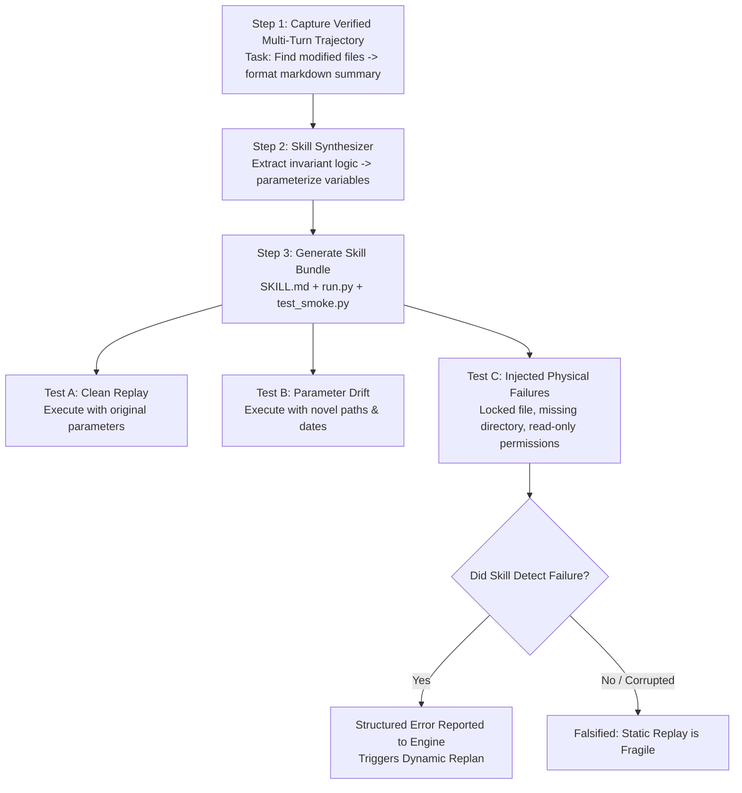

# 40 — Skill Compilation & Execution Robustness Experiment Protocol (Lab H)

> **Scope**: Phase 17 Lab H Specification  
> **Status**: APPROVED EXPERIMENT PROTOCOL  
> **Focus**: Trajectory-to-Skill Compilation, Parameter Generalization, Injected Failure Recovery, and Precondition Guards  
> **Target System**: Local Windows 11 Workstation (`E:\Workspace\Active\AstraRun`)  

---

## 1. Experimental Objectives & Falsification Targets

The "Skills as Compute Optimization" paradigm posits that an agent should compile successful multi-turn reasoning traces into deterministic scripts, reducing subsequent token cost to $O(1)$. This lab physically tests whether compiled skills remain robust under real-world workstation drift or fail catastrophically:

1. **Compilation Fidelity**: Can a 3-step LLM reasoning trajectory be automatically synthesized into a parameterized `SKILL.md` + `run.py` script?
2. **Parameter Generalization**: Does the synthesized skill execute cleanly when given novel paths, date ranges, and parameters?
3. **Injected Failure Resilience**: When physical preconditions fail (e.g., target file is locked, path does not exist, network drops), does the compiled skill fail safely with structured errors, or does it cause corrupted workstation state?
4. **Adaptive Preconditions**: Do compiled skills require explicit declarative preconditions (`PRECONDITIONS`) and postconditions (`POSTCONDITIONS`) to prevent brittle execution?

---

## 2. Experimental Lifecycle & Test Pipeline



---

## 3. Detailed Test Scenarios

### Scenario H-1: Developer Workspace Snapshot Skill
- **Source Trajectory**: Task 10 (Git Status Audit & Branch Tracking).
  - Trajectory steps: `git status` $\to$ `git rev-parse --abbrev-ref HEAD` $\to$ `git log -n 5 --oneline`.
- **Target Synthesized Skill**: `git-workspace-snapshot`
  - Input parameters: `repo_path` (string), `commit_depth` (int).
- **Test Runs**:
  - Run 1 (Identical): Run on `E:\Workspace\Active\AstraRun`.
  - Run 2 (Novel Workspace): Run on `E:\Workspace\Tools\pdfcraft`.
  - Verification: Compares execution time of multi-turn LLM reasoning (~4,500 ms) vs compiled skill execution (< 80 ms).

### Scenario H-2: Injected Failure & Precondition Testing
- **Injected Fault 1: Non-Existent Directory**
  - Parameter: `repo_path = "E:\Workspace\NonExistentPath"`
  - Expectation: Script checks `Path(repo_path).exists()`, halts before spawning child processes, and returns structured code `PRECONDITION_FAILED: PATH_NOT_FOUND`.
- **Injected Fault 2: Git Repository Corruption**
  - Parameter: Target directory exists but lacks a `.git` folder.
  - Expectation: Halts with `PRECONDITION_FAILED: NOT_A_GIT_REPO`.
- **Injected Fault 3: Destination Lock**
  - Action: Exclusive file lock placed on output report.
  - Expectation: Detects sharing violation; triggers graceful fallback without crashing.

---

## 4. The Declarative Contract Specification for Compiled Skills

To prevent fragility, the experiment validates whether skills must adhere to a strict declarative contract:

```yaml
---
name: git-workspace-snapshot
version: 1.0.0
inputs:
  repo_path: { type: path, exists: true, is_dir: true }
  commit_depth: { type: integer, min: 1, max: 100, default: 5 }
preconditions:
  - assert_directory_exists: "$inputs.repo_path"
  - assert_path_contains: ["$inputs.repo_path", ".git"]
postconditions:
  - assert_file_created: "$outputs.report_path"
  - assert_file_size_gt: ["$outputs.report_path", 0]
entrypoint: run.py
---
```

---

## 5. Falsification Conditions for Skill Architecture

1. **Drift Fragility**: If a synthesized skill fails when executed on a valid second repository without manual human code correction, automated skill synthesis is falsified as a primary runtime mechanism.
2. **Silent Failure**: If an injected fault causes the compiled script to silently corrupt output or hang indefinitely, static scripts without declarative precondition wrappers are rejected.
3. **Marginal Speedup**: If skill execution latency exceeds **500 ms** (approaching single-turn LLM generation time), compute optimization benefits are insufficient to justify registry complexity.
