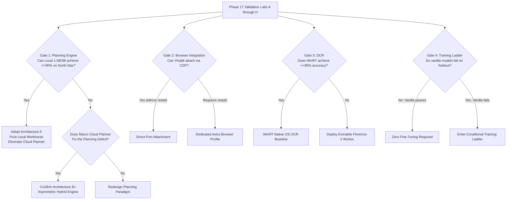

# 41 — Phase 17 Architecture Decision Gates & Falsification Thresholds

> **Scope**: Empirical Decision Framework for AstraRun v0.12  
> **Status**: APPROVED DECISION FRAMEWORK  
> **Rule**: Strict evidence-backed go/no-go criteria. No architecture choice advances without meeting its physical gate.  
> **Target System**: Local Windows 11 Workstation (`E:\Workspace\Active\AstraRun`)  

---

## 1. Executive Summary & Decision Logic

Phase 17 replaces theoretical debates with **empirical go/no-go gates**. The final production architecture for v0.12 will be decided purely by the outcomes of the 8 validation labs:



---

## 2. The 8 Master Decision Gates

| Gate ID | Architectural Dimension | Empirical Test / Lab | Falsification / Rejection Threshold | Promotion / Adoption Condition |
| :---: | :--- | :--- | :--- | :--- |
| **GATE-01** | **Macro / Micro Hybrid Split (Architecture B+)** | Lab A: Model Tournament on 25 North-Star tasks | If Architecture A (pure local model) achieves $\ge 90\%$ pass rate, Architecture B+ is rejected as unnecessary overhead. | If Architecture A scores $< 80\%$ while Architecture B achieves $\ge 92\%$, Architecture B+ is adopted. |
| **GATE-02** | **VRAM & Memory Reclamation** | Lab C: Hardware Profiling (`pynvml`) | If out-of-process worker leaves $> 25\,\text{MB}$ unreleased VRAM or zombie handles after kill, in-process architecture is re-evaluated. | Worker termination returns 100% of VRAM to baseline ($\Delta \le 5\,\text{MB}$ driver variance). |
| **GATE-03** | **Quantization Floor** | Lab B: Quantization Tournament | If `Q4_K_M` produces $> 5\%$ schema syntax errors vs `Q8_0`, `Q4` is disqualified; minimum floor raised to `Q5_K_M` or `Q8_0`. | Quantization achieves $\ge 95\%$ valid Pydantic outputs. |
| **GATE-04** | **Browser Session Attachment** | Lab D: Vivaldi CDP Lab | If Vivaldi locks profile and refuses CDP connection without terminating open tabs, "live session attachment" claim is rejected. | Dedicated Astra profile with shared session cookies is promoted. |
| **GATE-05** | **OCR Fast-Path Feasibility** | Lab E: WinRT OCR Lab | If WinRT OCR word accuracy is $< 90\%$ or latency $> 80\,\text{ms}$, OS-native OCR is rejected as standalone detector. | WinRT achieves $\ge 95\%$ accuracy on native UI text in $< 40\,\text{ms}$. |
| **GATE-06** | **Retrieval Architecture** | Lab F: Retrieval Lab | If pure SQLite FTS5 matches Hybrid RRF within $2\%$ on paraphrase queries, dense embedding model is discarded. | Hybrid RRF achieves $\ge 5\%$ recall advantage on paraphrase queries; adopted at $\le 80\,\text{MB}$ RAM. |
| **GATE-07** | **Job Object Sandbox Containment** | Lab G: Runtime Sandbox Lab | If a memory-hog child process exceeds limit without being terminated by Windows kernel, Job Object model is rejected. | Job Object halts process with `STATUS_QUOTA_EXCEEDED` cleanly. |
| **GATE-08** | **Compiled Skill Replay Robustness** | Lab H: Skill Compilation Lab | If static script replay fails upon simple directory change or locks without error handling, raw script compilation is rejected. | Skills require declarative pre/postcondition wrappers before registry promotion. |

---

## 3. The Conditional Training & Distillation Decision Ladder

`[USER_REQUIREMENT]` We do **NOT** commit to a 50,000 trajectory dataset, full-parameter SFT, or DPO by default. All training compute on the 80GB lab is strictly governed by the **Experimental Training Ladder**:

```
Step 0: Benchmark Vanilla Off-the-Shelf Models (Qwen2.5-Coder-1.5B/3B, Spark-X2.5)
        │
        ├── If vanilla models achieve >= 90% across North-Star roles:
        │   └── HALT: Zero fine-tuning required. Deploy vanilla model.
        │
        └── If vanilla models fail (< 80% on schema, path escaping, or replanning):
            │
            ▼
Step 1: Construct Failure Taxonomy from Frozen Benchmark Errors
        - Isolate exact failure heads (e.g., path backslash escaping, Pydantic nesting).
        │
        ▼
Step 2: Generate Small Curated Dataset (100 to 500 High-Fidelity Traces)
        - Synthesize targeted corrections for specific failure heads only.
        │
        ▼
Step 3: Run Low-Cost Parameter-Efficient Experiment (QLoRA / LoRA)
        - Train LoRA adapter on 1.5B model in lab environment.
        - Evaluate against identical frozen holdout test suite.
        │
        ├── If QLoRA fixes failure modes and achieves >= 90%:
        │   └── HALT: Adopt QLoRA adapter. Do not run full-parameter SFT.
        │
        └── If QLoRA exhibits attention collapse or schema regressions:
            │
            ▼
Step 4: Execute Full-Parameter SFT Experiment (Only if Justified)
        - Run full-parameter fine-tune in BF16 on 80GB lab.
        - Evaluate against identical frozen holdout.
        │
        ▼
Step 5: Scale Dataset Size Only When Learning Curves Justify It
        - Only expand to 10k–50k traces if validation loss and accuracy continue to climb.
```

---

## 4. Synthesis & Exit Condition

All 8 decision dimensions must have completed empirical evidence and each must produce an explicit architectural decision:
- **A failed hypothesis is a VALID Phase-17 result**:
  - If WinRT OCR fails $\to$ adopt another vision path.
  - If `bge-small` adds negligible value over FTS5 $\to$ adopt standalone SQLite FTS5.
  - If Architecture B+ loses to pure local in reliability/latency $\to$ adopt Architecture A.
  - If static skills fail on parameter drift $\to$ mandate adaptive preconditions/contracts.
  - If Vivaldi direct attachment fails $\to$ pivot browser strategy to dedicated instance.
- **Phase 17 succeeds when uncertainty is resolved, NOT when Architecture B+ passes.** Implementation of AstraRun v0.12 will not commence until all 8 decision dimensions have recorded physical evidence.
