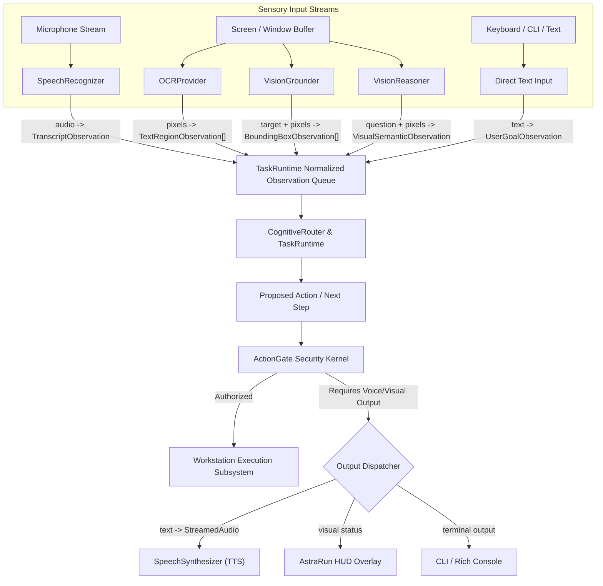
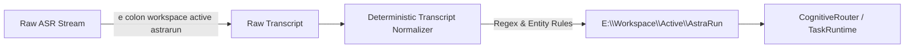
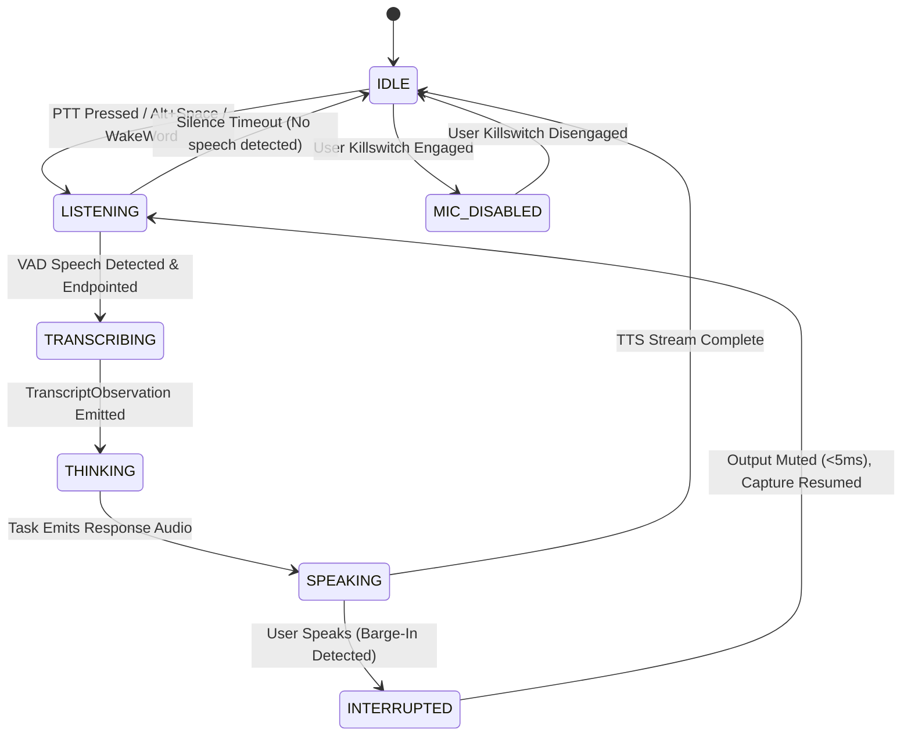

# 49_MULTIMODAL_VOICE_SPECIALIST_RESEARCH.md — Phase 18: Multimodal, Voice & Resource-Aware Architecture Dossier

> **Status**: APPROVED RESEARCH & ARCHITECTURAL SPECIFICATION (AUDITED & EVIDENCE-TAGGED)  
> **Phase**: 18 — Multimodal & Voice Specialist Research (Parallel Track)  
> **Workstation Profile**: `[MEASURED_LOCAL]` Intel Core i5-12450H (8C/12T) | 16 GB DDR4 RAM | NVIDIA GeForce RTX 2050 Laptop GPU (4096 MB VRAM) | Windows 11  
> **Evidence Tagging Key**:  
> - `[MEASURED_LOCAL]`: Measured directly on the host workstation.  
> - `[REPORTED_UPSTREAM]`: Published by upstream author / benchmark on reference hardware.  
> - `[ESTIMATED]`: Engineering estimation from parameters, quantization, and bandwidth formulas.  
> - `[TARGET]`: Architectural performance objective, unverified until physical measurement.  
> - `[NOT_MEASURED]`: Empirical metric pending execution in Phase 18A/18B/18C.  
> **Date**: 2026-10-01  

---

## 1. Architectural Requirement: Modality-Neutral Provider Interfaces

AstraRun v0.12 must never assume text-only input/output, permanently pinned language models, or cloud-dependent vision. All sensory inputs and actuator outputs must pass through provider-agnostic, decoupled interfaces that feed normalized observations into the `TaskRuntime`.



### 1.1 Normalized Observation Interfaces

```python
from dataclasses import dataclass, field
from typing import List, Dict, Any, Optional, Tuple
from enum import Enum
import time

class ProvenanceTier(str, Enum):
    NATIVE_API = "NATIVE_API"
    COM = "COM"
    DOM_CDP = "DOM_CDP"
    UIA = "UIA"
    OCR = "OCR"
    CLASSICAL_CV = "CLASSICAL_CV"
    VISUAL_GROUNDER = "VISUAL_GROUNDER"
    LOCAL_VLM = "LOCAL_VLM"
    EXTERNAL_VLM = "EXTERNAL_VLM"

@dataclass(frozen=True)
class ObservationBase:
    provenance: ProvenanceTier
    confidence: float  # 0.0 to 1.0
    timestamp_ns: int = field(default_factory=time.perf_counter_ns)
    latency_ms: float = 0.0
    cost_tokens: int = 0

@dataclass(frozen=True)
class TranscriptObservation(ObservationBase):
    text: str
    is_final: bool
    language: str
    detected_entities: List[str]
    intent_preserved: bool

@dataclass(frozen=True)
class BoundingBox:
    x_min: float  # Normalized [0.0, 1.0] relative to target window
    y_min: float
    x_max: float
    y_max: float
    center_point: Tuple[float, float]
    label: str

@dataclass(frozen=True)
class BoundingBoxObservation(ObservationBase):
    target_query: str
    candidates: List[BoundingBox]
    window_hwnd: int

@dataclass(frozen=True)
class TextRegionObservation(ObservationBase):
    text: str
    bbox: BoundingBox
    reading_order_index: int

@dataclass(frozen=True)
class VisualSemanticObservation(ObservationBase):
    question: str
    answer: str
    grounded_evidence: List[BoundingBox]
```

### 1.2 Model-Independent Provider Protocols

```python
from typing import Protocol, AsyncIterator, Iterator

class SpeechRecognizer(Protocol):
    """Normalized STT interface."""
    async def transcribe_stream(self, audio_chunks: AsyncIterator[bytes]) -> AsyncIterator[TranscriptObservation]: ...
    def transcribe_file(self, audio_path: str) -> TranscriptObservation: ...

class SpeechSynthesizer(Protocol):
    """Normalized TTS interface with instant cancellation."""
    def synthesize_stream(self, text: str) -> Iterator[bytes]: ...
    def cancel_playback(self) -> None: ...

class VisionGrounder(Protocol):
    """Locates explicit UI targets without deep reasoning."""
    def ground_target(self, image_bytes: bytes, target_desc: str, hwnd: int) -> BoundingBoxObservation: ...

class VisionReasoner(Protocol):
    """Interprets complex diagrams, semantic errors, and visual questions."""
    def reason_image(self, image_bytes: bytes, question: str) -> VisualSemanticObservation: ...

class OCRProvider(Protocol):
    """Extracts text regions with exact spatial coordinates."""
    def extract_text_regions(self, image_bytes: bytes, hwnd: int) -> List[TextRegionObservation]: ...
```

---

## 2. The Visual Escalation Hierarchy

AstraRun strictly prohibits routing raw screenshots directly to heavy VLMs. Every visual interaction must follow an escalating cost/latency ladder, escalating **only when the prior structured layer lacks sufficient confidence or fails to locate the element**.

```
Cost / Latency Ladder (Cheapest -> Most Expensive):

Tier 0: Native Windows API / Process Inspection [ESTIMATED: 0ms, 0 VRAM]
   │    GetSystemMetrics, EnumWindows, GetWindowRect, PowerShell CIM
   ▼
Tier 1: COM / Automation Surfaces [ESTIMATED: 1–5ms, 0 VRAM]
   │    Shell.Application, WScript.Shell, MS Office COM interfaces
   ▼
Tier 2: DOM / Chrome DevTools Protocol (CDP) [ESTIMATED: 5–20ms, 0 VRAM]
   │    Vivaldi / Edge / Chrome DOM tree, CDP DOM.getFlattenedDocument, XPath, CSS selectors
   ▼
Tier 3: Windows UI Automation (UIA) Core [ESTIMATED: 10–50ms, 0 VRAM]
   │    UIAutomationCore via ctypes, Name, AutomationId, ClassName, ControlType
   ▼
Tier 4: Windows Native OCR / WinRT OCR [ESTIMATED: 15–45ms, 0 VRAM, Host OS]
   │    Windows.Media.Ocr / WinRT OCR engine; extracts high-confidence text tokens
   ▼
Tier 5: Classical Image Processing / OpenCV [ESTIMATED: 20–40ms, 0 VRAM, CPU]
   │    Template matching, edge detection, contour analysis for fixed icons/badges
   ▼
Tier 6: Local Visual Grounder [ESTIMATED: 40–120ms, 250MB–850MB VRAM/RAM]
   │    Florence-2-Base / OmniParser YOLO IconDetect; resolves unlabelled icons & flat controls
   ▼
Tier 7: Local Small VLM [ESTIMATED: 300–800ms, 1200MB–2600MB VRAM, ON-DEMAND]
   │    SmolVLM-500M / Moondream2 / Qwen2.5-VL-3B; diagrams, chart interpretation, visual errors
   ▼
Tier 8: External Frontier VLM [ESTIMATED: 1200–3500ms, Cloud, STRICT PRIVACY QUARANTINE]
        Gemini 2.0 Flash / Claude 3.5 Sonnet; highly complex multi-image reasoning (Strict crop/redact)
```

---

## 3. Re-Verified Local STT Primary-Source Research

Speech-to-Text candidates were audited against official repositories and release notes for language support, architecture, and streaming.

### 3.1 Primary-Source Language Support Verification

| Candidate | Official Repository / Author | Verified Supported Languages (Primary Source) | Native Hindi / Hinglish Status | Architecture & Streaming Notes |
| :--- | :--- | :--- | :--- | :--- |
| **Moonshine Tiny / Base** | Useful Sensors / Moonshine AI (Pete Warden) | **Monolingual models**: English, Spanish, Arabic, Chinese, Japanese, Korean, Ukrainian, Vietnamese | **NO native Hindi support**. Trained on conversational English. Handles accented English, but NO Hinglish dataset. | Non-padded variable-length encoder-decoder. Sub-second audio processes in actual duration. Chunked streaming supported. |
| **SenseVoiceSmall** | FunASR / Alibaba (FunAudioLLM) | **5 Languages in public checkpoint**: Mandarin (`zh`), Cantonese (`yue`), English (`en`), Japanese (`ja`), Korean (`ko`) | **NO Hindi support in released checkpoint**. (Research paper mentions 50+ languages, but public weights are 5-language only). | Non-autoregressive CTC. Extremely fast (~70ms for 10s audio upstream), includes Audio Event Detection (AED) & Emotion. |
| **Whisper Multilingual** (`base`, `small`) | OpenAI / `whisper.cpp` / `faster-whisper` | **99 Languages**, explicitly including Hindi (`hi`) and English (`en`) | **VERIFIED NATIVE SUPPORT**. Trained on massive multilingual audio; recognized baseline for Indian English & Hindi. | Autoregressive Transformer. Fixed 30s chunk padding. `faster-whisper` (CTranslate2) and `whisper.cpp` support CPU int8. |
| **Whisper English-Only** (`base.en`, `small.en`) | OpenAI / `whisper.cpp` | English only | **NO Hindi support**. High accuracy on general English. | 30s fixed chunk padding. |

### 3.2 Quantitative Candidate Matrix (Strictly Tagged)

| Candidate | Model Size | Weights Format | Latency Claim & Tag | Indian English / Hinglish Suitability | Technical Entity Accuracy | Recommended Runtime | License |
| :--- | :---: | :---: | :--- | :--- | :--- | :--- | :---: |
| **Moonshine Tiny** | 27M params | ONNX (~110 MB) | `[REPORTED_UPSTREAM]` ~35–50 ms (CPU edge test) \| `[NOT_MEASURED]` locally | High on English commands; NO Hinglish | `[NOT_MEASURED]` locally | ONNX Runtime (CPU) | MIT / Apache 2.0 |
| **SenseVoiceSmall** | 230M params | ONNX (~230 MB INT8) | `[REPORTED_UPSTREAM]` ~70 ms (10s audio) \| `[NOT_MEASURED]` locally | English commands only; NO Hindi in public checkpoint | `[NOT_MEASURED]` locally | `sherpa-onnx` / ONNX Runtime | Apache 2.0 |
| **Whisper Base (Multilingual)** | 74M params | GGML / CTranslate2 (~140 MB) | `[REPORTED_UPSTREAM]` 120–220 ms (CPU int8) \| `[NOT_MEASURED]` locally | **High** (Verified native Hindi & Indian English) | `[NOT_MEASURED]` locally | `whisper.cpp` / CTranslate2 | MIT |
| **Whisper Base.en** | 74M params | GGML (~140 MB) | `[REPORTED_UPSTREAM]` 90–180 ms (CPU AVX2) \| `[NOT_MEASURED]` locally | Moderate (struggles on heavy regional accents) | `[NOT_MEASURED]` locally | `whisper.cpp` (C++) | MIT |
| **Whisper Small (Multilingual)** | 244M params | GGML (~460 MB) | `[REPORTED_UPSTREAM]` 350–600 ms (CPU) \| `[NOT_MEASURED]` locally | **Superior** Indian English & Hindi accuracy | `[NOT_MEASURED]` locally | `whisper.cpp` / CTranslate2 | MIT |

---

## 4. Astra-Specific STT Benchmark Corpus Specification

To prevent misleading results from generic speech datasets (e.g. LibriSpeech), AstraRun defines a domain-specific evaluation corpus reflecting actual daily workstation commands under physical laptop conditions.

### 4.1 The 13 Core Workstation Test Vectors

```text
C01: "open Vivaldi"                          (Short UI launch)
C02: "open my deep learning project"         (Semantic workspace navigation)
C03: "run pytest"                            (CLI command invocation)
C04: "kill whatever is using port 3000"      (Troubleshooting intent)
C05: "connect to Campus Guest"               (Fuzzy network SSID)
C06: "open E colon Workspace Active AstraRun" (Windows drive & path pronunciation)
C07: "run the CUDA benchmark"                (Technical hardware query)
C08: "use Qwen for this"                     (Cognitive model routing)
C09: "ask Spark to inspect it"               (Cognitive model routing)
C10: "Q4 K M"                                (Model quantization identifier)
C11: "git status"                            (Developer tool command)
C12: "open VS Code"                          (Compound acronym command)
C13: "run nvidia-smi"                        (Hyphenated binary execution)
```

### 4.2 Recording Protocol: Real Microphone Audio Only
- **Primary Source Audio**: Recorded directly from the host laptop microphone (Realtek High Definition Audio). Synthetic TTS audio is prohibited for primary evaluation.
- **Variations Required**:
  1. Standard Neutral English
  2. Indian English (natural conversational accent)
  3. Hinglish (e.g., *"Astra, VS Code open karo"* / *"port 3000 ko kill karo"*)
  4. Rapid Cadence (>180 WPM)
  5. Workstation Noise (RTX 2050 fans running under load)

### 4.3 Evaluation Metrics
- **Word Error Rate (WER %)**: Standard Levenshtein distance on words.
- **Command Intent Preservation (CIP %)**: Did the transcription capture the core executable intent?
- **Entity Preservation (EP %)**: Character-exact preservation of parameters (`Vivaldi`, `3000`, `Campus Guest`, `E:\Workspace`, `Qwen`, `Spark`, `Q4_K_M`, `nvidia-smi`).
- **Technical Token Accuracy (TTA %)**: Accuracy on developer acronyms (`pytest`, `cuda`, `smi`, `q4_k_m`).
- **Time to Final Transcript (TTFT)**: Silence offset to `TranscriptObservation` emission (`[NOT_MEASURED]` locally).
- **Real-Time Factor (RTF)**: $\text{Processing Time} / \text{Audio Duration}$ (`[NOT_MEASURED]` locally).

---

## 5. Deterministic Transcript Entity Normalization Layer

Standard ASR models frequently transcribe colloquial speech phonetically or with spaces (e.g., *"e colon workspace"*, *"q four k m"*). AstraRun establishes a deterministic, model-independent normalization layer positioned directly after STT:



### 5.1 Normalization Specification Table

| Raw Spoken ASR Output | Deterministic Rule / Pattern | Normalized Entity | Target Task |
| :--- | :--- | :--- | :--- |
| `"e colon workspace"` | `(?i)\b([a-z])\s+colon\s+workspace\b` -> `\1:\Workspace` | `E:\Workspace` | Workspace navigation |
| `"v s code"` / `"vee ess code"` | `(?i)\b(v\s*s\s*code\|vee\s+ess\s+code)\b` -> `VS Code` | `VS Code` | Application launch |
| `"q four k m"` / `"q4 k m"` | `(?i)\bq\s*(?:four\|4)\s*k\s*m\b` -> `Q4_K_M` | `Q4_K_M` | Model parameter |
| `"nvidia s m i"` / `"nvidia smi"` | `(?i)\bnvidia\s+(?:s\s*m\s*i\|smi)\b` -> `nvidia-smi` | `nvidia-smi` | GPU query |
| `"port three thousand"` | `(?i)\bport\s+three\s+thousand\b` -> `port 3000` | `port 3000` | Port troubleshooting |
| `"git status"` / `"get status"` | `(?i)\b(?:git\|get)\s+status\b` -> `git status` | `git status` | Git operation |

**Empirical Requirement**: Phase 18A must evaluate STT both **RAW** and **NORMALIZED** to measure the exact delta in Entity Preservation.

---

## 6. Voice UX: The AudioSessionManager Architecture

Voice is strictly an I/O surface for `TaskRuntime`, not an independent autonomous agent. The `AudioSessionManager` manages the physical Windows audio device, ring buffer, VAD, and streaming states.



### 6.1 AudioSessionManager State Machine Specification

```python
class AudioSessionState(str, Enum):
    IDLE = "IDLE"                      # Audio stream closed or silent; VAD in low-power idle
    LISTENING = "LISTENING"            # Audio active; pushing 512-sample chunks to VAD & ring buffer
    TRANSCRIBING = "TRANSCRIBING"      # Endpoint detected; sending audio to STT
    THINKING = "THINKING"              # STT complete; CognitiveRouter / LLM synthesizing plan
    SPEAKING = "SPEAKING"              # TTS output streaming via WASAPI
    INTERRUPTED = "INTERRUPTED"        # User barge-in triggered; flushing audio output buffer
    MIC_DISABLED = "MIC_DISABLED"      # Hard hardware/software killswitch; handle closed
```

### 6.2 Pre-Roll Ring Buffer
The `AudioSessionManager` maintains a 500ms sliding circular buffer. When VAD detects speech onset at $T_0$, audio from $T_0 - 100\text{ms}$ is prepended to the STT chunk, ensuring the first syllable is never clipped.

---

## 7. Mandatory Barge-In Architecture & Physical Measurement

```mermaid
sequenceDiagram
    participant User
    participant Mic as Microphone Capture (RingBuffer)
    participant VAD as Silero VAD v5 (CPU)
    participant AudioOut as Audio Output Stream (WASAPI)
    participant TaskRuntime as TaskRuntime Core

    Note over AudioOut: Astra is currently speaking TTS stream...
    User->>Mic: "Wait, cancel that!"
    Mic->>VAD: Push 30ms audio chunk (512 samples)
    VAD->>VAD: Inference -> Speech Detected!
    VAD->>AudioOut: IMMEDIATE_MUTE_ABORT signal (<5 ms)
    Note over AudioOut: Sound playback buffer flushed immediately!
    VAD->>TaskRuntime: Emit UserInterruptionEvent(timestamp)
    Note over TaskRuntime: Active execution paused; awaits new user input
    Mic->>TaskRuntime: Stream audio from -100ms pre-buffer to STT
```

### 7.1 Latency Ledger: Target vs Unmeasured
- VAD Chunk Window: `[ESTIMATED]` 30.0 ms
- VAD Inference: `[REPORTED_UPSTREAM]` 0.189 ms (AMD Threadripper) \| `[NOT_MEASURED]` on Core i5-12450H
- WASAPI Buffer Abort: `[ESTIMATED]` < 5.0 ms
- **Total Barge-In Latency**: `[TARGET]` **< 40 ms** (from user speech onset to speaker silence).
- **Status**: **`NOT_MEASURED` locally**. Must be physically measured in Phase 18A using timestamped audio callbacks (`p50`, `p95`, worst-case).

---

## 8. Re-Verified Local TTS Candidates & Workstation Audit

### 8.1 Primary-Source Language Support & Workstation Verification

| Candidate | Weights / Runtime | Model Size | Indian English / Hindi Voices | License | TTFA Claim & Tag |
| :--- | :--- | :---: | :--- | :---: | :--- |
| **Windows Native WinRT / SAPI** | Windows Built-In Media Engine | **0 MB download** (Host OS) | `[MEASURED_LOCAL]` **Installed on workstation**: `Microsoft Ravi (en-IN)` and `Microsoft Heera (en-IN)` | OS Component | `[ESTIMATED]` < 20 ms \| `[NOT_MEASURED]` locally |
| **Kokoro-82M v1.0** (hexgrad) | StyleTTS2 / ONNX | **82M params** (~160 MB ONNX) | **4 Hindi voices**: `hf_alpha`, `hf_beta`, `hm_omega`, `hm_psi` (Graded **'C'** by maintainer). English voices graded **'A'/'B'**. | Apache 2.0 | `[REPORTED_UPSTREAM]` ~75–110 ms CPU \| `[NOT_MEASURED]` locally |
| **Piper TTS** (rhasspy) | VITS / ONNX Runtime C++ | 25MB–60MB | Pretrained `en_IN` medium models available | MIT | `[REPORTED_UPSTREAM]` < 45 ms \| `[NOT_MEASURED]` locally |

### 8.2 Architectural Assessment
1. **Windows Native WinRT (`Microsoft Ravi`)**: `[MEASURED_LOCAL]` Verified installed. Requires 0 MB download, 0 MB GPU VRAM, zero Python dependencies, instant startup. Default primary candidate.
2. **Kokoro-82M ONNX**: Verified Apache 2.0. Excellent English quality; Hindi voices exist but have thinner G2P (Grade C). Evaluated against Windows native in Phase 18A shootout.

---

## 9. Visual Grounding vs VLM Reasoning Separation

Treating all visual tasks as a monolithic VLM problem is an architectural anti-pattern that exhausts VRAM and introduces unnecessary 2-second latencies for simple button clicks. AstraRun decouples vision into two distinct specializations:

```
VISUAL TASK TAXONOMY:

Role A: VISUAL GROUNDER (Coordinate Locator)
   Input:  Screenshot / Window Crop + Target String ("download button", "Wi-Fi toggle", "gear icon")
   Output: BoundingBox coordinates [x_min, y_min, x_max, y_max], center click point, confidence
   Models: Florence-2-Base (230M), OmniParser IconDetect (50M YOLOv8)
   Expected Latency: [REPORTED_UPSTREAM] 40 – 120 ms
   Residency: Resident-Safe or Fast CPU/On-Demand

Role B: VISUAL REASONER (Semantic Interpreter)
   Input:  Image + Semantic Question ("Which chart indicates Q3 revenue?", "Explain this dialog error")
   Output: Natural language answer, diagnostic explanation, structured JSON hypothesis
   Models: SmolVLM-500M, Moondream2 (1.86B), Qwen2.5-VL-3B
   Expected Latency: [REPORTED_UPSTREAM] 400 – 1500 ms
   Residency: On-Demand (Requires temporary eviction of heavy models) or External Cloud
```

### 9.1 Candidate Model Matrix (Strictly Tagged)

| Model | Primary Role | Parameters | Format | Expected VRAM & Tag | Expected Latency & Tag | Runtime Engine | License |
| :--- | :--- | :---: | :---: | :--- | :--- | :---: | :---: |
| **OmniParser v2 (IconDetect)** | Visual Grounder | 50M | ONNX | `[ESTIMATED]` ~180 MB | `[REPORTED_UPSTREAM]` 25–45 ms | ONNX Runtime | MIT |
| **Florence-2-Base** (Microsoft) | Visual Grounder | 230M | ONNX / PyTorch | `[ESTIMATED]` ~250 MB (INT8) | `[REPORTED_UPSTREAM]` 50–90 ms | ONNX / PyTorch | MIT |
| **Florence-2-Large** (Microsoft) | Visual Grounder | 770M | PyTorch INT8 | `[ESTIMATED]` ~750 MB (INT8) | `[REPORTED_UPSTREAM]` 140–220 ms | ONNX / PyTorch | MIT |
| **SmolVLM-500M** (Hugging Face) | Visual Reasoner | 500M | ONNX | `[REPORTED_UPSTREAM]` ~1.2 GB | `[REPORTED_UPSTREAM]` 250–450 ms | ONNX / Transformers | Apache 2.0 |
| **Moondream 2** (Vikhyat) | Visual Reasoner | 1.86B | PyTorch / ONNX | `[REPORTED_UPSTREAM]` ~1.2 GB | `[REPORTED_UPSTREAM]` 220–400 ms | ONNX / PyTorch | Apache 2.0 |
| **Qwen2.5-VL-3B-Instruct** | Deep Reasoner | 3.0B | GGUF Q4_K_M | `[ESTIMATED]` ~2.6 GB | `[REPORTED_UPSTREAM]` 600–1200 ms | llama.cpp (mmproj) | Apache 2.0 |

---

## 10. The Hard Hardware Filter (RTX 2050 4 GB VRAM)

### 10.1 Workstation VRAM Realities
- **GPU Capacity**: `[MEASURED_LOCAL]` 4096 MB GDDR6.
- **Measured Dual-Residency Footprint**: `[MEASURED_LOCAL]` Spark-X2.5 (1350 MB) + Qwen2.5 (1200 MB) = **2550 MB**.
- **Non-Model Workstation Reserves**: `[ESTIMATED]` DWM Desktop Compositor (~450 MB) + Vivaldi GPU Rendering (~350 MB) + CUDA Context Buffers (~200 MB) + Swapchain (~50 MB) = **~1050 MB**.
- **True Usable VRAM Headroom**:

$$\text{Usable Headroom} = 4096\text{ MB} - (2550\text{ MB} + 1050\text{ MB}) = \mathbf{496\text{ MB}} \quad [\text{ESTIMATED}]$$

### 10.2 Candidate Classification

```
+-----------------------------------------------------------------------------------------+
|                                CANDIDATE CLASSIFICATION                                 |
+-----------------------------------------------------------------------------------------+
| RESIDENT_SAFE (< 450 MB VRAM or 0 MB VRAM):                                            |
|   • WinRT Native Speech (0 MB VRAM) [MEASURED_LOCAL - INSTALLED]                        |
|   • Silero VAD v5 (0 MB VRAM - CPU)                                                     |
|   • Moonshine Tiny ASR (0 MB VRAM - CPU)                                                |
|   • Whisper Base (0 MB VRAM - CPU int8)                                                 |
|   • Kokoro-82M TTS (0 MB VRAM - CPU)                                                    |
|   • Piper TTS (0 MB VRAM - CPU)                                                         |
|   • OmniParser v2 IconDetect INT8 (~180 MB VRAM or CPU)                                 |
|   • Florence-2-Base INT8 (~250 MB VRAM)                                                 |
|                                                                                         |
| ON_DEMAND_SAFE (Requires temporary eviction of Qwen or Spark):                           |
|   • Florence-2-Large INT8 (~750 MB VRAM)                                                |
|   • SmolVLM-500M (~1.2 GB VRAM)                                                         |
|   • Moondream 2 (~1.2 GB VRAM)                                                          |
|   • Qwen2.5-VL-3B-Instruct Q4 (~2.6 GB VRAM - Evicts BOTH Spark & Qwen)                 |
|                                                                                         |
| CPU_ONLY_PRACTICAL:                                                                     |
|   • Moonshine Tiny ASR                                                                  |
|   • Whisper Base / Small                                                                |
|   • Silero VAD v5                                                                       |
|   • Piper TTS                                                                           |
|   • Kokoro-82M TTS                                                                      |
|                                                                                         |
| EXTERNAL_ONLY:                                                                          |
|   • Gemini 2.0 Flash / Claude 3.5 Sonnet / GPT-4o (Strict crop/redact quarantine)       |
|                                                                                         |
| NOT_PRACTICAL:                                                                          |
|   • UI-TARS-7B Local, Qwen2.5-VL-7B Local (Exceeds 4GB VRAM limit completely)           |
+-----------------------------------------------------------------------------------------+
```

---

## 11. Resource-Aware ModelResidencyManager Specification

The `ModelResidencyManager` must not hardcode permanent residency for any model. It acts as an active resource governor that balances VRAM allocation dynamically based on real-time task requirements.

### 11.1 Residency State Definitions

```python
class ResidencyState(str, Enum):
    PINNED = "PINNED"          # Never evicted under normal operation (Core Interactive Spark)
    WARM = "WARM"              # Resident in VRAM, but evictable if high-priority task demands it
    ON_DEMAND = "ON_DEMAND"    # Loaded temporarily for a specific step, evicted immediately after
    EVICTABLE = "EVICTABLE"    # Candidate for immediate eviction
    CPU_PINNED = "CPU_PINNED"  # Resident in System RAM on CPU threads (STT, TTS, VAD)
    UNAVAILABLE = "UNAVAILABLE"

@dataclass
class ModelProfile:
    model_id: str
    role: str
    ram_mb: int
    vram_mb: int
    load_latency_ms: float
    unload_latency_ms: float
    priority: int  # 1 (Highest) to 10 (Lowest)
    default_state: ResidencyState
    runtime_type: str  # "llama_server", "onnx_runtime", "winrt"
```

### 11.2 Configurable Allocation Policy
- **Spark-X2.5-1.7B**: `PINNED` candidate (Port 8090, 1350 MB VRAM) — primary interactive front-end.
- **Qwen2.5-Coder-1.5B**: `WARM / EVICTABLE` candidate (Port 8089, 1200 MB VRAM) — deep DAG/code engine; yields VRAM when visual reasoning is requested.
- **Visual Grounder**: `ON_DEMAND` or `CPU` candidate.
- **Visual Reasoner (VLM)**: `ON_DEMAND` candidate.
- **STT, TTS & VAD**: `CPU_PINNED` candidate — zero GPU VRAM impact.

---

## 12. Safe Visual Benchmark Specification (12 Fixtures)

```
FIXTURE CATALOG (12 Visual Scenarios):
VF01: Native Windows Buttons        -> Win32 "OK/Cancel", WPF Ribbon buttons
VF02: Unlabeled Custom Icons         -> Flat toolbar glyphs, audio mute icon, tray icons
VF03: Browser Buttons & Extensions   -> Vivaldi extension puzzles, reload button, URL shield
VF04: Modal Dialogs & Alert Popups   -> UAC prompt, unsaved changes confirmation, file picker
VF05: Image Grids & Thumbnails       -> File explorer photo grid, selecting 3rd image
VF06: Flowcharts & Diagrams          -> Architecture diagram; identifying node relationships
VF07: Dense Technical Screenshots    -> Terminal stacktrace with compiler errors
VF08: Low-Contrast Flat Controls     -> Dark-mode flat buttons with 1.2:1 contrast ratio
VF09: Per-Monitor DPI Scaled Targets -> 125% and 150% scaled secondary monitor buttons
VF10: Partially Obscured Windows     -> Overlapping Notepad over VS Code window title
VF11: OCR-Friendly Clean Text Panels -> Standard documentation reading view
VF12: OCR-Hostile Graphic Displays   -> Rendered canvas graphics, game menus, CAD viewports
```

---

## 13. Three-Gate Empirical Roadmap for Phase 18

Phase 18 is partitioned into three strictly decoupled, sequential empirical gates:

```
[ Phase 18A: VOICE EMPIRICAL GATE ]
  ├── Download & Test: Silero VAD, Moonshine Tiny, Whisper Base, Kokoro-82M
  ├── Test Native: Windows WinRT Speech (0 MB download)
  ├── Execute: Real microphone audio recording (13 technical vectors)
  ├── Measure: WER, CIP, EP, TTA, TTFT, RTF, CPU, RAM
  ├── Test: Deterministic Transcript Entity Normalizer
  ├── Shootout: WinRT vs Kokoro TTS (TTFA, cancellation, intelligibility)
  ├── Physically Measure: Real Barge-In latency (onset -> VAD -> silence)
  └── STOP FOR AUTHORIZATION

[ Phase 18B: VISUAL GROUNDING GATE (Following Phase 18A Review) ]
  ├── Benchmark structured hierarchy (API, COM, CDP, UIA, OCR, CV) on 12 fixtures
  ├── Record unresolved fixtures & calculate Grounding Necessity Rate
  ├── Download & test ONLY on unresolved fixtures: Florence-2-Base, OmniParser
  ├── DO NOT download a VLM
  └── STOP FOR AUTHORIZATION

[ Phase 18C: VISUAL REASONING GATE (Following Phase 18B Review) ]
  ├── Evaluate unresolved semantic fixtures from Phase 18B
  ├── Test sub-2B candidates (SmolVLM, Moondream) or external VLM
  └── Conclude Phase 18
```

---

## 14. Phase 18A Specific Download Authorization Request

In strict compliance with user instructions, **NO MODELS HAVE BEEN DOWNLOADED YET**.

### Authorized Candidate List for Phase 18A (Voice Only)

```
============================== PHASE 18A CANDIDATE LIST ==============================
Modality        | Candidate Model           | Source / Revision     | Format / Runtime   | Approx Size
--------------------------------------------------------------------------------------
Voice Activity  | Silero VAD v5             | snakers4/silero-vad   | ONNX (CPU)         | ~2.2 MB
Speech-to-Text  | Moonshine Tiny (English)  | Useful Sensors        | ONNX (CPU)         | ~110 MB
Speech-to-Text  | Whisper Base Multilingual | OpenAI / ggml-org     | GGML (whisper.cpp) | ~140 MB
Speech-to-Text  | Whisper Base.en (English) | OpenAI / ggml-org     | GGML (whisper.cpp) | ~140 MB
Text-to-Speech  | Windows WinRT (Ravi/Heera)| Host Windows 11       | Built-in (Host OS) | 0.0 MB
Text-to-Speech  | Kokoro-82M v1.0           | hexgrad/Kokoro-82M    | ONNX (CPU)         | ~160 MB
--------------------------------------------------------------------------------------
TOTAL PROPOSED PHASE 18A DOWNLOAD VOLUME:                                        ~552.2 MB (~0.54 GB)
======================================================================================
```

**Status**: **STOPPED FOR AUTHORIZATION**. Zero models have been downloaded.
